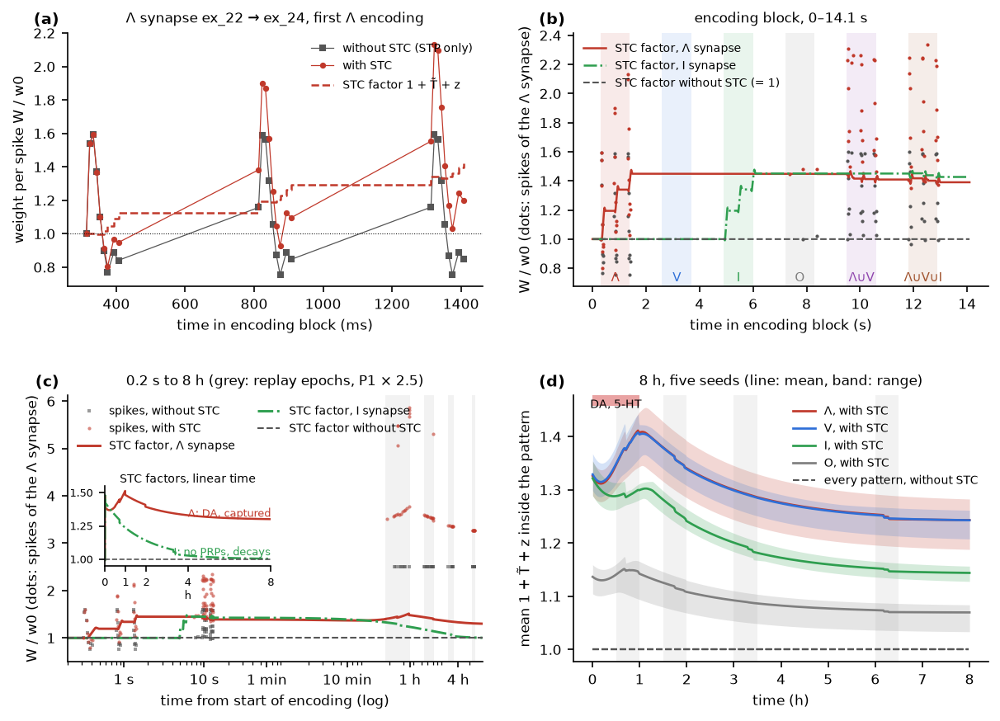
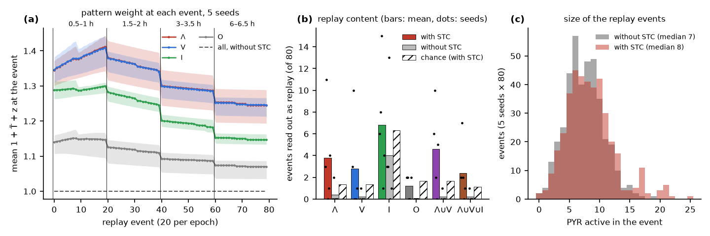

# tinyCA3: synapses with and without STC (comparison report of 2026-11-20)

This report answers three comments on [RESULTS_2026-11-17.md](RESULTS_2026-11-17.md):

1. How the weight of a synapse changes over time with and without synaptic tagging and capture (STC), comparing the
   effect of short-term plasticity (STP) with that of STC (Figure 10).
2. How the synaptic weights compare with and without STC during replay (Figure 11).
3. One comparison report, with the date it was made.

It is still a **pilot**: the weights are hand-calibrated, as in the 2026-11-17 report, sections 3–4.

## Summary

| | With STC | Without STC (STP only) |
|---|---|---|
| Weight per spike, one Λ synapse, first Λ encoding | 0.75–2.13 × w0 | 0.75–1.59 × w0 |
| STP factor rel/U across those spikes | 0.75–1.59 | 0.75–1.59 (same) |
| STC factor 1 + T̃ + z at the end of encoding (Λ synapse, seed 1) | 1.39 | 1.00 |
| Mean pattern weight at 8 h (Λ / V / I / O, 5 seeds) | 1.24 / 1.24 / 1.14 / 1.07 | 1.00 everywhere |
| Replays of Λ / Λ∪V per 8-h run (chance) | 3.8 (1.35) / 4.6 (1.68) | 0.4 (0.18) / 0.2 (0.11) |
| Replay events with ≥ 15 cells active (of 400) | 30 | 9 |

**Main conclusions.**

1. **STP and STC multiply, on timescales six orders apart.** STP scales each spike by 0.75–1.66 within a burst and is
   gone about 1 s later. STC moves the whole STP profile up by a factor 1 + T̃ + z, which builds during the 1.1 s of an
   encoding and lasts for hours.
2. **After about 1 s, only STC is left.** Without STC every synapse is back at w0 after each burst. With STC, the
   modulated patterns keep +24% at 8 h and the unmodulated ones +7–14%.
3. **STC is what selects replay content.** Without STC every P1 synapse has the same weight at every replay event.
   The trigger still recruits events of similar size (median 7 cells, against 8), but they carry no pattern: Λ, V and
   their unions are replayed at chance level, close to never. With STC, Λ and Λ∪V are replayed 2–3 times above chance.
4. **STP contributes little during replay.** Without STC each presynaptic cell fires once per event, so every replay
   spike has rel/U = 1. With STC, recurrent excitation is strong enough for some cells to fire 2–5 times, and those
   later spikes are facilitated, by up to 1.6×.

## Abbreviations

As in the 2026-11-17 report. In addition:

| Term | Meaning |
|---|---|
| W / w0 | Weight of one P1 synapse at one presynaptic spike, relative to the baseline NetCon weight w0 of the encoding state |
| rel/U | STP factor: the Tsodyks–Markram release of this spike divided by U, the release of the first spike of a rested synapse |
| 1 + T̃ + z | STC factor: tag plus captured weight, in units of w0 (1 without STC) |
| Probe synapse | One of five P1 synapses whose release, tag and captured weight are recorded every 0.5 ms in every online block |

## 1. Method (2026-11-20)

**The weight of one synapse.** At presynaptic spike n, the mod `TMExp2SynNMDA_STC` scales the conductance step by:

W_n / w0 = s_state · (rel_n / U) · (1 + T̃(t_n) + z(t_n))

- **s_state** is the brain-state switch of report section 4: 1 in encoding, 2.5 in replay blocks.
- **rel_n / U** is STP. It acts within tens of milliseconds, with τ_f = 138 ms and τ_d = 101 ms.
- **1 + T̃ + z** is STC. It is built over seconds and decays over hours.

**Without STC.** The new switch `run_pilot.py --no-stc` sets `plastic = 0` on all 600 P1 synapses. T̃ and z then stay
at 0, so no tags are set, the PRP pools are never triggered, and nothing is captured. Everything else is unchanged:
cells, wiring, STP, inhibition, encoding, DA and 5-HT pulses, trigger subsets, background noise and the 80 replay
events. The runs confirm it: max |T̃| = max |z| = 0 at 8 h in all five seeds.

**Probe synapses** (`run_pilot.PROBES`). Release, T̃, z and the spike count are recorded every 0.5 ms in the encoding
block and in every replay block:

| Probe | Synapse | Lies inside |
|---|---|---|
| Λ | ex_22 → ex_24 | Λ, Λ∪V, Λ∪V∪I |
| V | ex_42 → ex_44 | V, Λ∪V, Λ∪V∪I |
| I | ex_23 → ex_33 | I, Λ∪V∪I |
| O | ex_12 → ex_14 | O |
| Λ→O | ex_22 → ex_12 | no pattern (from a Λ cell to an O cell) |

Between blocks, T̃ and z of a probe are integrated offline with the logged PRP pool of its postsynaptic cell, using the
same `advance_slow` as the run.

**Runs.**

| Condition | Command | Seeds | Files |
|---|---|---|---|
| With STC | `run_pilot.py --seed N --light` | 1–5 | `results/seeds/pilot_s{N}.pkl` |
| Without STC | `run_pilot.py --seed N --light --no-stc` | 1–5 | `results/seeds/pilot_s{N}_nostc.pkl` |

- **With STC.** Seeds 2–5 are the runs of the 2026-11-17 report, sections 5–7. Seed 1 was rerun to add the probes.
  Its captured weights, tags and replay content are identical to the earlier run (max difference 0).
- **Analysis.** `stc_compare.py` writes Figures 10–11 and `results/stc_compare.json`. Six runs in parallel took about
  35 min of wall time.

## 2. Weight dynamics: STP against STC over time (2026-11-20)

**Figure 10.** The weight of P1 synapses with STC (red) and without STC (grey).

- **(a) One encoding, per spike.** Λ synapse ex_22 → ex_24 during the first Λ encoding: three bursts of 100 ms at
  100 Hz, 400 ms apart. Dots are spikes (W / w0). The dashed line is the STC factor 1 + T̃ + z.
- **(b) The encoding block, 0–14.1 s.**
  - Shading: the windows of the six encodings.
  - Dots: spikes of the Λ synapse.
  - Lines: STC factors of the Λ and I probes, and the flat factor without STC.
- **(c) One log time axis, 0.2 s to 8 h.**
  - Dots: every spike of the Λ synapse, in encoding and in replay. Replay spikes include the replay-state scale of 2.5.
  - Red line: the STC factor of the Λ synapse. Green dash-dot: the STC factor of the I synapse ex_23 → ex_33.
  - Inset: the same two STC factors on a linear axis in hours. Both start near 1.4. The Λ synapse is captured under DA
    and keeps 1.30 at 8 h. The I synapse gets no PRPs, so its tag decays to 1.00 by about 6 h.
  - Grey bands: the four replay epochs.
- **(d) Pattern means over 8 h.** Mean 1 + T̃ + z of the synapses inside Λ, V, I and O, over 5 seeds (line: mean,
  band: range across seeds). The dashed lines are the five runs without STC.
  - Λ and V lie on top of each other.
  - The pink bar marks the hour of DA and 5-HT.

**What STP does (a).** Within each burst the release first facilitates and then depletes:

- spike 2 reaches 1.59 × the first spike;
- by spike 6–7 it has fallen to 0.75–0.85;
- after the 400-ms gap the resources have recovered (τ_d = 101 ms); the first spike of the next burst is 1.16, because
  some facilitation remains (τ_f = 138 ms).

STP is the same with and without STC (rel/U 0.75–1.59 in both), because the synapse and the presynaptic spike times are
almost the same. **STP never leaves a lasting change:** without STC the weight is back at 1.00 at the start of every
burst.

**What STC does (a, b).** Calcium from co-firing raises the tag in steps during each burst:

- **First Λ encoding.** The STC factor goes from 1.00 to 1.42 in 1.1 s. The whole STP profile moves up with it, so
  the largest spike is 2.13 × w0 against 1.59 without STC.
- **Other encodings.** The Λ synapse is also driven by Λ∪V and Λ∪V∪I, which change its tag only a little (1.45 → 1.39).
  The I synapse is tagged only from its own encoding onward (1.00 → 1.43 at 6 s).
- **End of encoding**, seed 1, probes with STC: Λ 1.39, V 1.39, I 1.43, O 1.14. The cross-pattern synapse Λ→O ends at
  **0.92**: when only one of its two cells fires, the calcium falls in the depression band.

**The two timescales on one axis (c).**

- **STP** is the vertical spread of the spike dots inside each encoding and replay epoch. It never shifts the baseline.
- **STC** is the line. It builds in about 1 s and then changes slowly over hours:

| Time | 0.5 h | 1 h | 2 h | 4 h | 8 h |
|---|---|---|---|---|---|
| 1 + T̃ + z, Λ probe, seed 1 | 1.40 | 1.48 | 1.39 | 1.33 | 1.30 |

- The rise to 1 h is capture: z grows while DA keeps the PRP pool up and the tag is still above threshold.
- The decline after 1 h is the decay of the uncaptured part of the tag.

**After the first second, only STC remains (d).** Mean pattern weight, 5 seeds:

| Pattern | End of encoding | 1 h | 2 h | 4 h | 8 h | Without STC (any time) |
|---|---|---|---|---|---|---|
| Λ (DA) | 1.33 | 1.41 | 1.34 | 1.28 | 1.24 | 1.00 |
| V (5-HT) | 1.33 | 1.40 | 1.34 | 1.27 | 1.24 | 1.00 |
| I | 1.32 | 1.30 | 1.24 | 1.17 | 1.14 | 1.00 |
| O | 1.14 | 1.14 | 1.11 | 1.08 | 1.07 | 1.00 |
| Λ∪V | 1.30 | 1.35 | 1.29 | 1.23 | 1.20 | 1.00 |
| Λ∪V∪I | 1.28 | 1.31 | 1.24 | 1.19 | 1.16 | 1.00 |

- **Modulated patterns.** Λ and V gain weight during the DA/5-HT hour as tags are captured, then keep about 0.24
  above baseline.
- **Unmodulated patterns.** I and O lose weight from the start. What they keep at 8 h comes from synapses onto cells
  they share with Λ or V (report section 3).

## 3. Synaptic weights during replay, with and without STC (2026-11-20)

**Figure 11.** Replay with and without STC, 5 seeds × 80 events.

- **(a) Weights at each event.** Mean 1 + T̃ + z inside Λ, V, I and O at the start of each replay event (line: mean of
  5 seeds, band: range). The dashed line is every pattern without STC. Vertical lines separate the four epochs.
  Weights of the replay state are these values × 2.5.
- **(b) Replay content.** Events per 8-h run read out as a replay of each pattern (≥ 80% of its cells spike).
  Coloured bars: with STC. Grey bars: without STC. Hatched bars: the chance count of the with-STC events, from the
  hypergeometric null of report section 5. Dots are seeds.
- **(c) Event size.** PYR active per event, pooled over seeds, with and without STC.

**Weights at the events (a).** Mean 1 + T̃ + z per epoch, 5 seeds:

| Pattern | 0.5–1 h | 1.5–2 h | 3–3.5 h | 6–6.5 h | Without STC |
|---|---|---|---|---|---|
| Λ | 1.38 | 1.36 | 1.29 | 1.25 | 1.00 |
| V | 1.38 | 1.36 | 1.29 | 1.25 | 1.00 |
| Λ∪V | 1.35 | 1.31 | 1.24 | 1.20 | 1.00 |
| Λ∪V∪I | 1.31 | 1.26 | 1.20 | 1.17 | 1.00 |
| I | 1.29 | 1.26 | 1.19 | 1.15 | 1.00 |
| O | 1.15 | 1.12 | 1.09 | 1.07 | 1.00 |

- **First epoch.** Λ and V still rise during it (capture under DA and 5-HT).
- **From the second epoch on.** Every pattern declines from event to event and drops between epochs as the tags decay.
- **Replay events.** The small downward steps inside an epoch are the tag depression found in report section 5.
- **Without STC.** All 600 synapses have the same weight at every event, so the network has nothing to complete.

**Replay content (b).** Events per run, mean ± SD over 5 seeds, with the chance count:

| Pattern | With STC | Chance | Without STC | Chance | Seeds, without STC |
|---|---|---|---|---|---|
| Λ | 3.8 ± 4.3 | 1.35 | 0.4 ± 0.9 | 0.18 | 0, 2, 0, 0, 0 |
| V | 2.8 ± 4.2 | 1.35 | 0.2 ± 0.4 | 0.18 | 0, 1, 0, 0, 0 |
| I | 6.8 ± 5.3 | 6.31 | 4.0 ± 5.2 | 3.43 | 3, 3, 13, 0, 1 |
| O | 1.2 ± 1.1 | 1.68 | 0 | 0.11 | 0, 0, 0, 0, 0 |
| Λ∪V | 4.6 ± 3.8 | 1.68 | 0.2 ± 0.4 | 0.11 | 0, 1, 0, 0, 0 |
| Λ∪V∪I | 2.4 ± 2.7 | 1.13 | 0.2 ± 0.4 | 0.03 | 0, 1, 0, 0, 0 |

- **Without STC, the large patterns are almost never replayed.** All their counts come from two events of seed 2:
  - 19 cells at 3.33 h, which covers Λ, V, I, Λ∪V and Λ∪V∪I at once;
  - 14 cells at 6.28 h (Λ and I).

  Both are random recruitment, not completion.
- **I "replays" at chance in both conditions** (4.0 against 3.4, and 6.8 against 6.3), as found in report section 5.
- **With STC, Λ and Λ∪V are replayed 2.8× above chance.** The same circuit and trigger replay them 10–23 times more
  often than without STC. The selection of replay content therefore comes from the STC weights.

**Event size (c).**

| | With STC | Without STC |
|---|---|---|
| Median active cells, per seed | 10, 9, 8, 6, 9 | 8, 8, 7, 5, 8 |
| Pooled median | 8 | 7 |
| Events with ≥ 15 cells (of 400) | 30 | 9 |
| Whole-network bursts | 1 | 0 |

The trigger alone recruits 5–8 cells. STC adds the tail of large events (15–25 cells), in which a stored pattern is
completed.

**STP during replay.** The Λ probe in seed 1, at W / w0 including the replay scale of 2.5:

| | With STC | Without STC |
|---|---|---|
| Presynaptic spikes over 80 events | 47, in 39 events | 33, in 33 events |
| Spikes per event | 1–5 | always 1 |
| W / w0 | 3.27–5.86 | always 2.50 (= 2.5 × 1 × 1) |

- **Without STC** a replay spike always meets a rested synapse, so STP plays no role.
- **With STC** completion makes some cells fire 2–5 times, and those spikes are facilitated, by up to 1.6×. So STP
  amplifies replay only where STC has already made the pattern complete.

## 4. What this means for the model

1. **The two mechanisms are separable in the model, as designed.** STP sets how strongly one burst is transmitted.
   STC sets which synapses keep a change past the burst. Their effects multiply. They share no state inside the synapse:
   rel/U is the same with and without STC. They interact only through firing, when STC makes cells fire more spikes
   (section 3, STP during replay).
2. **Replay selection needs STC.** STP alone, with the same trigger and the same brain-state switch, gives replay
   events of normal size but no stored content. This is the negative control that the replay result of report section
   5 lacked.
3. **The effect of STC is small in absolute terms.** At replay time the modulated patterns are only 1.25–1.38 × the
   unmodulated baseline. That explains why the replay bias is weak and varies from seed to seed (report section 5).

## Caveats

- **Pilot parameters.** All weights are hand-calibrated (report sections 3–4), and the replay-state scale of 2.5 is
  status *free*.
- **The probes are single synapses in seed 1.** Figure 10a–c shows one realisation. The pattern means in Figure 10d
  and Figure 11 use all 600 synapses and five seeds.
- **Offline probe curves are reconstructed.** Between online blocks, the probe values in Figure 10c are integrated with
  a PRP pool logged every ~60 s. Inside the blocks they are recorded directly. Each block starts from the value the run
  restored.
- **Chance for the runs without STC** uses the same hypergeometric null as report section 5, applied to their own
  events.

## Files

- `run_pilot.py`: new `--no-stc` switch and probe recording (`PROBES`). The light pickle keeps, under `probes`, the
  values at every presynaptic spike and T̃, z every 10 ms (`compact_probes`), about 0.4 MB per run.
- `stc_compare.py`: analysis, Figures 10–11, `results/stc_compare.json`.
- `results/seeds/pilot_s{1..5}_nostc.pkl`: the five runs without STC. `pilot_s1.pkl` is rerun with probes, with
  identical results.
