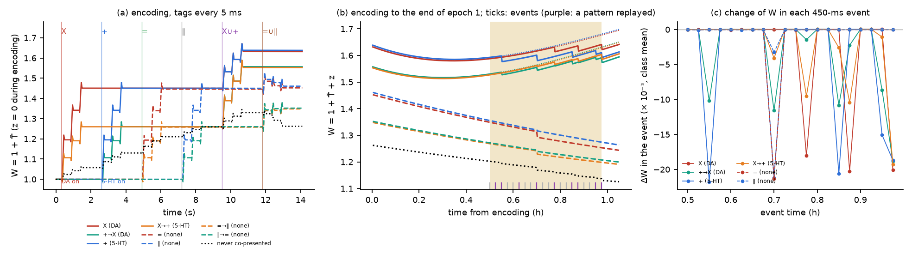
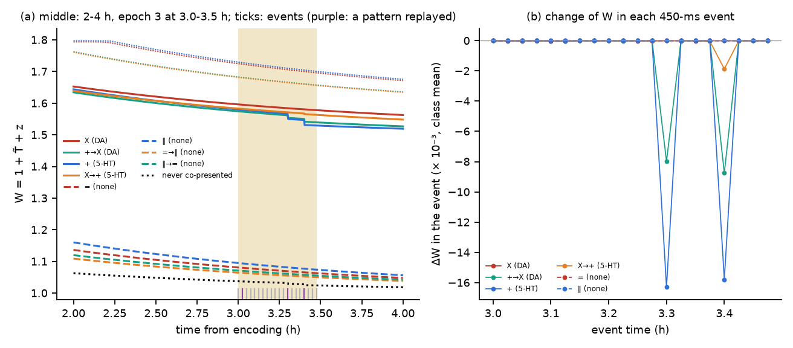
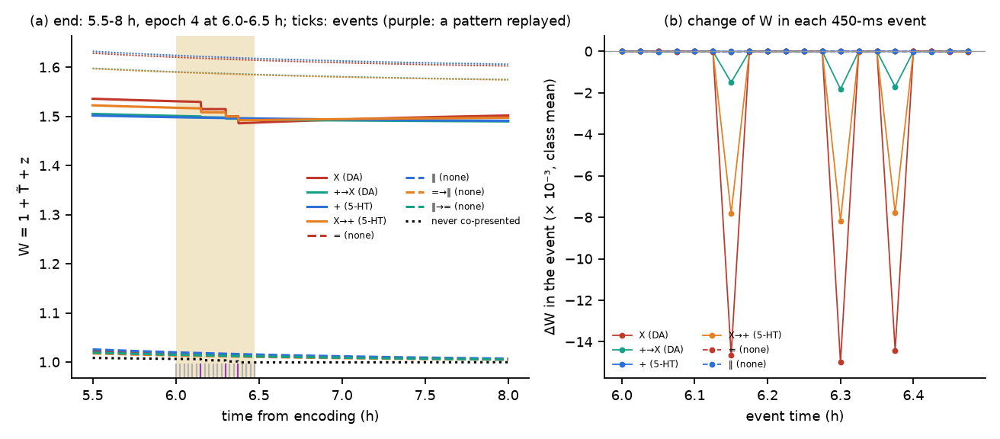
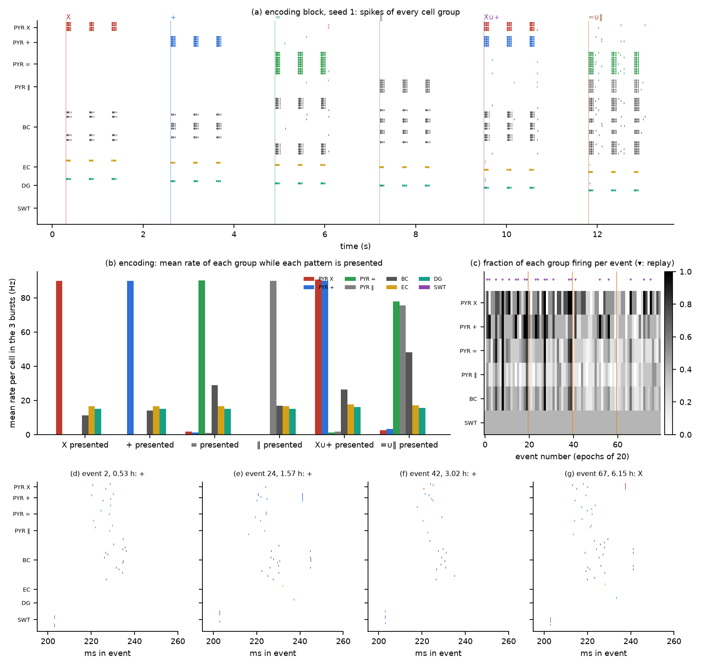
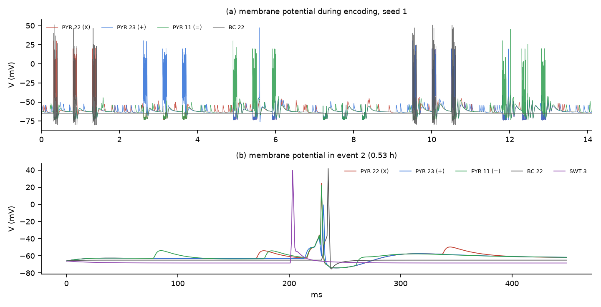

# DA vs 5-HT synaptic tagging with replay: weight dynamics and network activity (extended report of 2026-11-27)

Extends [DA vs 5-HT](DA_VS_5HT_2026-11-26.md) and [the layout-B results](LAYOUT_B_RESULTS_2026-11-26.md). The question
is how the weights of the DA-gated and 5-HT-gated synapses evolve over the whole 8 h, and what the replay events do to
them. It also covers what every cell group does during encoding and during replay.

## Summary

| # | Question | Answer |
| --- | --- | --- |
| 1 | Do DA and 5-HT give different weights? | **No.** Averaged over the classes each one gates, W at 8 h is 1.535 (DA) and 1.538 (5-HT) over 5 seeds. The ratio stays within 0.997–1.001 for the whole run (Figure E1c, E5d) |
| 2 | What shapes the curve? | Three phases, the same for both: tags decay for the first 0.3 h (W 1.63 → 1.58); capture lifts W to a peak of 1.70–1.72 at 1.5–1.7 h; then the tags fade and W settles on the captured z (1.49–1.50 at 8 h, seed 1) |
| 3 | What does replay do? | **It only depresses.** In 80 events no synapse moves up by more than 0.001; 16 events, all of them with a replayed pattern, move 120–495 of the 600 synapses down. By 8 h replay has lowered the modulated classes by 0.08–0.12 in seed 1 (X 1.502 against 1.603 without replay), and by 0.03–0.05 on average over 5 seeds |
| 4 | Who is depressed? | The synapses of the pattern that replays. In seed 1, + replays in epochs 1–3 and X in epoch 4. So + loses the most early (−0.097 in epoch 1) and X the most late (−0.044 in epoch 4). This is the only DA/5-HT asymmetry, and it comes from which pattern replays, not from the modulator |
| 5 | Activity | In encoding, the presented pattern fires at 90 Hz in bursts, and other pyramidal cells stay near 0–3 Hz. In replay, an event recruits about half of X and + and fewer = and ‖ cells. A pattern counts as replayed in 22 of 80 events (seed 1) |

## 1. Data

- **Trace runs, seed 1** (`run_pilot.py --seed 1 --light --trace --mod-min 10 --gate 30`, with replay, `--no-replay`
  and `--prp-block`): the slow state every 10 s, spikes and voltages of the encoding block and of all 80 replay events,
  and every synapse's W = 1 + T̃ + z just before and after each event. They reproduce the light runs of seed 1 exactly
  (same 8-h weights, same 80 events).
- **Light runs, 5 seeds**, for the averages (`class_stats.COND`).
- **Figures:** `extended_figs.py` → `results/layout_B/extended/fig_E*.png`, numbers in `extended_numbers.json`.

Classes (synapse pre → post; the modulator of the postsynaptic cell gates capture): DA-gated X and +→X; 5-HT-gated
+ and X→+; ungated =, ‖, =→‖, ‖→= and never co-presented. Replay epochs: 20 events, 90 s apart, from 0.5, 1.5, 3 and
6 h. Between events the model runs no spikes: the tags, PRPs and captured weights evolve offline.

## 2. The whole simulation

**Figure E1.** (a) and (b) seed 1; (c) 5 seeds. Shaded: replay epochs.

- **(a) Same gate for both.** DA and 5-HT are released for 10 min. The synthesis trigger G reaches 0.93 in both X and
  + cells and decays with τ 30 min. The PRP pool grows to 0.65 at 1.05 h and lasts until about 7.5 h. = and ‖ cells
  make none.
- **(b) Seed 1, W per class.** All four modulated classes follow one curve within 0.04. Without replay (dotted) they
  peak at 1.76–1.80 near 2 h and end at 1.57–1.61. With replay they peak lower (1.68–1.72 at 1.5–1.7 h) and end at
  1.49–1.50. The ungated classes decay to w0 the same way with or without replay (= 1.006, ‖ 1.007).
- **(c) 5 seeds.** The DA-gated and 5-HT-gated means overlap over the whole run: 1.535 and 1.538 at 8 h, 1.005 and
  1.006 under the PRP block. The ungated classes end at 1.005.

## 3. First phase: encoding to the end of the first replay epoch

**Figure E2.** Seed 1. (b): solid with replay, dotted without (modulated classes); ticks mark events, purple when a
pattern replayed.

- **Encoding (a).** Each presentation (3 bursts) adds a step of about 0.26 to the tags of the synapses inside the
  pattern. X and + get a second presentation in X∪+ and reach 1.63–1.64. The cross classes X→+ and +→X are set
  only in X∪+ (1.55–1.56), as are = and ‖ in =∪‖ (1.45–1.46). DA starts at 0.3 s with X, and 5-HT at 2.6 s with +.
  The tags themselves do not depend on the modulator.
- **0–0.5 h, before replay.** Capture starts slowly (the trigger and PRPs take minutes to build), so the tags decay
  first. The modulated classes dip from 1.63 to 1.58, and the ungated classes fall without stopping (= 1.45 → 1.35).
- **Epoch 1 (0.5–0.98 h).** Capture now lifts the modulated classes. Every event where a pattern replays cuts W by
  0.01–0.02 in the classes of that pattern (c), and the curve becomes a saw-tooth. + replays in 7 of the 9 replay
  events, so + takes the largest loss: −0.097 over the epoch, against −0.058 for X. Events without a replayed pattern
  change nothing (c, zeros).

## 4. Middle of the simulation

**Figure E3.** Seed 1, 2–4 h.

- **Capture is over, tags are fading.** After the peak at 1.5–1.7 h the tags decay faster than capture adds weight,
  so every modulated class falls slowly (X 1.653 at 2 h → 1.562 at 4 h). The PRP pool is down to about 0.1.
- **Epoch 3 (3.0–3.5 h).** Only 3 events replay a pattern, all of them +. Each lowers + by 0.016 and +→X by
  0.008; X is untouched. The + class ends the epoch lowest (1.529 against X 1.577). Without replay the curves are
  0.12–0.17 higher at this time.

## 5. End of the simulation

**Figure E4.** Seed 1, 5.5–8 h.

- **Epoch 4 (6.0–6.5 h).** Now only X replays (3 events). Each costs X about 0.015 and X→+ about 0.008, so X drops
  from 1.531 to 1.488 and loses its lead.
- **After the last epoch.** The replay pushed the tags of X slightly negative. Without PRPs to capture that, the tags
  relax back to 0 and X rises again, by 0.015 (1.488 → 1.502). The modulated classes end within 0.012 of each other
  (1.490–1.502). The ungated classes are at w0 (1.000–1.007).

## 6. Up and down scaling

**Figure E5.** (a)–(c) seed 1; (d) 5 seeds.

- **(a) Distributions.** At the end of encoding the DA-gated synapses form two groups: X (1.62–1.65) and +→X
  (1.55–1.56). The 5-HT-gated synapses form the same two groups. By 2 h both have moved up to 1.62–1.67. By 8 h both
  sit at 1.48–1.52 and the groups have merged. The DA and 5-HT histograms overlap at each time.
- **(b) Offline vs replay.** Offline, the modulated classes lose 0.03–0.05 in the first 0.5 h, then gain 0.19–0.22
  in 0.5–1.5 h (capture), and lose about 0.06–0.1 per interval after that (tag decay). Replay (black) only subtracts:
  0.05–0.10 in 0.5–1.5 h, and up to 0.06 later. The ungated classes only lose, almost all of it offline.
- **(c) Per event.** No synapse goes up in any event. In 16 of the 80 events 120–495 synapses go down by more than
  0.001. All 16 replay a pattern; the largest losses come from the events that recruit nearly all 25 cells (events 9
  and 28: 495 and 398 synapses). 6 other events also replay a pattern but change nothing, and the remaining 58 events
  change nothing either.
  Replay spikes are sparse and short (one or two spikes per cell), and that puts the calcium of the tag rule in its
  depression range.
- **(d) DA vs 5-HT.** W(DA-gated) / W(5-HT-gated), averaged over the 5 seeds, stays between 0.997 and 1.001 for the
  whole 8 h, with and without replay and under the PRP block. Individual seeds deviate by up to 1.5% in either
  direction, after epochs in which one of the two patterns replayed more.

## 7. Electrical activity of every cell group

**Figure E6.** Seed 1. (a) encoding; (b) mean rate per cell in the three 100-ms bursts of each presentation;
(c) fraction of each group that fires in each replay event (200–440 ms), ▾ marks events where a pattern
replayed; (d)–(g) one replay event per epoch.

**Figure E6b.** Seed 1. (a) encoding block; (b) replay event 2 (0.53 h).

**Encoding** (mean rate in the bursts, Hz):

| Group | X presented | + | = | ‖ | X∪+ | =∪‖ |
| --- | --- | --- | --- | --- | --- | --- |
| PYR X (4 cells) | 90.0 | 0 | 1.7 | 0 | 90.8 | 2.5 |
| PYR + (5) | 0 | 90.0 | 1.3 | 0 | 90.0 | 3.3 |
| PYR = (10) | 0 | 0 | 90.3 | 0 | 1.3 | 78.0 |
| PYR ‖ (6) | 0 | 0 | 1.1 | 90.0 | 1.7 | 75.6 |
| BC (25) | 11.2 | 14.0 | 28.9 | 16.8 | 26.3 | 48.3 |
| EC, DG (6 each, one per pattern) | 16.7, 15.0 | same | same | same | 17.8, 16.1 | 17.2, 15.6 |
| SWT (10) | 0 | 0 | 0 | 0 | 0 | 0 |

- The presented pattern fires at 90 Hz, locked to its 100-Hz mossy-fibre drive. The other pyramidal cells stay
  silent or near background (≤ 3.3 Hz). The X and + cells, which DA and 5-HT reach, fire exactly like the = and ‖
  cells, which nothing reaches: no modulator acts on firing at this stage.
- Basket-cell firing grows with the number of active pyramidal cells: 11 Hz for X (4 cells) and 48 Hz for =∪‖
  (16 cells). In =∪‖ this inhibition is strong enough to lower the pattern's rate to 76–78 Hz.
- EC and DG fire only for their own pattern, near 100 and 90 Hz. The table averages each over its 6 cells.
- The trigger cells (SWT) are silent during encoding.

**Replay events** (mean fraction of the group that fires in an event, 80 events):

| PYR X | PYR + | PYR = | PYR ‖ | BC | SWT | EC, DG |
| --- | --- | --- | --- | --- | --- | --- |
| 0.49 | 0.48 | 0.35 | 0.27 | 0.38 | 0.40 | 0.04 |

- An event starts with 4 of the 10 trigger cells (SWT) at 200 ms. Pyramidal cells fire once or twice within
  210–240 ms, then the basket cells silence the network for about 50 ms (E6b-b).
- The recurrent weights decide who is recruited. X and + have the strongest internal weights, and about half of
  their cells fire in an average event; ‖ has the weakest, at 27%. A pattern counts as replayed (≥ 80% of its cells)
  in 22 events: 9, 7, 3 and 3 per epoch. Replay of + dominates the first three epochs and X the fourth.
- EC and DG are almost silent in replay (4%); the events are internal to CA3.

## 8. Conclusions

1. With the same rule and parameters, DA and 5-HT give the same weights. They differ by less than 0.3% over the
   5-seed average for the whole 8 h. The capture, not the modulator, sets the curve.
2. Replay in this model is a depressing process. It never potentiates; it lowers the replayed synapses by about
   0.01–0.02 per event, and the modulated classes by 0.08–0.12 by 8 h in seed 1 (0.03–0.05 over 5 seeds). Its net effect on DA- or 5-HT-gated weights
   depends on which pattern happens to replay, which differs between epochs and seeds.
3. During capture (0.5–1.5 h), offline capture adds 2–4 times as much weight as replay removes. After that, replay
   mainly speeds up the loss.
4. Activity is the same for modulated and unmodulated cells, both in encoding and in replay. The 5-HT1A → Kir3
   current, when switched on, changes this only at a near-threshold drive
   ([report](SEROTONIN_WEAK_DRIVE_2026-11-27.md)).

Open points:

- [ ] Replay as depression contradicts the common view that replay consolidates. Check the calcium of a replay spike
  pair against the potentiation and depression thresholds of the tag rule, and decide whether replay should be able to
  potentiate.
- [ ] Use more seeds for the replay asymmetry: in seed 1 + replays first and X last, and this sets the order of the
  classes at 8 h.
- [ ] Background activity between events (no spikes are simulated offline) would show whether the 5-HT difference
  measured in slices (5 → 1.9 Hz) matters for the tags.
