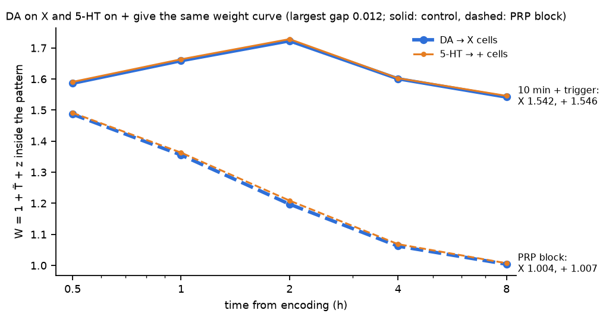

# DA vs 5-HT: neuromodulatory synaptic tagging in tinyCA3 (report of 2026-11-26)

Companion to [the layout-B results](LAYOUT_B_RESULTS_2026-11-26.md) and
[the 5-HT1A → Kir3 report](SEROTONIN_GIRK_2026-11-26.md). The circuit is described in
[ca3_basic_circuit_architecture.md](ca3_basic_circuit_architecture.md).

## Summary

In the layout-B runs, DA and 5-HT run the same tagging dynamics. Both go through one rule (`stc.py`) with the same
parameters: amplitude 1, a 10-min release, and a synthesis trigger with τ_G = 30 min.

They differ in three things only:

- **Which cells they reach.** DA reaches the X cells and 5-HT the + cells.
- **Onset.** DA starts at 0.3 s and 5-HT at 2.6 s.
- **Replay mode.** Only DA has the optional replay-triggered release (VTA mode).

So the X and + weights overlap. At 8 h, W is 1.542 for X and 1.546 for +, over 5 seeds. The difference reported in
the literature (5-HT acting on LTD, in CA2) is not modelled yet. It is the main open question below.

**Update, same day.** 5-HT now has a mechanism of its own: the 5-HT1A → Kir3 (GIRK) current on the + cells
(`run_pilot.py --ht-girk 6e-5`, calibrated to Johnston et al. 2014). It changes nothing measurable: the + cells keep
firing at 90 Hz during encoding, and in 15 runs every class ends within 0.002 of the runs without it (+ at 1.544
against 1.546; [report](SEROTONIN_GIRK_2026-11-26.md)). Everything below describes the runs without it, and holds
with it. With the drive onto the + cells weakened to 5%, the current lowers X→+ by 0.044 and X by 0.013 at 8 h, and a
weaker drive alone turns the + tags into LTD tags ([report of 2026-11-27](SEROTONIN_WEAK_DRIVE_2026-11-27.md)).

## Model mechanism

A modulator never touches the tag. It acts only on PRP synthesis in the cells it reaches, so it decides which tags
can be captured.

1. **Tag.** Each recurrent synapse sets a tag T̃ from calcium during encoding. It is set by presynaptic firing
   (c_pre = 1) whether or not a modulator is present, at about 0.26 per presentation. X and + reach 0.63 after their
   second presentation, in X∪+.
2. **Modulator pulse.** Source m ∈ {DA, 5-HT} gives a rectangular level M_j(t) to every cell j of its pattern. It
   starts with the presentation of that pattern.
3. **Synthesis trigger.** M_j switches on a per-cell state G_j, which then outlasts it (equation below). A 10-min
   release keeps synthesis going for about an hour.
4. **PRP pool.** One pool P_j per postsynaptic cell. It grows while the summed tags onto the cell exceed
   θ_pro = θ0 / (G_j + 0.001), with θ0 = 0.5, and decays with τ_P = 60 min.
5. **Capture.** A synapse moves its tag into the lasting weight z while |T̃| > 0.2 and its postsynaptic P > 0
   (τ_z = 60 min). Readout: W = 1 + T̃ + z.

```latex
\frac{dG_j}{dt} = \frac{M_j\,(1 - G_j)}{\tau_{on}} - \frac{G_j}{\tau_G}, \qquad \tau_{on} = 2\ \text{min},\ \tau_G = 30\ \text{min}
```

PRPs belong to the postsynaptic cell, so the modulator of the postsynaptic cell decides capture. A synapse onto an X
cell captures with DA only; a synapse onto a + cell captures with 5-HT only. No synapse gets both, and no = or ‖ cell
gets either.

## DA vs 5-HT side by side

Only the cells reached, the onset, the replay mode and the biological basis differ. Every dynamic quantity is the
same. The rows come from `stc.py` and `run_pilot.py` (layout B, `--mod-min 10 --gate 30`).

| Property | DA | 5-HT |
| --- | --- | --- |
| Cells reached | X: 22, 24, 42, 44 (4 cells) | +: 23, 32, 33, 34, 43 (5 cells) |
| Synapses that can capture | onto X cells: X, +→X | onto + cells: +, X→+ |
| Release onset | 0.3 s (encoding of X) | 2.6 s (encoding of +) |
| Release | 10 min, amplitude 1 | 10 min, amplitude 1 |
| Trigger G | τ_on 2 min, τ_G 30 min, peak 0.93 | same, peak 0.93 |
| PRP pool P, peak (mean over cells) | 0.64–0.67 | 0.64–0.67 |
| PRP synthesis ends | 1.02–1.11 h | 1.02–1.11 h |
| Capture z at 8 h (inside the pattern) | 0.51–0.58 | 0.49–0.58 |
| Replay-triggered release (`--replay-da`) | yes: an event that replays X releases DA for 10 min | none |
| Direct effect on the cells | none | 5-HT1A → Kir3: 4.3 mV hyperpolarization (`--ht-girk`, added the same day; no effect on the 8-h weights, within 0.002) |
| Biological basis | D1/D5 → cAMP/PKA → protein synthesis; gates L-LTP (Navakkode, S&A Ch. 15) | not sourced for CA3 LTP; the only STC source is 5-HT-facilitated LTD in CA2 (Benoy et al. 2022, S&A p. 242) |

The 2.3-s gap between the onsets is about 0.4% of the 10-min release, so it has no visible effect. Ranges are over
the 5 seeds.

## Results

The DA-reached X synapses and the 5-HT-reached + synapses follow the same curve within about 0.01, with PRPs on and
with them blocked. The rise to about 1.72 at 2 h and the hold near 1.54 at 8 h come from capture. With the PRP block,
both decay to w0 (1.004 and 1.007).



**Figure D1.** `da_vs_5ht_fig.py`, from `results/layout_B/class_stats.json` (layout B, 10 min + trigger and PRP
block, 5 seeds, mean W inside each pattern).

The cross classes behave the same way. +→X captures with DA (W 1.529 at 8 h) and X→+ with 5-HT (1.530). Without
replay, X and + both end higher, at 1.592 and 1.595: replay lowers the captured z by about 0.04 for both modulators.
Per seed, z at 8 h is larger for X in 2 of 5 seeds and for + in 3, so the order is noise.

## Interpretation and open questions

In these runs, 5-HT is a second copy of DA on another set of cells. So the model shows that capture is
pattern-specific. It cannot show any difference between the modulators.

- **What the identity shows.** The weight dynamics come from the tag history and the postsynaptic PRP pool alone. X
  and + get the same tagging (both reach about 0.63 in X∪+) and the same gate, so they end the same.
- **Where the biology differs.** DA through D1/D5 → cAMP/PKA → protein synthesis gates L-LTP and has CA1 support. For
  5-HT, the only STC source in the literature review is CA2. There, 5-HT turns weak LTD into lasting LTD and allows
  cross-tagging with weak LTP (Benoy et al. 2022). No CA3 LTP source is cited.
- **Time course.** DA has two modes in the literature. LC gives a cell-wide grace period; VTA gives pattern-specific
  gating through replay. The model has both for DA (encoding release plus `--replay-da`) but only the first for 5-HT.

Open questions, each a change to try in the model:

- [x] Give 5-HT an effect of its own, sourced in CA3: 5-HT1A → Kir3 (done, [report](SEROTONIN_GIRK_2026-11-26.md)).
- [ ] Give 5-HT its own gain κ_5HT and its own τ_G. The architecture doc keeps κ_DA and κ_5HT apart, but the code uses
  amplitude 1 for both.
- [ ] Let 5-HT gate LTD tags (negative T̃) rather than LTP tags, following the CA2 result. This needs an LTD-inducing
  protocol for the + pattern.
- [ ] Add a replay-triggered 5-HT mode (raphe), or decide it has no basis, and record that decision in the
  architecture doc.
- [ ] Source a CA3 role for 5-HT in STC before fixing any 5-HT parameter.
