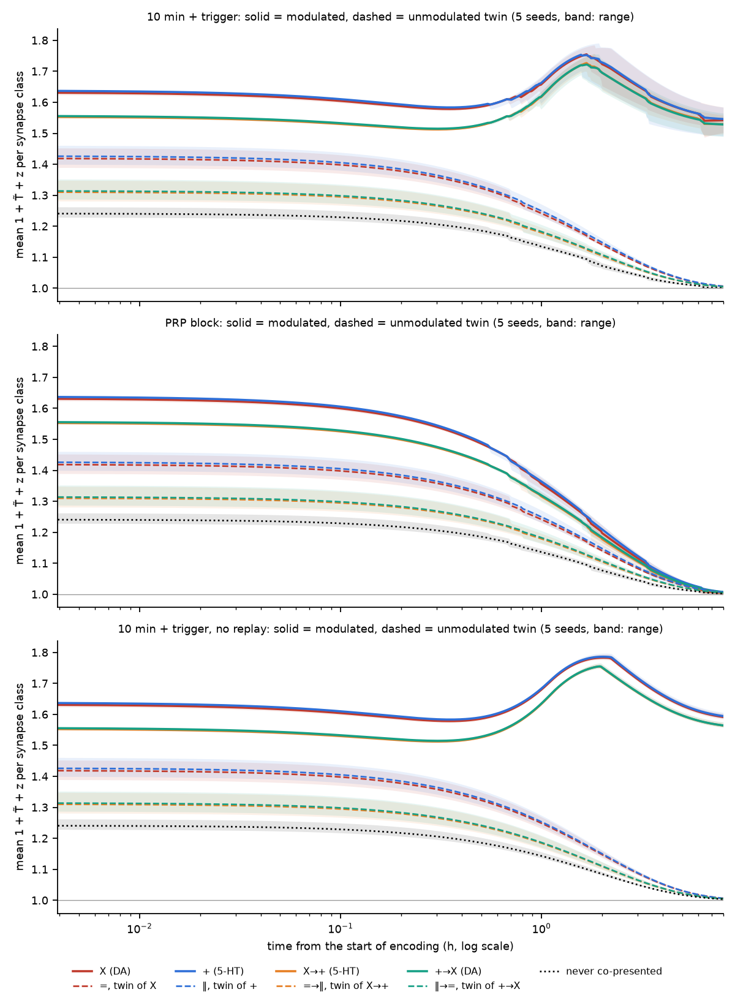

# Layout B: clean controls for synaptic tagging and capture (report of 2026-11-26)

Follow-up to [the architecture update plan](architecture_update_plan_2026-11-26.md). The circuit is described in
[ca3_basic_circuit_architecture.md](ca3_basic_circuit_architecture.md) and the protocol in [PROTOCOL.md](PROTOCOL.md).
All runs use the bio-plausible protocol (DA and 5-HT released for 10 min, with the synthesis trigger, τ_G = 30 min),
5 seeds, 8 h each.

## Summary

| # | Question | Answer |
| --- | --- | --- |
| 1 | Are the controls clean now? | **Yes.** No synapse of = or ‖ captures, in any seed or condition: z = 0 at 8 h, and their weight returns to w_0 (1.006). In v1, the controls I and O kept z = 0.145 and 0.069, all of it on synapses that end on Λ or V cells |
| 2 | Is capture visible against the controls? | **Yes.** At 8 h the modulated classes stay at 1.53–1.55 × w_0 (range over seeds 1.49–1.58). Their unmodulated twins are at 1.004–1.006 |
| 3 | Is the difference due to capture? | **Yes.** Under a PRP block the same modulated synapses return to w_0 (1.004–1.007) with the time course of the controls. With PRPs they keep +0.53–0.54 |
| 4 | Do the cross synapses of X∪+ capture? | **Yes**, almost as much as the synapses inside X and + (1.53 against 1.54). Each takes the modulator of its postsynaptic cell |
| 5 | What does replay do? | It **lowers** capture slightly (z −0.04, 4–5 of 5 seeds), as in v1. Replay of the small patterns X and + is above chance but weak, and partly present under the PRP block too |
| 6 | Why does B capture more than v1 (z 0.51 against 0.24)? | In v1 the later patterns that shared Λ cells depressed the Λ tags during encoding (0.45 → 0.35). In B, X is touched only by X∪+, which raises its tags to 0.63, so they stay above the capture threshold longer (until 1.8 h, against 1.3 h) |

## 1. What changed

Layout B uses the patterns of the corrected circuit figure (`docs/figs/CA3_basic_circuit.png`):

- **Basic patterns:** X (4 cells, DA), + (5 cells, 5-HT), = (10 cells) and ‖ (6 cells). They are disjoint and together
  cover the 25 cells.
- **Combinations:** X∪+ (modulated) and =∪‖ (unmodulated).

No cell of = or ‖ is ever reached by a modulator. Each recurrent synapse belongs to one class (architecture doc,
Table 3a). Each modulated class has an unmodulated twin presented in the same sequence:

| Modulated class | Its unmodulated twin |
| --- | --- |
| X | = |
| + | ‖ |
| X→+ | =→‖ |
| +→X | ‖→= |

The code is unchanged apart from the pattern sets (commit 2a7a91e). The v1 layout stays available with
`TINYCA3_LAYOUT=v1`, and all v1 outputs reproduce byte for byte.

## 2. Runs

| Condition | Command (`TINYCA3_LAYOUT=B`) | Files in `results/layout_B/seeds/` |
| --- | --- | --- |
| Control | `run_pilot.py --seed S --light --mod-min 10 --gate 30` | `pilot_s{1..5}_mod10_gate30.pkl` |
| PRP block | the same plus `--prp-block` | `pilot_s{1..5}_mod10_gate30_prpblock.pkl` |
| No replay | the same plus `--no-replay` | `pilot_s{1..5}_mod10_gate30_norep.pkl` |
| Seed 1, full output | `run_pilot.py --seed 1 --mod-min 10 --gate 30` | `../pilot.npz`, `../pilot_events.pkl` (not in git, 69 MB) |

The full run reproduces the light seed-1 run event for event. Readouts: `class_stats.py` (Figure B1,
`class_stats.json`) and `replay_stats.py --suffix _mod10_gate30` (`replay_stats_mod10_gate30.json`).

## 3. Encoding check

Calibration was not changed. Every pattern is recruited cleanly:

| Pattern | n | Member rate (Hz) | Other cells (Hz) |
| --- | --- | --- | --- |
| X | 4 | 90 | 0 |
| + | 5 | 90 | 0 |
| = | 10 | 90 | 1.3 |
| ‖ | 6 | 90 | 0 |
| X∪+ | 9 | 90 | 1.5 |
| =∪‖ | 16 | 77 (73–83) | 2.6 |

Each EC unit fires its 30 drive spikes. The 16-cell =∪‖ fires more slowly because of the feedback inhibition. The O
border in v1 (also 16 cells) behaved the same way.

## 4. Main result: weight per synapse class



**Figure B1.** Mean 1 + T̃ + z per synapse class against time from the start of encoding (log scale). Solid lines are
the modulated classes, dashed lines their unmodulated twins in the same colour, and the dotted line the pairs never
presented together. Lines are the mean of 5 seeds; bands are the range. Top: control. Middle: PRP block. Bottom: no
replay.

**Table 1.** W = mean 1 + T̃ + z per class at 1 h and 8 h, mean of 5 seeds (8-h range in brackets).

| Class | Control, 1 h | Control, 8 h | PRP block, 8 h | No replay, 8 h |
| --- | --- | --- | --- | --- |
| X (DA) | 1.659 | **1.542** [1.502, 1.584] | 1.004 | 1.592 |
| + (5-HT) | 1.664 | **1.546** [1.491, 1.584] | 1.007 | 1.595 |
| X→+ (5-HT) | 1.619 | **1.530** [1.497, 1.558] | 1.005 | 1.564 |
| +→X (DA) | 1.620 | **1.528** [1.490, 1.565] | 1.007 | 1.564 |
| =, twin of X | 1.241 | 1.006 [1.006, 1.006] | 1.006 | 1.006 |
| ‖, twin of + | 1.249 | 1.006 [1.006, 1.007] | 1.006 | 1.006 |
| =→‖ | 1.179 | 1.004 | 1.004 | 1.005 |
| ‖→= | 1.182 | 1.005 | 1.005 | 1.005 |
| never co-presented | 1.134 | 1.001 | 1.002 | 1.004 |

Reading the figure from left to right:

1. **Encoding sets tags in every class.**
   - A pattern's first presentation tags its synapses to T̃ ≈ 0.45, whatever the pattern.
   - Its second presentation, in a combination, adds more. X∪+ (9 cells at 90 Hz) raises X and + to 0.63. =∪‖ (16 cells
     at 77 Hz) barely raises = and ‖ (0.45–0.46).
   - So twins share their sequence of presentations but not their tag amplitude: about 1.63 against 1.42 at the end of
     encoding.
2. **DA and 5-HT make PRPs only in X and + cells.** P peaks at about 0.65 at 1.06 h, and synthesis ends about 68 min
   after onset (report of 2026-11-24).
   - **Modulated classes:** their tags are still above the capture threshold (|T̃| > 0.2), so z rises and W peaks near
     1.75 at about 1.7 h.
   - **Controls:** no PRPs ever reach = and ‖ cells, so the controls have z = 0 at every time, in every seed.
3. **After PRPs run out (from about 2 h) only the tags decay.**
   - The controls return to w_0 by 8 h.
   - The modulated classes keep z ≈ 0.53.
4. **PRP block.**
   - The modulated classes start where they do in the control and then decay to w_0 like the controls (middle
     panel).
   - So the whole difference at 8 h is capture. The difference in tag amplitude between twins (point 1) disappears by
     8 h.
   - This within-class comparison (1.542 against 1.004 for X) is the cleanest measure of capture in the circuit.

The cross synapses of X∪+ capture nearly as much as those inside X and +. They were co-active only once, in X∪+, and
end at a lower tag (0.55). The postsynaptic cell decides which modulator a synapse uses: X→+ ends on + cells (5-HT),
and +→X on X cells (DA).

### Pairs never presented together

Pairs never presented together are tagged at encoding too, though they are never co-active. In the calcium rule,
presynaptic firing alone puts calcium above θ_p (c_pre = 1). This sets T̃ ≈ 0.26 per presentation of the
presynaptic pattern, also on the cross synapses. Postsynaptic firing alone adds almost nothing.

- **Synapses onto control cells** reach T̃ ≈ 0.40.
- **Synapses onto X/+ cells** reach T̃ ≈ 0.06–0.12. That is below the capture threshold of 0.2, so they never capture
  (z = 0 in every seed), although those cells have PRPs.

So the "never co-presented" class is a baseline without co-activity, not a baseline without tags.

## 5. Comparison with v1

**Table 2.** Same protocol (10 min + trigger, 5 seeds), v1 layout (`results/seeds/pilot_s{1..5}_mod10_gate30.pkl`).

| v1 pattern | W at 8 h | z at 8 h | z of its synapses onto Λ/V cells | z of its other synapses |
| --- | --- | --- | --- | --- |
| Λ (DA) | 1.244 | 0.242 | — | — |
| V (5-HT) | 1.244 | 0.242 | — | — |
| I (control) | 1.147 | 0.145 | 0.362 | 0.000 |
| O (control) | 1.070 | 0.069 | 0.111 | 0.000 |

In v1, all of the controls' capture came from synapses onto Λ or V cells: 8 of the 20 I synapses and 150 of the 240
O synapses. Their other synapses had z = 0 exactly, as = and ‖ do now. **The v1 statement "I and O decay to w_0"
was true only for hand-picked probes.**

The overlap also hurt the modulated patterns. During the v1 encoding the Λ tags fell from 0.45 after Λ to 0.35 by
the end. Each later pattern that included some Λ cells but not all of them depressed the Λ tags: O (−0.09), Λ∪V and
Λ∪V∪I. In layout B no later pattern touches X except X∪+, which raises its tags.

| Layout | Tag at end of encoding | Capture runs until | z at 8 h |
| --- | --- | --- | --- |
| v1 (Λ) | 0.35 | 1.27 h | 0.24 |
| B (X) | 0.63 | 1.77 h (seed 1) | 0.51 |

The PRP time course is the same in both layouts (peak 0.65 at 1.05 h).

## 6. Replay

**Table 3.** Events read out as replay per epoch (E1–E4), summed over 5 seeds × 20 events, with the chance count from
the hypergeometric null. Bursts (≥ 23 active cells) are excluded: 3 in the control and 2 under the PRP block.

| Pattern | Control, observed | Control, chance | PRP block, observed | PRP block, chance |
| --- | --- | --- | --- | --- |
| X | 6, 6, 3, 7 | 4.0, 3.3, 1.8, 2.0 | 5, 4, 3, 3 | 3.6, 2.9, 1.3, 1.3 |
| + | 15, 22, 15, 13 | 9.9, 9.1, 5.3, 6.3 | 10, 14, 8, 7 | 9.1, 7.8, 4.1, 4.6 |
| = | 6, 2, 0, 0 | 5.2, 3.7, 1.4, 1.6 | 6, 3, 0, 0 | 4.5, 3.4, 0.9, 0.7 |
| ‖ | 3, 2, 1, 0 | 6.6, 5.6, 2.7, 3.4 | 3, 3, 1, 0 | 5.9, 4.8, 1.9, 2.1 |
| X∪+ | 3, 5, 2, 4 | 2.7, 1.7, 0.7, 0.6 | 1, 2, 1, 0 | 2.3, 1.7, 0.4, 0.2 |
| =∪‖ | 3, 1, 0, 0 | 3.9, 1.9, 0.9, 0.3 | 3, 2, 0, 0 | 3.2, 2.2, 0.6, 0.0 |

- **Captured patterns replay above chance, but weakly.**
  - X, + and X∪+ replay above chance in every epoch of the control, by about 2–7 times in the late epochs.
  - The controls = and ‖ stay at or below chance and are read out at most once after 3 h.
  - Only 5 events in 400 pass the per-event test (p_chance < 0.05/6), in both conditions.
- **The small patterns are a weak replay readout.**
  - X has 4 cells, so "replay" means all 4 fire, which random activity of 8–9 cells often produces.
  - Under the PRP block, X and + are also above chance in the late epochs (6 against 2.6 for X). There the tags alone
    bias completion until about 3 h.
  - The difference between control and PRP block is clearest for X∪+ in the late epochs (6 against 1).
- **Replay lowers capture.**
  - With replay, z at 8 h is lower than without it: X −0.039 (4/5 seeds), + −0.043 (5/5), X∪+ −0.034 (5/5).
  - The calcium of a replay event falls in the depression band and lowers the tags of the patterns it involves. This
    is the same effect as in v1 (RESULTS_2026-11-17, section 5), and the same sign.

## 7. Limits

1. **Twins are matched in presentation sequence, not in tag amplitude** (section 4). Compare a class with itself under
   the PRP block when the size of the capture effect matters.
2. **Small modulated patterns.** X and + have 4 and 5 cells. The capture readout per synapse is clean, but the replay
   readout per pattern is weak (section 6).
3. **No mixed combination.** Layout B keeps the controls clean by never combining a modulated with an unmodulated
   pattern. The v1 question of whether an unmodulated input can capture from modulated neighbours is therefore not
   tested here. With per-cell PRPs, the answer would be set by the postsynaptic cell, as for the cross synapses of X∪+.
4. **Pilot status.** All weights are the hand-calibrated pilot values (`circuit.CircuitParams`). None was refitted for
   layout B.

## 8. Reproduce

```bash
for s in 1 2 3 4 5; do
  TINYCA3_LAYOUT=B .venv/bin/python run_pilot.py --seed $s --light --mod-min 10 --gate 30
  TINYCA3_LAYOUT=B .venv/bin/python run_pilot.py --seed $s --light --mod-min 10 --gate 30 --prp-block
  TINYCA3_LAYOUT=B .venv/bin/python run_pilot.py --seed $s --light --mod-min 10 --gate 30 --no-replay
done
TINYCA3_LAYOUT=B .venv/bin/python class_stats.py
TINYCA3_LAYOUT=B .venv/bin/python replay_stats.py --suffix _mod10_gate30
```

Run with `PYTHONPATH` unset (see `nrn_setup.py`). One run with replay takes about an hour.
