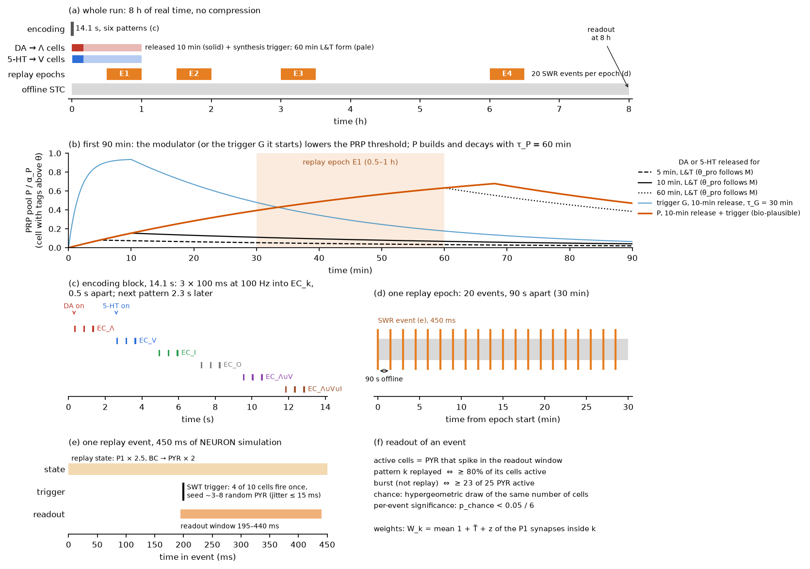
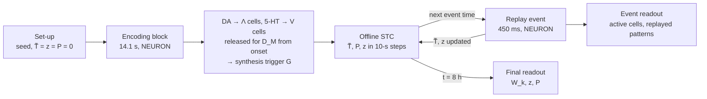

# tinyCA3 computational experiment protocol (2026-11-23, updated 2026-11-24)

This document describes the protocol `run_pilot.py` runs. The timings come from the code (`run_pilot.py`,
`circuit.py`, `stc.py`), and Figure P1 is drawn from the same constants by `make_protocol_fig.py`. The circuit is
described in [ca3_basic_circuit_architecture.md](ca3_basic_circuit_architecture.md). The results are in
[RESULTS_2026-11-17.md](RESULTS_2026-11-17.md).

**Figure P1.** The protocol at five time scales.

- **(a)** The whole 8-h run. Encoding takes the first 14.1 s. DA and 5-HT are released for 10 min from the encoding of Λ and V (pale: the 60-min L&T form). Four
  replay epochs (E1–E4) of 20 events each follow. Between online blocks, the slow STC variables are integrated
  offline. The readout is at 8 h.
- **(b)** The first 90 min. The modulator, or the synthesis trigger G it starts, lowers the PRP synthesis
  threshold. The PRP pool P then builds and decays with τ_P = 60 min. Black: the L&T form, with the modulator on for
  5, 10 or 60 min. Blue and orange: G and P for the bio-plausible protocol, a 10-min release with the trigger; P is
  drawn with synthesis ending at 68 min, the mean of 5 seeds.
- **(c)** The encoding block.
- **(d)** One replay epoch.
- **(e)** One replay event.
- **(f)** How an event is read out.

## 1. Phases

| # | Phase | Time | Simulator | What happens |
|---|---|---|---|---|
| 0 | Set-up | — | — | Circuit built for the seed: 25 PYR, 25 BC, 6 EC and 6 DG units, 10 SWT trigger cells. T̃ = z = P = 0 |
| 1 | Encoding | 0–14.1 s | NEURON, online | Patterns Λ, V, I, O, Λ∪V, Λ∪V∪I in turn, starting at 0.3 s and every 2.3 s after. Each is 3 bursts of 100 ms at 100 Hz into EC_k, 0.5 s apart. EC_k → DG_k → the cells of pattern k. Co-firing sets the tags T̃ of the P1 synapses (calcium rule). Encoding state: P1 at w0, BC → PYR at w_bp |
| 2 | Neuromodulation | From the onset of Λ (DA) and V (5-HT), for D_M | Offline | DA reaches the Λ cells and 5-HT the V cells. While it is on, θ_pro is low, so cells whose tag sum exceeds θ_pro make PRPs. Bio-plausible protocol: DA and 5-HT released for D_M = 10 min switch on a per-cell synthesis trigger G that decays with τ_G = 30 min; θ_pro follows G (section 3 below). The code default is still the L&T form: 60 min, θ_pro follows M |
| 3 | Offline STC | Between all online blocks | numpy, 10-s steps | T̃ decays (τ ≈ 1.9 h). P follows dP/dt = (−P + α_P·Θ[Σ\|T̃\| − θ_pro(M)]) / τ_P. z captures while \|T̃\| > 0.2 and P > 0 |
| 4 | Replay epochs | E1 0.5–1 h, E2 1.5–2 h, E3 3–3.5 h, E4 6–6.5 h | NEURON, online | 20 events per epoch, 90 s apart |
| 5 | One replay event | 450 ms | NEURON, online | Replay state: P1 × 2.5, BC → PYR × 2. At 200 ms, 4 of the 10 SWT cells fire once and seed ~3–8 random PYR. The recurrent P1 weights, scaled by (1 + T̃ + z), decide which pattern completes. Replay co-firing changes T̃ too |
| 6 | Readout | Each event, and at 8 h | Analysis | Per event: active cells in 195–440 ms, replayed patterns, chance. At 8 h: W_k = mean 1 + T̃ + z inside each pattern |

The online and offline phases alternate. No time scale is compressed.

## 2. Readouts

| Readout | Definition | Where |
|---|---|---|
| Active cells | PYR that spike between 195 and 440 ms of an event | `run_pilot.py` |
| Pattern replayed | ≥ 80% of the cells of pattern k active | `run_pilot.py` |
| Burst | ≥ 23 of 25 PYR active. Bursts are excluded from replay counts | `replay_stats.py` |
| Chance | Hypergeometric probability that a random set of the same size covers ≥ 80% of k | `replay_stats.py` |
| Per-event significance | p_chance < 0.05 / 6 | `replay_stats.py` |
| Pattern weight | W_k = mean 1 + T̃ + z of the P1 synapses inside k, at fixed times and at 8 h | `stc_compare.py`, `prp_stats.py` |

## 3. Neuromodulator duration and the synthesis trigger

The modulator is a rectangular pulse of amplitude 1 and duration D_M on the cells it reaches.

- **Bio-plausible protocol (from 2026-11-24): `--mod-min 10 --gate 30`.**
  - DA and 5-HT are released for 10 min. Phasic release itself lasts under a second; the receptor and cAMP/PKA
    signalling lasts minutes. A 5-min novel environment is enough for behavioural tagging (Moncada & Viola 2007).
  - The modulator switches on a per-cell synthesis trigger G: dG/dt = M (1 − G) / τ_on − G / τ_G, with τ_on = 2 min
    and τ_G = 30 min. The PRP threshold is θ_pro = θ0 / (G + 0.001), so synthesis outlasts the release, ending
    about 68 min after onset.
  - This reproduces the 60-min results: z of Λ at 8 h 0.243 against 0.242, and 398 of 400 replay events identical
    ([SYNTHESIS_TRIGGER_2026-11-24.md](SYNTHESIS_TRIGGER_2026-11-24.md)).
- **L&T form (code default, report of 2026-11-17 sections 3–8):** D_M = 60 min, θ_pro follows M directly. The
  60 min is in effect the synthesis window.
- **Without the trigger, a short release does not consolidate.** P builds with τ_P = 60 min only while M is on, so it
  peaks at 1 − exp(−D_M / 60): 0.08 for 5 min, 0.15 for 10 min (Figure P1b). No pattern stays above 1.10 × w0 at
  8 h (report section 9).

## 4. Conditions

Every condition runs on seeds 1–5. The seed sets the background noise, the SWT → PYR wiring and the trigger subset of
every event. Runs are `env -u PYTHONPATH .venv/bin/python run_pilot.py --seed S --light [flags]`. Output goes to
`results/seeds/pilot_sS<suffix>.pkl`.

| Condition | Flags | Suffix | What changes | Report section |
|---|---|---|---|---|
| Baseline (60-min modulator) | — | — | — | 5–7 |
| Baseline, 10-min modulator | `--mod-min 10` | `_mod10` | DA and 5-HT on for 10 min | 9 |
| Baseline, 5-min modulator | `--mod-min 5` | `_mod5` | DA and 5-HT on for 5 min | 9 |
| **Bio-plausible baseline** | `--mod-min 10 --gate 30` | `_mod10_gate30` | 10-min release, synthesis trigger with τ_G = 30 min | Report of 2026-11-24 |
| Bio-plausible, 5-min release | `--mod-min 5 --gate 30` | `_mod5_gate30` | 5-min release, same trigger | Report of 2026-11-24 |
| No replay | `--no-replay` | `_norep` | No SWR events; offline STC only | 5 |
| Replay DA (VTA mode) | `--replay-da 10` | `_rda10` | An event that replays Λ (not a burst) releases DA onto the Λ cells for 10 min | 6 |
| X4 | `--no-encoding-da --replay-da 10` | `_noencda_rda10` | No DA at encoding; Λ gets DA only from replay | 7 |
| No STC | `--no-stc` | `_nostc` | P1 with plastic = 0: STP only, no tags, no capture | Comparison report |
| PRP block | `--prp-block` | `_prpblock` | α_P = 0: tags set, nothing captured (anisomycin analogue) | 8 |

Flags combine. The suffixes are joined in the order `_mod`, `_gate`, `_prpblock`, `_nostc`, `_noencda`, then `_norep` or
`_rda`.

## 5. Analysis scripts

| Script | Input | Output |
|---|---|---|
| `make_figures.py` | Seed 1, full output (`results/pilot.npz`) | Figures 2–6 |
| `replay_stats.py` | Baseline, no replay | `results/replay_stats.json`, Figure 7 |
| `da_stats.py` | Replay DA | `results/da_stats.json`, Figure 8 |
| `x4_stats.py` | X4 | `results/x4_stats.json`, Figure 9 |
| `stc_compare.py` | Baseline, no STC | `results/stc_compare.json`, Figures 10–11 |
| `prp_stats.py` | Baseline, PRP block | `results/prp_stats.json`, Figure 12 |
| `mod_stats.py` | Baseline, 10-min and 5-min modulator, PRP block | `results/mod_stats.json`, Figure 13 |
| `trigger_stats.py` | L&T 60 min, 10 min with and without trigger, 5 min with trigger, PRP block; offline τ_G sweep | `results/trigger_stats.json`, Figure 14 |
| `make_protocol_fig.py` | Constants of the code | `results/fig_protocol.png` (Figure P1) |
