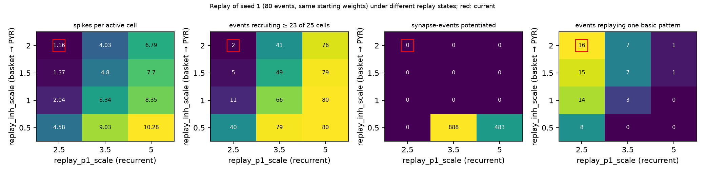

# Why replay only depresses in tinyCA3 (report of 2026-11-27)

Follow-up to [the extended DA vs 5-HT report](DA_5HT_REPLAY_EXTENDED_2026-11-27.md), whose first open point was this:
in 80 replay events no synapse goes up, and 16 events push 120–495 synapses down. This report finds the cause in the
calcium rule of the tag, using the spikes recorded in the seed-1 trace run.

## Summary

| # | Question | Answer |
| --- | --- | --- |
| 1 | What sets the sign of a tag change? | Synaptic calcium c. Above θ_d = 1.2 the tag is pushed down, above θ_p = 3 it is pushed up (much faster). Each presynaptic spike adds c_pre = 1.0 (after 20 ms), each postsynaptic spike c_post = 0.28; c decays with 48.8 ms |
| 2 | How much calcium does replay give? | At most 2.04, in all 28 360 synapse-events with a spike. **No synapse ever reaches θ_p in replay.** One presynaptic spike gives about 1.0 (below θ_d); two give about 1.7 (inside the depression window) |
| 3 | Does this explain the losses? | Yes. The change of W in an event follows the time c spends above θ_d (r = −0.986), with the slope of the rule (−0.00055 per ms, i.e. 1 + T̃ ≈ 1.2). Synapses that never pass θ_d change by less than 0.0001 |
| 4 | Why are the replayed patterns hit hardest? | Their strong recurrent weights make their cells fire a second spike. 15–16% of the X, +, X→+ and +→X synapses get two or more presynaptic spikes in an event, against 2–4% for = and ‖ |
| 5 | Why does encoding potentiate? | A 100-ms burst at 90 Hz gives 6–9 spikes 10–11 ms apart. Calcium climbs to a median 4.4 and stays above θ_p for 150 ms per presentation |
| 6 | What would potentiate in replay? | A pre-and-post burst of 3 spikes no more than 8 ms apart, or 4 spikes no more than 17 ms apart. In replay, 87% of firing cells fire once, 12% twice, and 2% three or four times |

## 1. The rule

From `neuron/TMExp2SynNMDA_STC.mod` (Luboeinski & Tetzlaff 2021, with the slice values c_pre = 1.0 and
c_post = 0.2758 set in `CircuitParams`, because the network values never reach θ_p with these cells):

```latex
\tau_h \frac{d\tilde T}{dt} = -k\,\tilde T + \gamma_p\,(\tilde T_{max} - \tilde T)\,H(c - \theta_p) - \gamma_d\,(1 + \tilde T)\,H(c - \theta_d)
```

γ_p = 1645.6 and γ_d = 313.1: while c > θ_p, potentiation wins by a factor of about 4. Between θ_d and θ_p there is
only depression.

## 2. Evidence


**Figure R1.** `replay_calcium.py`: calcium reconstructed from the recorded spikes of
`pilot_s1_mod10_gate30_trace.pkl` with the model's parameters (`replay_calcium.json`).

- **(a) Replay stays in the depression window.** A single spike pair peaks near 1.2. Two spikes pass θ_d and stay
  there for 10–35 ms. Only a tight triplet (≤ 8 ms) touches θ_p. An encoding burst stays above θ_p for over 100 ms.
- **(b) Replay is sparse.** Of the 760 cell firings in 80 events, 658 are a single spike, 88 two, 12 three and 2
  four. An encoding burst gives 6–9 spikes per cell.
- **(c) The reconstruction matches the simulation.** For every synapse and event, ΔW is proportional to the time
  above θ_d (r = −0.986). The slope matches the depression term with 1 + T̃ ≈ 1.2–1.3. No point lies above 0: no
  potentiation anywhere.
- **(d) The burst needed for potentiation.** Peak calcium of n spikes, each both pre- and postsynaptic. θ_p is
  reached by 3 spikes up to 8 ms apart, 4 up to 17 ms, 5 up to 21 ms. Two spikes never reach it.

By number of presynaptic spikes in an event (all synapse-events, seed 1):

| Presynaptic spikes | Synapse-events | Median peak c | Above θ_d | Mean ΔW |
| --- | --- | --- | --- | --- |
| 0 (postsynaptic only) | 10 120 | 0.28 | 0% | 0 |
| 1 | 15 792 | 1.00 | 9% | −0.0002 |
| 2 | 2 112 | 1.72 | 99% | −0.0105 |
| 3 | 288 | 1.79 | 100% | −0.0155 |
| 4 | 48 | 1.84 | 100% | −0.0192 |

Three or four presynaptic spikes in replay are spread over the event, not packed into a burst, so they add little
calcium over two.

## 3. Interpretation

Replay depresses because the replay events are too sparse to reach the potentiation threshold, not because of a
coding error. It is a consequence of three choices:

1. **The tag rule's thresholds** (L&T 2021), fitted to slice plasticity protocols with long high-frequency trains.
2. **The replay state** (`replay_p1_scale` 2.5, `replay_inh_scale` 2.0, 4 trigger cells): it gives one, sometimes
   two, spikes per cell, and the basket cells end the event after about 30 ms.
3. **Presynaptic dominance of calcium** (c_pre = 1.0 against c_post = 0.28): a second presynaptic spike matters,
   postsynaptic spikes hardly do.

The second spike comes most often from the patterns with the strongest weights, so replay acts as negative feedback
on them: the more a pattern is potentiated, the more its cells fire twice, and the more it is depressed. This is why
the replayed pattern of an epoch loses the most.

The literature points both ways. Sharp-wave ripples have been reported to depress hippocampal synapses during rest
and sleep (Norimoto et al. 2018, Science, "Hippocampal ripples down-regulate synapses"; not yet checked against the
paper in `reference/`). They are also described as the moment of consolidation. Under the first reading, the model's
behaviour is a feature: capture consolidates, and replay prunes. Under the second, the replay state is too sparse.

## 4. Options

| Option | Change | Effect expected | Cost |
| --- | --- | --- | --- |
| A. Keep it | None; document replay as SWR downscaling | Capture consolidates, replay prunes the patterns that replay | Needs the Norimoto et al. 2018 check |
| B. Burstier replay | Lower `replay_inh_scale` or raise `replay_p1_scale`, so replayed cells fire 3–4 spikes within 8–17 ms | Replayed synapses pass θ_p and potentiate | Risk of runaway events that recruit all 25 cells (already 2 of 80) |
| C. Larger postsynaptic calcium in replay | Raise c_post in replay blocks (dendritic depolarization during ripples) | A single pre spike with a postsynaptic burst can reach θ_d or θ_p | Ad hoc, and changes encoding too unless it is set per block |
| D. No tag plasticity in replay | `plastic` = 0 in replay blocks; replay then acts only through the VTA-mode DA release | The replay effect becomes zero | Removes a mechanism instead of explaining it |

A first test of B costs little: rerun only the replay blocks of seed 1 with the stored weights and a few values of the
two scales, and count the spikes per cell. That would show whether a non-runaway bursty replay exists in this
network.

## 5. Test of option B: a burstier replay state

`replay_bursts.py` reruns the 80 replay events of seed 1 from the weights each started with (W_before, restored as
T̃ = W_before − 1, z = 0), for 12 replay states: basket-cell inhibition `replay_inh_scale` ∈ {2, 1.5, 1, 0.5} ×
recurrent scale `replay_p1_scale` ∈ {2.5, 3.5, 5}. The current state (2, 2.5) reproduces the full run in all 80
events. Results in `results/layout_B/replay_bursts/` (`summary.json`).



**Figure R2.** `replay_bursts.py --summary`. Red square: the current replay state.

| inh scale | p1 scale | Spikes per active cell | Cells with ≥ 3 spikes | Events with ≥ 23 cells | Events replaying one basic pattern | Synapse-events up | Synapse-events down |
| --- | --- | --- | --- | --- | --- | --- | --- |
| **2** | **2.5** | **1.16** | **2%** | **2** | **16** | **0** | **3 092** |
| 1.5 | 2.5 | 1.37 | 8% | 5 | 15 | 0 | 4 697 |
| 1 | 2.5 | 2.04 | 25% | 11 | 14 | 0 | 9 746 |
| 0.5 | 2.5 | 4.58 | 67% | 40 | 8 | 0 | 26 020 |
| 2 | 3.5 | 4.03 | 73% | 41 | 7 | 0 | 24 720 |
| 0.5 | 3.5 | 9.03 | 100% | 79 | 0 | 888 | 46 478 |
| 1 | 5 | 8.35 | 100% | 80 | 0 | 0 | 48 000 |
| 0.5 | 5 | 10.28 | 100% | 80 | 0 | 483 | 47 509 |

(The remaining four settings fall between these rows; all are in `summary.json`.)

- **No setting potentiates without runaway.** More spikes come only with events that recruit the whole network.
  Weakening inhibition or raising recurrence turns specific replay (16 single-pattern events now) into all-cell
  events, and the depression grows with the spike count (up to all 600 synapses per event).
- **Even runaway events hardly potentiate.** With 9–10 spikes per cell, 888 or fewer of about 47 000 synapse-events
  go up, against 46 000 that go down. In 10 of 12 settings, none goes up at all.
- **The reason is the spike interval, not the count.** Measured in 4 events in each of four settings (2/2.5,
  1/2.5, 0.5/3.5, 1/5), the interval between a cell's replay spikes is rarely shorter than 18 ms (10th percentile
  17.6–18.2 ms, median 20–44 ms; at most 2% of intervals ≤ 8 ms). That is the reverberation period of the CA3 loop, about 50 Hz. Potentiation needs 3 spikes within 8 ms or
  4 within 17 ms (Figure R1d). Encoding gets 10-ms intervals only because the mossy fibres drive the cells at
  100 Hz. Replay has no such drive.

**So option B does not work in this network.** The replay state cannot produce the tight bursts the tag rule needs;
it can only produce more, equally slow spikes, which deepen the depression. A replay that potentiates would need a
different source of fast bursting (intrinsic bursting of the pyramidal cells, or a calcium rule with a postsynaptic
burst term, option C), or the depression accepted as the model's replay effect (option A).
