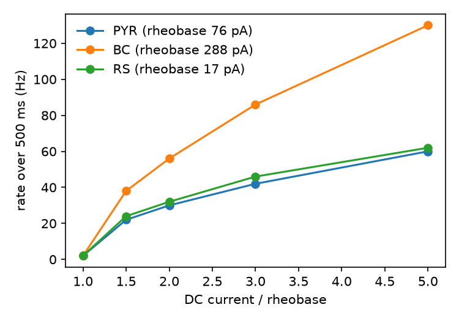
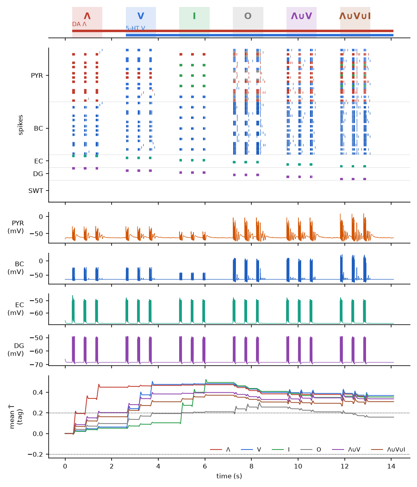
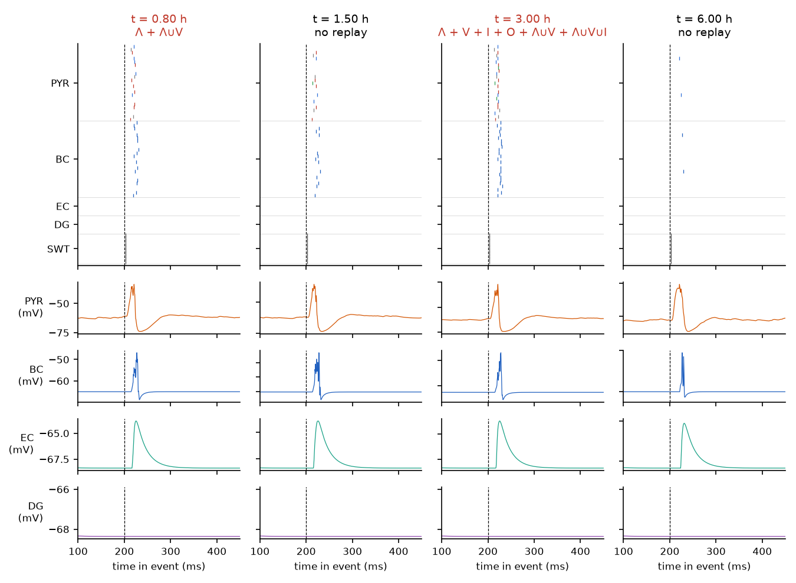
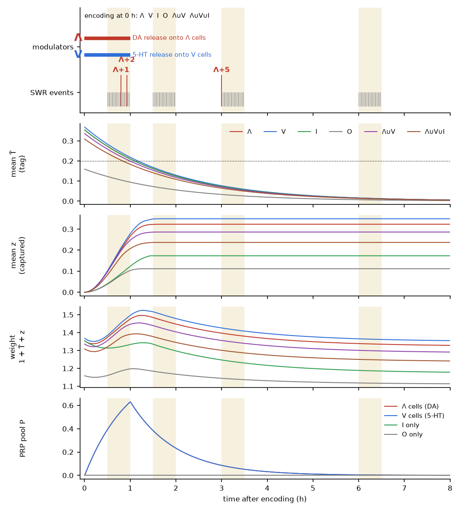
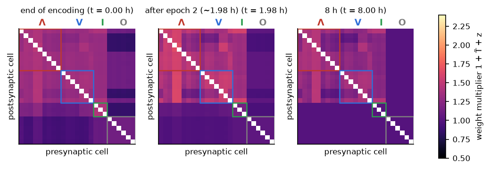
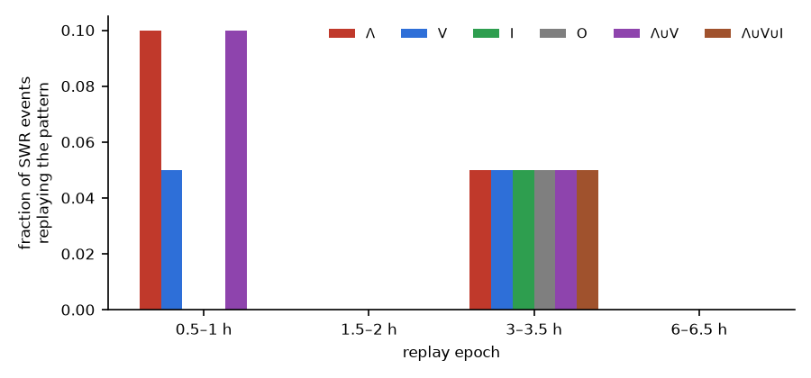

# tinyCA3 results

One numbered section per result; figures are numbered across the document and each has a caption. Stages and acceptance criteria are in
[implementation_plan.md](implementation_plan.md) §4. All runs so far are deterministic (no noise), so
repeating them adds nothing; seeds start to matter at T6.

## 1. T0: environment and the STP mechanism (2026-11-17)

**Setup.**

- Python 3.13.3 venv with pip `neuron==9.0.2`, numpy, scipy, matplotlib and pytest (`requirements.txt`).
- `PYTHONPATH` must be unset. The NEURON 8.2.7 app bundle cannot be imported under Homebrew's Python 3.14, and it
  shadows pip's NEURON when it is on `PYTHONPATH`.
- `nrn_setup.load_mechanisms` compiles `neuron/` on first use. That folder holds the existing
  `TMExp2SynNMDACA1_SCExc.mod` and 13 Bezaire et al. 2016 channel files, copied unchanged from
  tinyHippo-bio-plasticity (CC0; provenance in `neuron/BEZAIRE_CHANNELS.md`).

**Acceptance** (`tests/test_t0_environment.py`, 5 tests, all pass):

- All 14 mechanisms load.
- The Tsodyks–Markram release per spike at 10, 20, 40 and 80 Hz (10 spikes each) matches the numpy reference
  `reference/tm_numpy.py` to < 1e-9.
- At 80 Hz, release relative to spike 1 is 1.000, 1.535, 1.598, 1.406, 1.165 for spikes 1–5. The same values were
  obtained earlier under NEURON 8.2.7.

**Status:** T0 accepted.

## 2. T1: Hodgkin–Huxley-type cells (2026-11-17)

**Cells** (`cells.py`; all at 34 °C, dt 0.025 ms):

| Type | Used for | Build |
|---|---|---|
| PYR | 25 CA3 pyramidal cells | Soma (20 × 20 µm), one apical dendrite (300 × 3 µm), axon initial segment (50 × 1 µm). Bezaire pyramidal channels at the template's somatic densities (`params.BEZ_PYR_SOMA`) |
| BC | 25 basket cells | The published Bezaire PV basket cell: 17 sections, seven channel types |
| RS | EC_k, DG_k, SWT | One compartment (20 × 20 µm) with the pyramidal somatic channels |

**Measurements** (`run_t1_cells.py` → `results/t1_cells.json`; Figure 1). All are from DC current
injection into the soma: 500-ms steps after 500 ms of settling. Rin comes from a −20 pA step.

| Type | V_rest (mV) | R_in (MΩ) | Rheobase (pA) | Rate at 1 / 1.5 / 2 / 3 / 5 × rheobase (Hz) | Last/first ISI at 5× |
|---|---|---|---|---|---|
| PYR | −63.1 | 168.3 | 75.6 | 2 / 22 / 30 / 42 / 60 | 1.04 |
| BC | −65.0 | 52.2 | 288.2 | 2 / 38 / 56 / 86 / 130 | 1.03 |
| RS | −68.4 | 2107.6 | 16.8 | 2 / 24 / 32 / 46 / 62 | 1.03 |

**Figure 1.** f–I curves of the three cell types (T1). Firing rate over a 500-ms DC step, against the step amplitude
in multiples of each cell's rheobase (given in the legend). Deterministic, 34 °C, dt 0.025 ms. Made by
`run_t1_cells.py`.

**Acceptance** (`tests/test_t1_cells.py`, 9 tests, all pass):

1. **BC port against the original template.** `build_bc` agrees with `reference/bezaire2016/class_pvbasketcell.hoc`
   within 0.01 mV, with equal spike counts, for −50 pA and +500 pA steps.
2. **Rheobase and repetition.** Every type has a DC rheobase below 2 nA and fires ≥ 5 spikes at 2× rheobase.
3. **BC fast spiking.** BC fires 130 Hz at 5× rheobase, with last/first ISI 1.03. The criterion was > 100 Hz with
   little accommodation.
4. **RS single spikes.** An RS unit fires exactly one spike to one AMPA-only synaptic event for NetCon weights
   0.003–0.016.
   - With the NMDA component on, the same event fires a train: 3 spikes at weight 0.004 and 7 at 0.008. The 148-ms NMDA
     decay keeps depolarising the cell after the first spike.
   - So every input onto EC, DG and SWT units is AMPA-only (gmax_nmda = 0). The plan's Tables 2–3 are updated.

**What these cells are not.**

- **No CA3 values.** All densities are Bezaire CA1 model values, used as placeholders. Not one value is a CA3
  measurement.
- **The PYR does not adapt or burst.** Last/first ISI is ≈ 1.0, while real CA3 pyramidal cells adapt and many burst.
  The plan lists I_CaL/I_KCa as a later extension.
- **The PYR's HCN and A-type currents are flat.** They sit at their somatic densities along the dendrite, without the
  template's distance gradients.
- **The RS unit is extremely compact.** Rin is 2.1 GΩ and rheobase 17 pA, so it is very sensitive to background
  input. That is acceptable for detonator-type input and readout units, but background drive onto RS units must be
  calibrated in T3, not copied from the PYR.

**Status:** T1 accepted against the plan's criteria. The CA3-specific intrinsic properties above are open.

## 3. Pilot: STP + STC + triggered replay over 8 h (2026-11-17)

**This is a single-seed pilot with hand-calibrated weights.** It builds stages T2–T7 of the plan in minimal form so
that the whole dynamics can be seen. No stage acceptance criterion beyond the STC-synapse check (T4) has been run. The
numbers below describe this run only.

**What runs.**

- `circuit.py`: all projections P1–P8 of the plan, with Hodgkin–Huxley cells (§2).
- `neuron/TMExp2SynNMDA_STC.mod`: the 600 P1 synapses. They are STP + STC: calcium, tag T̃, captured weight z, and a
  PRP value P written from Python.
- `stc.py`: one PRP pool per pyramidal cell, the DA and 5-HT pulses, and the offline integration between blocks.
- `run_pilot.py`: the 8-hour protocol. `make_figures.py`: Figures 2–6.
- **Real time, no compression.** The 14.1 s of encoding and 80 replay events of 450 ms each are simulated in NEURON
  (dt 0.025 ms). The hours between events are integrated offline in 10-s steps, with no spikes and no calcium.

**STC synapse check (T4, `tests/test_t4_stc_synapse.py`, 3 tests, pass).** The mod matches the numpy reference
`reference/stc_numpy.py` within 1% on T̃ and z for three single-synapse protocols:

- strong: pre and post at 100 Hz for 1 s;
- weak: pre alone at 20 Hz;
- capture: strong, with P = 1.

Postsynaptic spikes enter through a NetCon with weight −1. A second NetCon weight element was not delivered to
`NET_RECEIVE` under NEURON 9.0.2.

**Calibration decisions** (all status *free*; each was needed to get tagging without runaway):

| Change | Why |
|---|---|
| PYR Kdr × 2 (`pyr_k_scale`) | With the Bezaire density, PYR followed only 2 of 10 mossy-fibre inputs at 100 Hz, so co-firing stayed near 45 Hz and calcium never reached θ_p |
| Basket cells with one segment per section (`BCParams(compact=True)`) | Same Rin (52.5 vs 52.2 MΩ), rheobase (288 vs 289 pA) and f–I as the full cell, about 3× faster. The BCs took 80% of the run time |
| Mossy fibres AMPA-only, w_mf = 0.35 | With NMDA, each encoding was followed by about 2 s of reverberation, which depressed every synapse. The strong AMPA drive keeps members near 90 Hz in the 16–19-cell patterns |
| P1 NMDA/AMPA ratio 0.3 (CA1 value 1.23) | Limits recurrent reverberation |
| Calcium c_pre = 1, c_post = 0.2758 (L&T slice values) | With L&T's in vivo values (0.6, 0.1655), co-firing at the rates these cells reach never crossed θ_p = 3 |
| w0 = 0.0006, w_bp = 0.01, trigger 0.0016 | Higher w0 or weaker inhibition made the O encoding ignite the whole network. Stronger inhibition stopped tagging. A trigger of 0.0018 or more fires all 25 PYR at once |
| P6 total weight 0.00268 | EC fires on ~90% of its pattern, not on subsets (threshold 0.00236 measured on the RS unit). At 4× this, Λ alone triggered EC for Λ∪V, Λ∪V∪I and O |
| Tag decay k_rel = 0.1 (L&T, ~1.9 h); DA and 5-HT for 60 min (Lehr et al. 2022) | With the 43-min tag (k_rel = 0.265) the tags fell below threshold within ~24 min, before PRPs had accumulated |

**Figure 2.** The encoding block (0–14.1 s).

- **Top:** the pattern whose EC unit is driven (shaded, with its glyph), and the DA (Λ cells) and 5-HT (V cells)
  release bars.
- **Raster:** spikes by cell type. PYR rows are coloured by their first pattern: Λ red, V blue, I green, O grey.
- **Middle:** the mean somatic potential of each population, PYR, BC, EC and DG. This is an LFP proxy, not an
  extracellular potential.
- **Bottom:** the mean early-phase weight T̃ (the tag) of the P1 synapses inside each pattern. The dotted lines are the
  tag thresholds ±0.2.

Each 100-ms pulse adds a step to the tag of the pattern being encoded. Later patterns that share cells change earlier
tags a little. At the end of encoding the mean tags are:

| Λ | V | I | O | Λ∪V | Λ∪V∪I |
|---|---|---|---|---|---|
| 0.354 | 0.368 | 0.354 | 0.159 | 0.336 | 0.309 |

O, the largest pattern, ends below the tag threshold on average.

**Figure 3.** Four triggered SWR events, one from each replay epoch: the first event with a replay, or else the first
event of the epoch. The dashed line is the trigger (SWT burst at 200 ms). The title gives the time after encoding and
the patterns read out as replayed, meaning ≥ 80% of their cells spiked.

- **0.80 h:** a burst of 16 cells, read as Λ and Λ∪V.
- **1.50 h and 6.00 h:** no replay.
- **3.00 h:** a burst of 24 of 25 cells, which meets the readout for every pattern.

EC depolarises but never fires, so DG never reinstates a pattern: the P6 loop did not work in any event.

**Figure 4.** The dynamics over 8 h. Shaded bands are the four replay epochs (20 SWR events each, 90 s apart).

- **(a) Events.**
  - DA release onto Λ cells (glyph Λ) and 5-HT release onto V cells (glyph V), 60 min each.
  - Each SWR event is a grey tick. Events read out as replay are coloured, with the first replayed pattern's glyph and
    "+n" for the others.
- **(b) Tags.** Mean tag T̃ per pattern; the tag threshold is dotted.
- **(c) Capture.** Mean captured weight z.
- **(d) Total weight.** The mean weight multiplier 1 + T̃ + z of each pattern's P1 synapses.
- **(e) PRP pools.** The mean pool P of cell groups. The Λ and V curves coincide, because both groups have the same
  modulator schedule and tag sums above threshold. I-only and O-only cells receive no modulator and make no PRPs.

What happens over time:

- **Tags** decay with τ ≈ 1.9 h.
- **PRPs** rise while DA and 5-HT are on (to 0.63 at 1 h), then decay with τ = 60 min.
- **Capture** happens in the first ~1.5 h and then stays fixed. Mean z at 8 h:

  | Λ | V | Λ∪V | Λ∪V∪I | I | O |
  |---|---|---|---|---|---|
  | 0.323 | 0.349 | 0.286 | 0.237 | 0.173 | 0.112 |

- **I and O** capture only on their synapses onto cells that are also in Λ or V (ex_13, ex_53 for I; nine border
  cells for O). This is the per-cell pool outcome the algorithm doc predicts for pattern 6 (X6).

**Figure 5.** P1 weight multiplier 1 + T̃ + z for every pair (row: postsynaptic, column: presynaptic) at three times:

- the end of encoding;
- after replay epoch 2 (~1.98 h);
- 8 h.

Cells are ordered Λ, V, I, O (each cell listed once, at its first pattern), then the rest. Outlined blocks are the
synapses within each pattern; the diagonal (no autapses) is blank. Early weights are high in all patterns at the end of
encoding. By 8 h only the captured part remains: highest within Λ and V and between them, near baseline elsewhere.

**Figure 6.** Fraction of the 20 SWR events per epoch in which each pattern was read out as replayed.

- **Epoch 1 (0.5–1 h):** 2 events, read as Λ, V and Λ∪V.
- **Epoch 3:** the one whole-network burst.
- **Epochs 2 and 4:** none.

**What the pilot shows.**

1. **Encoding tags.** All six patterns tag, and outside cells stay near-silent: 0–23 non-member spikes per pattern
   window.
2. **Capture follows the modulators.** Capture is gated by DA and 5-HT through the per-cell PRP pools. Modulated
   patterns end at z ≈ 0.32–0.35, unmodulated ones capture only through shared cells.
3. **Unmodulated tags decay.** They return to baseline over ~8 h (Figure 4b).

**What it does not show yet.**

- **Clean replay.** Only 3 of 80 events reached the readout threshold, and all three were broad bursts (15–24 of 25
  cells), not single-pattern completions. The median event activated 3 cells. Completion needs the weight multiplier
  near 2, while capture here reaches 1.3–1.5. A trigger only slightly stronger (0.0018) ignites the whole network. So
  the stable completion regime of plan §2.4 (m_c ≈ 1.5) is not reached in this circuit yet.
- **Replay acting on STC.** No replay refreshed a tag. The few bursts came at 0.8–0.9 h and 3 h and changed T̃ only
  briefly. So the replay → STC loop of the plan (§3.5) is not exercised.
- **The P6 loop.** EC never fired during replay. The P6 weight was set so that EC needs ~90% of a pattern within one
  volley, and replay bursts are spread over ~20 ms.
- **The plan's checks.** None of the T7 checks (null test, PRP block, runaway statistics) was run. It is one seed.

**Next.** The completion threshold is the open problem. Candidates, to test in this order:

1. a weaker, longer trigger;
2. a slower GABA_A or a GABA_B component, so that one pattern can win cleanly;
3. letting replay carry DA (VTA mode), so that replay can drive capture.

Then come the T7 checks with ≥ 5 seeds.

**Run.** `run_pilot.py` (encoding block 14.1 s simulated in 199 s wall time; total about 25 min on one core), then
`make_figures.py`. Data: `results/pilot.npz`, `results/pilot_events.pkl`.
