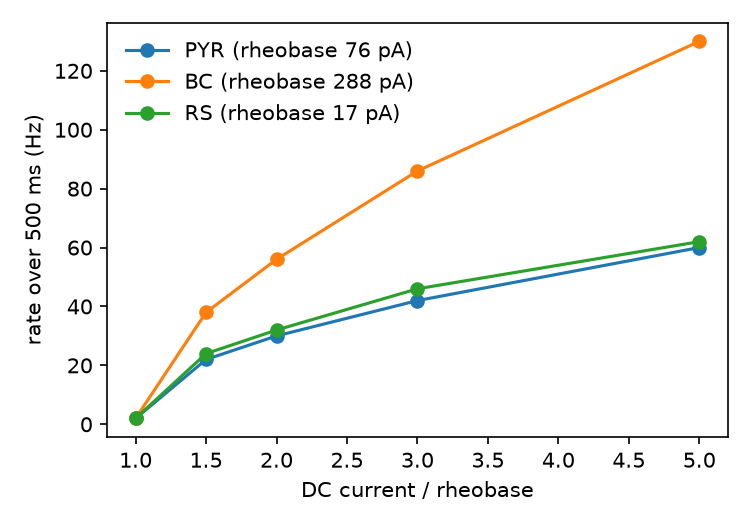
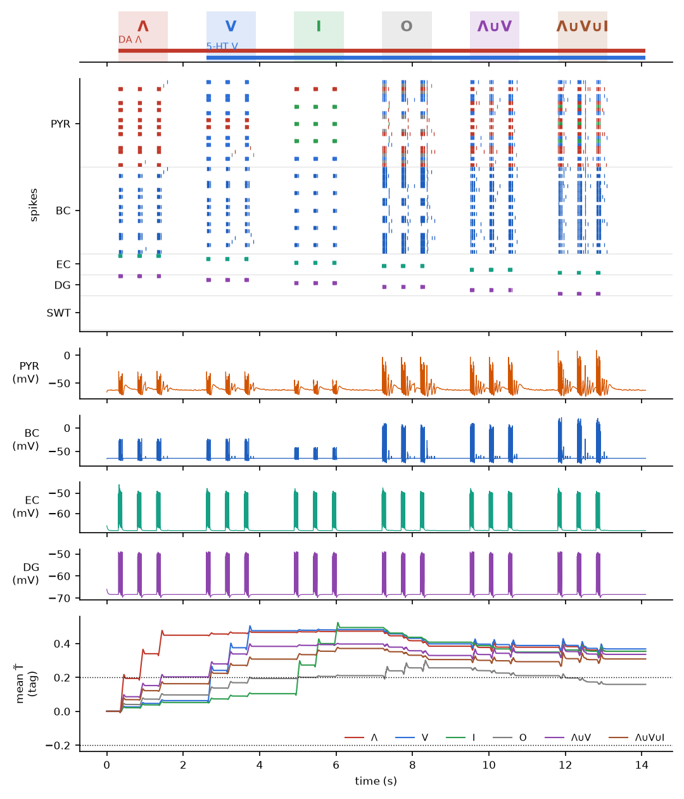
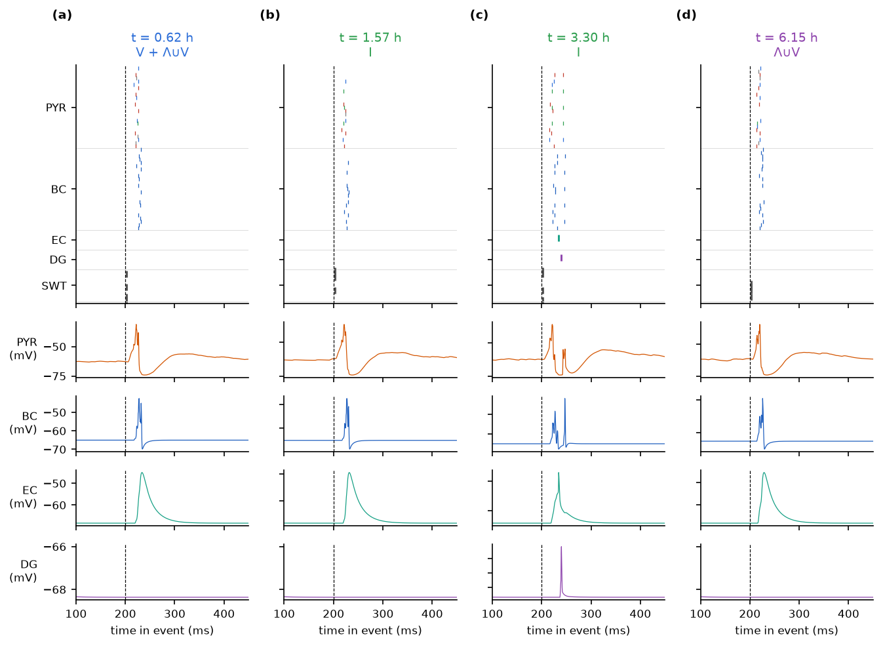
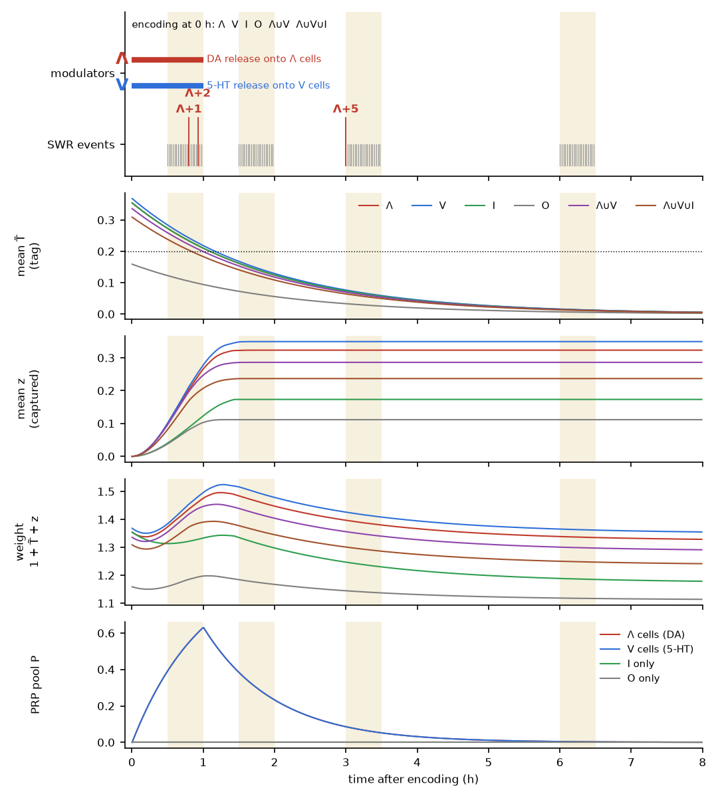
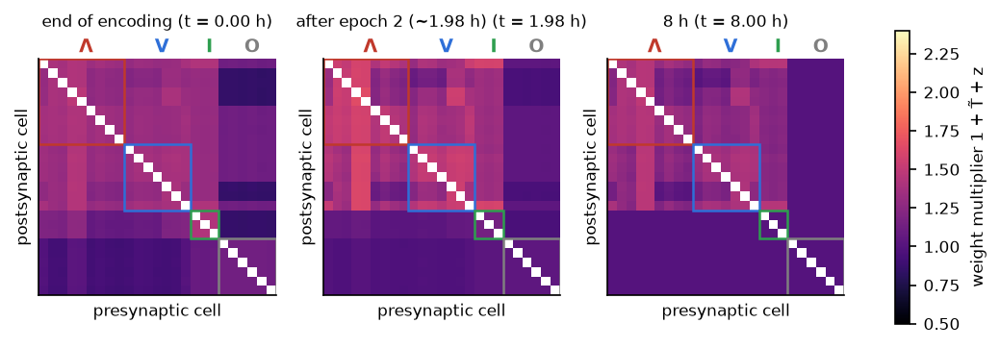
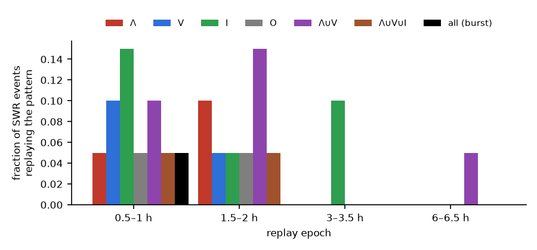
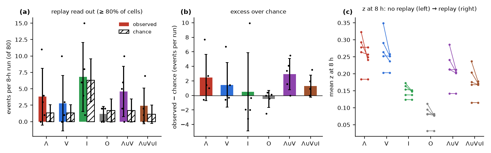
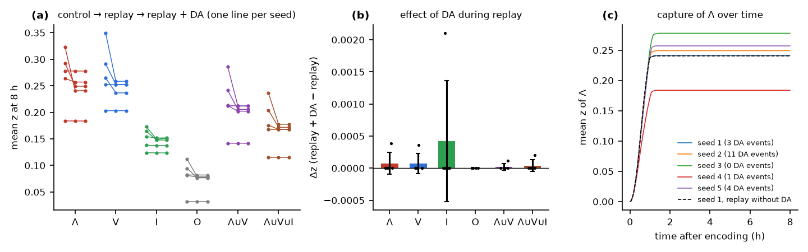

# tinyCA3 results (report of 2026-11-17)

## Abbreviations

| Term | Meaning |
|---|---|
| PYR | CA3 pyramidal cell (25, `ex_ij`) |
| BC | Basket cell, fast-spiking PV interneuron (25, `in_ij`) |
| EC, DG | Entorhinal and dentate units, one per pattern (`EC_k`, `DG_k`) |
| **RS** | **Regular-spiking unit**: the one-compartment Hodgkin–Huxley cell used for EC, DG and SWT (`cells.build_rs`). It is an input/readout unit, not a model of an entorhinal or granule cell |
| **SWT** | **Sharp-wave trigger**: 10 RS cells that fire once at the start of each replay event and contact every PYR weakly, with jittered delays (projection P8). They carry no pattern; the P1 weights decide what is replayed (implementation plan §1) |
| SWR | Sharp-wave ripple, here one triggered replay event of 450 ms |
| P1–P8 | Projections of the implementation plan, Table 3 (P1 = recurrent collaterals with STC) |
| STP, STC | Short-term plasticity (Tsodyks–Markram release); synaptic tagging and capture |
| T̃, z, P | Tag (early-phase weight change), captured (late-phase) weight, PRP pool; all in units of the baseline weight w0 |
| PRP | Plasticity-related products |
| DA, 5-HT | Dopamine (onto Λ cells), serotonin (onto V cells) |
| Population potential | Mean somatic membrane potential of one cell type: an LFP proxy, not a computed extracellular potential |

One numbered section per result; figures are numbered across the document and each has a caption. Stages and acceptance criteria are in
[implementation_plan.md](implementation_plan.md) §4. All runs so far are deterministic (no noise), so
repeating them adds nothing; seeds start to matter at T6.

## 1. T0: environment and the STP mechanism (2026-11-17)

**Setup.**

- Python 3.13.3 venv with pip `neuron==9.0.2`, numpy, scipy, matplotlib and pytest (`requirements.txt`).
- `PYTHONPATH` must be unset. The NEURON 8.2.7 app bundle cannot be imported under Homebrew's Python 3.14, and it
  shadows pip's NEURON when it is on `PYTHONPATH`.
- `nrn_setup.load_mechanisms` compiles `neuron/` on first use. That folder holds the existing
  `TMExp2SynNMDACA1_SCExc.mod` and 13 Bezaire et al. 2016 channel files, copied unchanged from
  tinyHippo-bio-plasticity (CC0; provenance in `neuron/BEZAIRE_CHANNELS.md`).

**Acceptance** (`tests/test_t0_environment.py`, 5 tests, all pass):

- All 14 mechanisms load.
- The Tsodyks–Markram release per spike at 10, 20, 40 and 80 Hz (10 spikes each) matches the numpy reference
  `reference/tm_numpy.py` to < 1e-9.
- At 80 Hz, release relative to spike 1 is 1.000, 1.535, 1.598, 1.406, 1.165 for spikes 1–5. The same values were
  obtained earlier under NEURON 8.2.7.

**Status:** T0 accepted.

## 2. T1: Hodgkin–Huxley-type cells (2026-11-17)

**Cells** (`cells.py`; all at 34 °C, dt 0.025 ms):

| Type | Used for | Build |
|---|---|---|
| PYR | 25 CA3 pyramidal cells | Soma (20 × 20 µm), one apical dendrite (300 × 3 µm), axon initial segment (50 × 1 µm). Bezaire pyramidal channels at the template's somatic densities (`params.BEZ_PYR_SOMA`) |
| BC | 25 basket cells | The published Bezaire PV basket cell: 17 sections, seven channel types |
| RS | EC_k, DG_k, SWT | One compartment (20 × 20 µm) with the pyramidal somatic channels |

**Measurements** (`run_t1_cells.py` → `results/t1_cells.json`; Figure 1). All are from DC current
injection into the soma: 500-ms steps after 500 ms of settling. Rin comes from a −20 pA step.

| Type | V_rest (mV) | R_in (MΩ) | Rheobase (pA) | Rate at 1 / 1.5 / 2 / 3 / 5 × rheobase (Hz) | Last/first ISI at 5× |
|---|---|---|---|---|---|
| PYR | −63.1 | 168.3 | 75.6 | 2 / 22 / 30 / 42 / 60 | 1.04 |
| BC | −65.0 | 52.2 | 288.2 | 2 / 38 / 56 / 86 / 130 | 1.03 |
| RS | −68.4 | 2107.6 | 16.8 | 2 / 24 / 32 / 46 / 62 | 1.03 |

**Figure 1.** f–I curves of the three cell types (T1). Firing rate over a 500-ms DC step, against the step amplitude
in multiples of each cell's rheobase (given in the legend). Deterministic, 34 °C, dt 0.025 ms. Made by
`run_t1_cells.py`.

**Acceptance** (`tests/test_t1_cells.py`, 9 tests, all pass):

1. **BC port against the original template.** `build_bc` agrees with `reference/bezaire2016/class_pvbasketcell.hoc`
   within 0.01 mV, with equal spike counts, for −50 pA and +500 pA steps.
2. **Rheobase and repetition.** Every type has a DC rheobase below 2 nA and fires ≥ 5 spikes at 2× rheobase.
3. **BC fast spiking.** BC fires 130 Hz at 5× rheobase, with last/first ISI 1.03. The criterion was > 100 Hz with
   little accommodation.
4. **RS single spikes.** An RS unit fires exactly one spike to one AMPA-only synaptic event for NetCon weights
   0.003–0.016.
   - With the NMDA component on, the same event fires a train: 3 spikes at weight 0.004 and 7 at 0.008. The 148-ms NMDA
     decay keeps depolarising the cell after the first spike.
   - So every input onto EC, DG and SWT units is AMPA-only (gmax_nmda = 0). The plan's Tables 2–3 are updated.

**What these cells are not.**

- **No CA3 values.** All densities are Bezaire CA1 model values, used as placeholders. Not one value is a CA3
  measurement.
- **The PYR does not adapt or burst.** Last/first ISI is ≈ 1.0, while real CA3 pyramidal cells adapt and many burst.
  The plan lists I_CaL/I_KCa as a later extension.
- **The PYR's HCN and A-type currents are flat.** They sit at their somatic densities along the dendrite, without the
  template's distance gradients.
- **The RS unit is extremely compact.** Rin is 2.1 GΩ and rheobase 17 pA, so it is very sensitive to background
  input. That is acceptable for detonator-type input and readout units, but background drive onto RS units must be
  calibrated in T3, not copied from the PYR.

**Status:** T1 accepted against the plan's criteria. The CA3-specific intrinsic properties above are open.

## 3. Pilot: STP + STC + triggered replay over 8 h (2026-11-17)

**This is a single-seed pilot with hand-calibrated weights.** It builds stages T2–T7 of the plan in minimal form so
that the whole dynamics can be seen. No stage acceptance criterion beyond the STC-synapse check (T4) has been run.

**Which run.** The figures and numbers below are the second pilot run, made after the replay calibration of section 4.
The first run (commit `c55e88b`) had the same encoding but two wiring bugs that disabled the trigger and the
CA3 → EC → DG loop. Its replay results are superseded; section 4 compares the two.

**What runs.**

- `circuit.py`: all projections P1–P8 of the plan, with Hodgkin–Huxley cells (§2).
- `neuron/TMExp2SynNMDA_STC.mod`: the 600 P1 synapses. They are STP + STC: calcium, tag T̃, captured weight z, and a
  PRP value P written from Python.
- `stc.py`: one PRP pool per pyramidal cell, the DA and 5-HT pulses, and the offline integration between blocks.
- `run_pilot.py`: the 8-hour protocol. `make_figures.py`: Figures 2–6.
- **Real time, no compression.** The 14.1 s of encoding and 80 replay events of 450 ms each are simulated in NEURON
  (dt 0.025 ms). The hours between events are integrated offline in 10-s steps, with no spikes and no calcium.

**STC synapse check (T4, `tests/test_t4_stc_synapse.py`, 3 tests, pass).** The mod matches the numpy reference
`reference/stc_numpy.py` within 1% on T̃ and z for three single-synapse protocols:

- strong: pre and post at 100 Hz for 1 s;
- weak: pre alone at 20 Hz;
- capture: strong, with P = 1.

Postsynaptic spikes enter through a NetCon with weight −1. A second NetCon weight element was not delivered to
`NET_RECEIVE` under NEURON 9.0.2.

**Calibration decisions** (all status *free*; each was needed to get tagging without runaway):

| Change | Why |
|---|---|
| PYR Kdr × 2 (`pyr_k_scale`) | With the Bezaire density, PYR followed only 2 of 10 mossy-fibre inputs at 100 Hz, so co-firing stayed near 45 Hz and calcium never reached θ_p |
| Basket cells with one segment per section (`BCParams(compact=True)`) | Same Rin (52.5 vs 52.2 MΩ), rheobase (288 vs 289 pA) and f–I as the full cell, about 3× faster. The BCs took 80% of the run time |
| Mossy fibres AMPA-only, w_mf = 0.35 | With NMDA, each encoding was followed by about 2 s of reverberation, which depressed every synapse. The strong AMPA drive keeps members near 90 Hz in the 16–19-cell patterns |
| P1 NMDA/AMPA ratio 0.3 (CA1 value 1.23) | Limits recurrent reverberation |
| Calcium c_pre = 1, c_post = 0.2758 (L&T slice values) | With L&T's in vivo values (0.6, 0.1655), co-firing at the rates these cells reach never crossed θ_p = 3 |
| w0 = 0.0006, w_bp = 0.01 (encoding state) | Higher w0 or weaker inhibition made the O encoding ignite the whole network. Stronger inhibition stopped tagging |
| P6 total weight 0.00268 | EC fires on ~90% of its pattern, not on subsets (threshold 0.00236 measured on the RS unit). At 4× this, Λ alone triggered EC for Λ∪V, Λ∪V∪I and O |
| Tag decay k_rel = 0.1 (L&T, ~1.9 h); DA and 5-HT for 60 min (Lehr et al. 2022) | With the 43-min tag (k_rel = 0.265) the tags fell below threshold within ~24 min, before PRPs had accumulated |
| Replay state: sparse random trigger, P1 × 2.5, P3 × 2 | See section 4 |

**Figure 2.** The encoding block (0–14.1 s).

- **(a)** The pattern whose EC unit is driven (shaded, with its glyph), and the DA (Λ cells) and 5-HT (V cells)
  release bars.
- **(b)** Spikes by cell type. PYR rows are coloured by their first pattern: Λ red, V blue, I green, O grey.
- **(c)–(f)** The population potential of PYR, BC, EC and DG.
- **(g)** The mean tag T̃ of the P1 synapses inside each pattern. The dotted lines are the tag thresholds ±0.2.

Each 100-ms pulse adds a step to the tag of the pattern being encoded. Later patterns that share cells change earlier
tags a little. At the end of encoding the mean tags are:

| Λ | V | I | O | Λ∪V | Λ∪V∪I |
|---|---|---|---|---|---|
| 0.354 | 0.368 | 0.354 | 0.159 | 0.336 | 0.309 |

O, the largest pattern, ends below the tag threshold on average.

**Figure 3.** Four triggered SWR events, **(a)–(d)**, one from each replay epoch: the first event read out as a replay,
or else the first event of the epoch. In each column:

- **top:** spikes by cell type;
- **below:** the population potential of PYR, BC, EC and DG.

The dashed line is the trigger. A random 4 of the 10 SWT cells fire at about 203 ms (dark ticks in the SWT rows). The
title gives the time after encoding and the patterns read out as replayed (≥ 80% of their cells spiked). The four
events:

- **(a) 0.62 h:** V and Λ∪V, 17 cells.
- **(b) 1.57 h:** I, 12 cells.
- **(c) 3.30 h:** I, 12 cells. Here the CA3 → EC → DG loop closes: EC_I fires at ~232 ms, DG_I at ~238 ms, and a second
  PYR wave follows at ~245 ms.
- **(d) 6.15 h:** Λ∪V, 17 cells.

**Figure 4.** The dynamics over 8 h. Shaded bands are the four replay epochs (20 SWR events each, 90 s apart).

- **(a) Events.**
  - DA release onto Λ cells (glyph Λ) and 5-HT release onto V cells (glyph V), 0–1 h.
  - Each SWR event is a grey tick.
  - An event read out as a replay is coloured by the largest pattern with ≥ 80% of its cells active (legend). A black
    tick is a whole-network burst (≥ 23 of 25 cells).
- **(b) Tags.** Mean tag T̃ per pattern; the tag threshold is dotted.
- **(c) Capture.** Mean captured weight z.
- **(d) Total weight.** The mean weight multiplier 1 + T̃ + z.
- **(e) PRP pools.** The mean pool P of cell groups.
  - **Λ and V coincide exactly.** Both have DA or 5-HT for the same hour and tag sums above threshold. Λ is drawn as a
    thick pale line and V dashed on top of it.
  - **I-only and O-only lie on top of each other at zero.** They receive no modulator and make no PRPs.

**Why do I and O have tags in (b) without any DA or 5-HT?** Tagging needs only co-activity. Calcium from pre- and
postsynaptic firing sets T̃ during encoding (Figure 2g). The neuromodulator acts one step later: it lowers the PRP
synthesis threshold, so it decides **capture**, not tagging. This follows the architecture doc ("tagging is set by
co-activity alone, but capture needs a neuromodulatory signal", its Eq. 2) and the literature behind it: tags are
protein-synthesis independent, PRPs are not. I and O are the controls. Their tags are set, then decay without capture;
their small z in (c) comes only from synapses onto cells shared with Λ or V.

What happens over time:

- **Tags** decay with τ ≈ 1.9 h. Each replay event also steps them **down**, visibly in (b) at 0.62–0.97 h, 1.95 h
  and 3.3 h.
- **PRPs** rise while DA and 5-HT are on (to 0.63 at 1 h), then decay with τ = 60 min.
- **Capture** happens in the first ~1.3 h, then stays fixed. Mean z at 8 h:

  | Λ | V | Λ∪V | Λ∪V∪I | I | O |
  |---|---|---|---|---|---|
  | 0.241 | 0.258 | 0.212 | 0.177 | 0.149 | 0.078 |

**Figure 5.** P1 weight multiplier 1 + T̃ + z for every pair (row: postsynaptic, column: presynaptic) at three times:

- **(a)** the end of encoding;
- **(b)** after replay epoch 2 (1.98 h);
- **(c)** 8 h.

Cells are ordered Λ, V, I, O, each listed once at its first pattern (so the I and O blocks hold only cells outside Λ and
V), then the rest. Outlined blocks are the synapses within each pattern, labelled with their mean. The diagonal (no
autapses) is blank. The colour range is 0.9–1.7.

How to read it, since the neuromodulator effect is easy to miss:

- **(a) Encoding.** All blocks are raised, because tagging does not depend on DA or 5-HT: Λ 1.35, V 1.35, I 1.43,
  O 1.13. Here the modulated patterns do not stand out.
- **(b) 1.98 h.** Λ and V hold at 1.32, carried by their captured z. I and O fall to 1.14 and 1.05, carried only by
  their decaying tags.
- **(c) 8 h.** The tags have decayed, so what remains is capture. Λ and V stay at 1.24; I and O are back at baseline
  (1.00, 1.00).

**The neuromodulator effect is the difference between (a) and (c):** the same tag, kept only where DA or 5-HT was
present.

**Figure 6.** Fraction of the 20 SWR events per epoch in which each pattern was read out as replayed, and the
fraction of whole-network bursts (black). Single panel.

| Epoch | Pattern replays | Bursts | Median active cells |
|---|---|---|---|
| 0.5–1 h | 4 | 1 | 11 |
| 1.5–2 h | 5 | 0 | 9.5 |
| 3–3.5 h | 2 | 0 | 7 |
| 6–6.5 h | 1 | 0 | 8 |

**What the pilot shows.**

1. **Encoding tags.** All six patterns tag. Outside cells stay near-silent: 0–24 non-member spikes per pattern window.
   Each EC unit fires only for its own pattern.
2. **Capture follows the modulators.** Capture is gated by DA and 5-HT through the per-cell PRP pools. Modulated
   patterns end at z ≈ 0.24–0.26, unmodulated ones capture only through shared cells.
3. **Replay content follows capture.**
   - 12 of 80 events are pattern replays, and 1 is a whole-network burst.
   - The replays are of Λ, V, Λ∪V (the captured patterns) and I. **O, the uncaptured pattern, is never replayed alone.**
   - Replay becomes rarer as the tags decay: 5, 5, 2 and 1 events per epoch.
   - On the naive network (s = 0 in section 4), the same trigger never produces a replay.
4. **Replay acts back on STC, by depression.** Replay co-firing is brief and moderate, so it puts calcium in the
   depression band (θ_d ≤ c < θ_p). Each event lowers the tags of the patterns it involves (Figure 4b). Tags lowered
   before PRPs arrive capture less: z at 8 h is 0.24/0.26 for Λ/V here, against 0.32/0.35 in the first run, where
   replay was disabled by the wiring bug. So in this circuit **replay reduces capture rather than refreshing tags**.
   This is the opposite of the refresh mechanism the plan assumed (algorithm doc §3.3), and a falsifiable result to
   check with seeds.

**What it does not show yet.**

- **Clean replay.** The I "replays" are probably chance. I has 5 cells, and with 10–16 random cells active, 4 or 5 of
  them can be I by accident. A proper readout needs a null distribution from shuffled patterns. Two events mix captured
  and uncaptured patterns (21 and 20 cells, including O).
- **The P6 loop.** It closes only rarely, as in Figure 3c. Most replay activity is spread over ~20 ms, so EC_k rarely
  sees ≥ 90% of its pattern within one volley.
- **Replay as a cause of capture.** No DA is released during replay (VTA mode off), so replay cannot drive capture
  here.
- **The plan's checks.** None of the T7 checks was run (null test with seeds, PRP block, runaway statistics). It is one
  seed.

**Run.** `run_pilot.py` (encoding block 14.1 s simulated in 305 s wall time; the whole run about 35 min on one core),
then `make_figures.py`. Data: `results/pilot.npz`, `results/pilot_events.pkl` (not committed).

## 4. Replay calibration (2026-11-17)

The first pilot run read out only 3 of 80 events as replay, all of them broad bursts. Calibration with
triggered events on the captured weights of that run, scaled by s = 0 (naive), 1 (actual) and 2, found two
wiring bugs and two structural problems.

**Bug 1: a shared synapse in P6.** All cells of a pattern projected onto one Tsodyks–Markram synapse on EC_k. The first
PYR spike depleted it (U = 0.9, τ_d = 1.5 s), so the other cells' spikes delivered almost nothing. EC never fired in
any replay event of the first run. **Fix:** one synapse per connection.

**Bug 2: a shared synapse in P8.** All 10 trigger cells contacted one synapse per PYR, so the trigger depressed itself.
More trigger spikes gave *less* drive. **Fix:** one synapse per connection.

**Problem 1: the trigger was all-or-none.** All 25 PYR are identical and received identical trigger input.
- Below 0.0012 the trigger fired 1–3 cells; at 0.0014 it fired all 25, in the same millisecond. That was before any
  basket cell could respond, so 1–8× stronger inhibition made no difference.
- **Fix:** a sparse, random trigger. Each SWT cell contacts each PYR with p = 0.3, and each event fires a random 4 of
  the 10 SWT cells. This mirrors sharp waves starting from small, varying subsets of CA3 cells. The trigger now seeds
  3–8 random cells (w_swt = 0.006).

**Problem 2: one weight cannot serve both encoding and replay.**
- **Encoding** needs weak recurrent excitation and weak inhibition. Otherwise the 16-cell O pattern ignites the network,
  or the pattern cells are shunted below the rate that tags.
- **Replay** needs the opposite: recurrents strong enough to complete a pattern from a few seeds, and inhibition strong
  enough to keep one winner.

**Fix: a brain-state switch** (`Circuit.set_state`). In replay blocks:

- P1 transmission is scaled × 2.5. This stands for the release of CA3 recurrents from the cholinergic suppression they
  are under during encoding; it follows Hasselmo et al. 1995 and is **unverified**, quoted from memory and not checked
  against the paper.
- P3 is scaled × 2, for strong basket-cell recruitment during ripples.

Learning is in units of w0, so the stored T̃ and z are not changed by the switch. Both scales are status *free*.

**Calibration results** (16 events per condition; the first number is replays read out, the second whole-network
bursts):

| Setting | s = 0 (naive) | s = 1 (8-h weights) | s = 2 |
|---|---|---|---|
| Old trigger, encoding state | none, median 2–3 cells | none | none |
| Sparse trigger only | none, median 2.5 cells | none, median 3.5 cells | none |
| + P1 × 3 | none | 4 broad, 5 bursts | 3, 2 bursts |
| + P1 × 5 or more | bursts in 9–16 of 16 | bursts | bursts |
| **+ P1 × 2.5, P3 × 2 (chosen)** | **none, median 8 cells** | **4 (V/Λ∪V/Λ∪V∪I ×2, Λ, Λ+O+Λ∪V), 5 bursts** | **7 (Λ ×3, V, I, Λ+I+…), 4 bursts** |

With the loop on or off, the chosen setting gives the same counts. So the selection is made by P1, not by the loop.

**First run against second run** (same encoding, same 80 event times):

| | Run 1 (bugs) | Run 2 (calibrated) |
|---|---|---|
| Pattern replays / bursts | 2 / 1 | 12 / 1 |
| Median active cells per event | 3 | 10 |
| Events in which EC fires | 0 | a few (e.g. Figure 3c) |
| z at 8 h, Λ / V | 0.32 / 0.35 | 0.24 / 0.26 |
| z at 8 h, I / O | 0.17 / 0.11 | 0.15 / 0.08 |

**Next.**

1. A null readout (shuffled patterns) and ≥ 5 seeds, to separate replay from chance.
2. DA during replay of Λ (VTA mode), to test whether replay can drive capture instead of only depressing tags.
3. A PRP-block run (α_P = 0): no pattern should survive 8 h.
4. The calcium constants under replay. The depression found here depends on L&T's thresholds being reached only
   partially by brief co-firing.

## 5. Null readout and five seeds (2026-11-18)

**Question.** Is the replay of section 3 more than chance, and does replay reduce capture in every seed or only in the
one run shown?

**Runs.** 5 seeds × 2 conditions, each the full 8-h protocol of section 3 with the calibrated defaults:

- **replay:** 80 SWR events, as before;
- **no-replay control:** the same seed with the SWR events skipped.

The seed sets the background noise, the sparse trigger wiring (P8) and the trigger subset of every event. Commands:
`run_pilot.py --seed N --light [--no-replay]`. Results go to `results/seeds/`; the analysis is `replay_stats.py`
(Figure 7, `results/replay_stats.json`).

**Null readout.** An event is read out as a replay of pattern k when ≥ 80% of k's cells spike. When n random cells out
of 25 are active, the chance that this happens is hypergeometric:

p_chance(k, n) = P(X ≥ ⌈0.8 n_k⌉), with X ~ Hypergeom(25, n_k, n).

This is the same as shuffling the pattern over random cells of equal size.

- **Chance count.** The expected chance count is the sum of p_chance over the events of the run, with whole-network
  bursts (≥ 23 cells) excluded.
- **Small patterns are easy to hit by chance.** With 10–12 cells active, p_chance is 0.06–0.14 for I (5 cells), but
  only 0.0003–0.003 for Λ (9 cells), and ~0 for the 16-cell O and Λ∪V.

**Figure 7.** Five seeds.

- **(a) Replay counts.** Events per 8-h run read out as replay of each pattern (coloured, mean ± SD, dots = seeds)
  against the chance count (hatched).
- **(b) Excess over chance.** Observed − chance, per seed (dots) and mean ± SD.
- **(c) Paired effect of replay on capture.** Mean captured weight z at 8 h without replay (left end) and with replay
  (right end) for each seed. One line is one seed.

| Pattern | Observed | Chance | Seeds above chance | Significant events (p < 0.05/6) | z, no replay | z, replay | Δz (replay − control) | Seeds with Δz < 0 |
|---|---|---|---|---|---|---|---|---|
| Λ | 3.8 ± 4.3 | 1.35 ± 1.24 | 4/5 | 0.8 ± 0.8 | 0.268 | 0.242 | −0.027 ± 0.036 | 5/5 |
| V | 2.8 ± 4.2 | 1.35 ± 1.24 | 2/5 | 0.0 | 0.272 | 0.241 | −0.031 ± 0.037 | 5/5 |
| I | 6.8 ± 5.3 | 6.31 ± 3.27 | 1/5 | 0.4 ± 0.9 | 0.151 | 0.142 | −0.009 ± 0.011 | 5/5 |
| O | 1.2 ± 1.1 | 1.68 ± 1.75 | 2/5 | 0.0 | 0.080 | 0.069 | −0.011 ± 0.014 | 5/5 |
| Λ∪V | 4.6 ± 3.8 | 1.68 ± 1.75 | 4/5 | 0.4 ± 0.9 | 0.219 | 0.195 | −0.024 ± 0.032 | 5/5 |
| Λ∪V∪I | 2.4 ± 2.7 | 1.13 ± 1.40 | 3/5 | 0.6 ± 0.9 | 0.180 | 0.160 | −0.020 ± 0.026 | 5/5 |

Counts are events per run of 80, mean ± SD over 5 seeds. Whole-network bursts: 1, 0, 0, 0, 0. Median active cells per
event: 10, 9, 8, 6 and 9.

**Findings.**

1. **Replay of the captured patterns is above chance, but weakly and not reliably.**
   - Λ and Λ∪V exceed chance in 4 of 5 seeds, by +2.4 and +2.9 events per run on average.
   - V exceeds chance in only 2 of 5. O and I sit at chance.
   - Few single events pass the strict per-event test: 0.8 per run for Λ, none for V.
   - The seeds differ a lot. Seed 2 replays Λ 11 times; seeds 3 and 4 replay it 0–1 times. In seed 4, the trigger
     recruits a median of only 6 cells, too few to start a completion.
2. **I "replays" are chance.** Observed 6.8 against 6.3 expected. The 5-cell I pattern is covered by chance whenever
   10–12 cells fire. The I events of section 3 should not be read as replay of I.
3. **Replay reduces capture in every seed and every pattern** (5/5 for each of the six patterns). One-sided sign test,
   5 of 5 per pattern: p = 1/32 ≈ 0.03.
   - For the modulated patterns the drop is about 10% of z (Λ 0.268 → 0.242, V 0.272 → 0.241).
   - Its size varies with how much the seed replays: seed 4, with almost no replay, shows no change.
   - This confirms section 3 finding 4 beyond one seed. In this circuit, **replay depresses tags before they are
     captured; it does not refresh them.**

**What this means for the model.**

- **Replay selection works only in part.** Capture biases replay content toward the captured patterns, but the bias is
  small against chance, and it fails in some seeds. A sharper selection will need a larger capture effect (m ≈ 1.25
  now), a different completion readout, or a less random trigger.
- **The refresh mechanism of the plan is not supported here.** The algorithm doc (§3.3) assumed that replay re-sets
  tags and helps capture. With L&T's calcium rule, brief replay co-firing reaches θ_d but rarely θ_p, so replay
  depresses. Replay could help capture only through a separate route, such as DA released during replay (VTA mode),
  which is the next test.

**Status.** 5 seeds, as CLAUDE.md asks for stochastic results. Still a pilot: the weights are hand-calibrated, and the
PRP-block and runaway checks of T7 are not run.

## 6. DA during replay (VTA mode) (2026-11-18)

**Question.** Section 5 showed that replay lowers capture. Can replay help capture instead, if it brings its own DA?
The VTA → hippocampus route is pattern-specific: dopamine released during activity boosts later reactivation of that
activity (McNamara et al. 2014, via Sajikumar & Abel 2024 Ch. 14).

**Protocol.** The same 5 seeds and the same 80 events as section 5. Every non-burst event read out as a replay of Λ
releases DA onto the Λ cells for 10 min (amplitude 1, the encoding amplitude). Command:
`run_pilot.py --seed N --light --replay-da 10`. Analysis: `da_stats.py` (Figure 8, `results/da_stats.json`).

DA events triggered by replay, per seed: 3, 11, 0, 1 and 4.

**Figure 8.** DA during replay.

- **(a) Captured weight.** Mean z at 8 h for each pattern in three conditions: no replay, replay, and replay with DA.
  One line is one seed.
- **(b) Effect of DA.** The difference replay + DA − replay, per seed (dots) and mean ± SD. The axis spans ±0.002.
- **(c) Capture of Λ over time.** Mean z of Λ in the replay + DA runs (one curve per seed, with its number of DA
  events), against seed 1 with replay but no DA (dashed).

| Pattern | z, no replay | z, replay | z, replay + DA | Δz (DA effect) |
|---|---|---|---|---|
| Λ | 0.268 | 0.242 | 0.242 | +0.000 ± 0.000 |
| V | 0.272 | 0.241 | 0.241 | +0.000 ± 0.000 |
| I | 0.151 | 0.142 | 0.142 | +0.000 ± 0.001 |
| O | 0.080 | 0.069 | 0.069 | +0.000 ± 0.000 |
| Λ∪V | 0.219 | 0.195 | 0.195 | +0.000 ± 0.000 |
| Λ∪V∪I | 0.180 | 0.160 | 0.160 | +0.000 ± 0.000 |

**Result: DA during replay does not change capture, in any seed or pattern.** It does make PRPs: after each event
after 1 h, the PRP pool of the Λ cells rises by 0.08–0.15 (seed 2: 0.36 → 0.46 at 1.57 h). The pool simply finds
nothing to capture, for one of two reasons:

1. **Too early.** Events in the first hour (0.68–0.97 h) fall inside the encoding DA pulse (0–1 h). The PRP gate is
   all-or-none (Θ[Σ|T̃| − θ_pro(M)]) and is already open, so extra DA adds nothing.
2. **Too late.** By the later events the mean Λ tag is below the capture threshold of 0.2: 0.10–0.13 at 1.5–1.95 h,
   0.04 at 3.3 h, and ~0 at 6 h. Section 5 showed that replay lowers the tags too. Capture needs |T̃| > 0.2 at each
   synapse, so new PRPs find no tagged synapses.

So, in this protocol, replay-triggered DA is either redundant or too late. This does not test whether the route works
in principle. A fair test needs DA that arrives **only** with replay, inside the tag window. That is experiment X4 of
the algorithm doc: encode Λ without DA, so that its only DA comes from replay. It is the next run.

**Caveats.**

- **Arbitrary DA settings.** The DA amplitude (1) and duration (10 min) were chosen here.
- **All-or-none PRP gate.** It makes extra DA useless while encoding DA is on. A graded synthesis rate would not.
- **The trigger depends on readout.** Replay of Λ is above chance in only 4 of 5 seeds (section 5), and seed 3 had no
  DA event at all.
