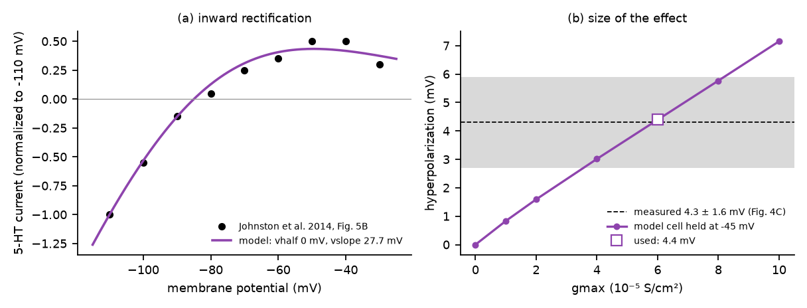

# A 5-HT-specific mechanism: 5-HT1A → Kir3 (GIRK) on the + cells (report of 2026-11-26)

Follow-up to [the layout-B results](LAYOUT_B_RESULTS_2026-11-26.md). Until now DA and 5-HT were the same mechanism on
different cells: each gated PRP synthesis in its own pattern through the synthesis trigger, with the same parameters.
This report adds the first effect that only 5-HT has, taken from a CA3 measurement, and calibrates it to that paper.
Commits: d2d59ed (mechanism), f639f35 (calibration).

## Summary

| # | Question | Answer |
| --- | --- | --- |
| 1 | Which 5-HT effect is added? | In CA3 pyramidal cells, 5-HT acts through 5-HT1A receptors to open Kir3 (GIRK) K⁺ channels. The cells hyperpolarize and fire less; PV basket cells are not affected (Johnston et al. 2014) |
| 2 | How is it calibrated? | Rectification is fitted to the measured I-V (vhalf 0 mV, vslope 27.7 mV relative to E_K). gmax = 6 × 10⁻⁵ S/cm² gives 4.4 mV of hyperpolarization near −45 mV, against the measured 4.3 ± 1.6 mV |
| 3 | When is it on? | In the + cells while 5-HT is present: from the encoding of + (2.6 s) for 10 min. It is off in every replay epoch, the first of which starts at 0.5 h |
| 4 | Does it change encoding? | **No.** The + cells fire at 90 Hz with and without it, and the tags of every synapse class at the end of encoding agree to 0.001. The 100 Hz mossy-fibre drive overrides a 4–6 mV hyperpolarization |
| 5 | What about the 8-h weights? | The 15 runs (5 seeds × control, PRP block, no replay) are still going. Given item 4, they are expected to match the layout-B results; section 5 will be filled in when they finish |
| 6 | Is the PRP gate of 5-HT changed? | No. Its only STC source is in CA2, where 5-HT makes weak LTD last through BDNF/TrkB (Benoy et al. 2022). That fits a gate on synthesis, but it acts on LTD tags, and this protocol sets only positive tags |

## 1. The mechanism

Johnston, McBain & Fisahn (2014, J Physiol 592:4187, [doi:10.1113/jphysiol.2014.279083](https://doi.org/10.1113/jphysiol.2014.279083)),
mouse and rat ventral hippocampal slices, 32 °C, kainate-induced gamma oscillations, 10 µM 5-HT:

| Measurement | Value | Where |
| --- | --- | --- |
| Pyramidal cell membrane potential | hyperpolarized by 4.3 ± 1.6 mV (median −48.8 → −49.5 mV), n = 14; absent in 5-HT1A⁻/⁻ mice and with NAD 299 | Fig. 4C |
| Pyramidal cell firing (cell-attached) | 5.0 → 1.9 Hz (medians), n = 8 | Fig. 4D |
| 5-HT-induced current | inwardly rectifying, reverses near E_K (−85 mV); rectification index −0.62 (median), n = 9 | Fig. 5A–D |
| Kir3 block (tertiapin-Q) | no hyperpolarization, no change in firing | Fig. 5F |
| PV basket cells | membrane potential and firing unchanged, n = 6 | Fig. 3 |
| EPSCs and IPSCs onto pyramidal cells | EPSC frequency falls; IPSC frequency does not | Fig. 2 |
| Time to full effect | about 5 min | Fig. 1A |

Model (`neuron/ch_GIRK.mod`), inserted in the soma and dendrite of every pyramidal cell with gmax = 0; none in basket
cells:

```latex
i_{GIRK} = \frac{g_{max}\,(v - E_K)}{1 + \exp\!\left(\frac{v - E_K - v_{half}}{v_{slope}}\right)}
```

`run_pilot.py --ht-girk 6e-5` sets gmax in the + cells (MOD_CELLS["5-HT"]) while 5-HT is on: a step at the 5-HT onset
inside the encoding block, and a per-block value in replay blocks. Output files get the suffix `_girk`.

## 2. Calibration



**Figure G1.** `girk_calibration.py`, values in `results/layout_B/girk_calibration.json`.

- **(a) Rectification.** A least-squares fit to the points of Fig. 5B (read from the plot) gives vhalf = 0 mV and
  vslope = 27.7 mV relative to E_K. The fit is within about 0.1 of every point. Its rectification index is −0.41,
  inside the measured range (median −0.62, quartiles −0.69 to −0.17).
- **(b) Size.** The paper measured 4.3 mV in active cells sitting near −49 mV. The model cell is held at −45 mV with
  0.08 nA, just below threshold, and gmax = 6 × 10⁻⁵ S/cm² gives 4.4 mV there (2.8 mV at rest, −63 mV).
- **Firing is not fitted.** The model cell switches from silence to about 10 Hz at threshold, so it cannot reproduce a
  5.0 → 1.9 Hz change. Above threshold, at 0.1 nA, the calibrated current silences it (15.5 Hz → 0).
- **Not modelled:** the onset of about 5 min (the conductance switches on at once), and the fall in EPSC frequency,
  which in the slice follows from the quieter pyramidal cells.

A first, uncalibrated version (1.5 × 10⁻⁴ S/cm², vhalf 15 mV, vslope 10 mV, about 6 mV) was replaced before any
result was kept; its 15 runs were stopped and restarted.

## 3. Effect on encoding

Encoding block only, seed 1 (`TINYCA3_LAYOUT=B`), with the current off and on:

| Readout | GIRK off | GIRK on (6 × 10⁻⁵ S/cm²) |
| --- | --- | --- |
| Rate of + cells while + is encoded (Hz) | 90 | 90 |
| Rate of + cells while X∪+ is encoded (Hz) | 90 | 90 |
| Rate of X cells while X∪+ is encoded (Hz) | 90.8 | 90.8 |
| Tag T̃ at the end of encoding, class X | 0.632 | 0.632 |
| Tag T̃ at the end of encoding, class + | 0.638 | 0.638 |
| Tag T̃ at the end of encoding, class X→+ | 0.553 | 0.553 |
| Tag T̃ at the end of encoding, class +→X | 0.557 | 0.557 |
| Tag T̃ at the end of encoding, class = | 0.452 | 0.452 |
| Tag T̃ at the end of encoding, class ‖ | 0.461 | 0.461 |
| Tag T̃ at the end of encoding, class =→‖ | 0.348 | 0.348 |
| Tag T̃ at the end of encoding, class ‖→= | 0.352 | 0.353 |
| Tag T̃ at the end of encoding, class none | 0.262 | 0.263 |

Both runs use the same noise stream, so the differences are real but tiny: at most 0.0006 (class ‖). They are spread
over the network, with none larger in the + classes. The first version (about 6 mV) gave the same result.

The + cells are driven by the mossy fibres at 100 Hz (w_mf = 0.35, AMPA). That drive is far above threshold, so a
few millivolts of extra K⁺ current changes neither their spike count nor the calcium that sets the tags. The
paper's effect is on weak, spontaneous firing (5 → 1.9 Hz), not on strongly driven firing.

## 4. Runs

| Condition | Command (`TINYCA3_LAYOUT=B`) | Files in `results/layout_B/seeds/` |
| --- | --- | --- |
| Control | `run_pilot.py --seed S --light --mod-min 10 --gate 30 --ht-girk 6e-5` | `pilot_s{1..5}_mod10_gate30_girk.pkl` |
| PRP block | the same plus `--prp-block` | `pilot_s{1..5}_mod10_gate30_prpblock_girk.pkl` |
| No replay | the same plus `--no-replay` | `pilot_s{1..5}_mod10_gate30_norep_girk.pkl` |

Readout: `class_stats.py --girk` (`class_stats_girk.json`, `fig_B1_classes_girk.png`), compared with the runs
without the current in [the layout-B report](LAYOUT_B_RESULTS_2026-11-26.md).

## 5. Results at 8 h

Pending: the runs started on 2026-11-26 and take about 3 hours.

## 6. What this means, and next steps

With this protocol, 5-HT1A–GIRK is silent where it is switched on. During encoding the drive is too strong for it.
During replay 5-HT is already off. That fits the low firing of raphe 5-HT neurons in slow-wave sleep, when sharp waves
occur, though that is not yet sourced here. A 5-HT effect would show where the paper found it: in weak, spontaneous activity. Options:

- [ ] Weaker encoding of + (fewer or slower mossy-fibre pulses), so that 5-HT1A can lower firing and the tags.
- [ ] Spiking background between events, so that a long 5-HT release can lower the background calcium and tags.
- [ ] An LTD protocol for the + pattern, to test the CA2 result (5-HT makes weak LTD last; Benoy et al. 2022).
- [ ] The slow onset (about 5 min) and the fall in EPSC frequency, if a weaker-drive protocol makes them matter.
