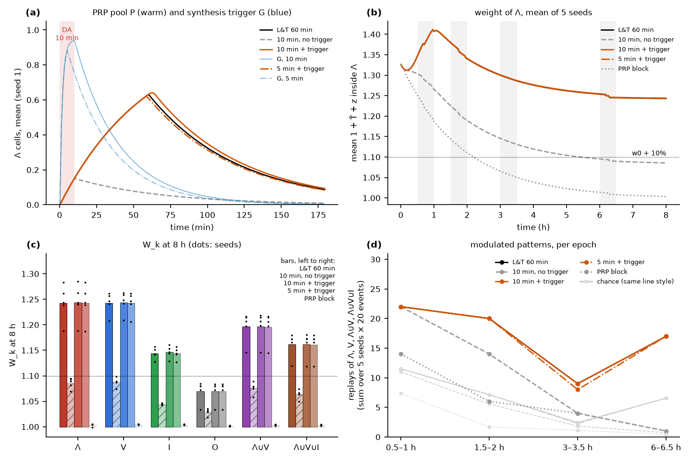

# Synthesis trigger: DA and 5-HT for minutes (report of 2026-11-24)

Follow-up to [RESULTS_2026-11-17.md](RESULTS_2026-11-17.md), section 9. The protocol is in
[PROTOCOL.md](PROTOCOL.md). Figure numbering continues from the earlier reports.

## Summary

- **Problem.** Until now DA (onto the Λ cells) and 5-HT (onto the V cells) stayed on for 60 min. Released DA and
  5-HT act for minutes. In the L&T model the modulator sets the PRP synthesis threshold only while it is present, so
  a 10-min modulator gives a third of the capture and no pattern stays above 1.10 × w0 (report section 9).
- **Change.** The modulator no longer sets the threshold directly. It switches on a per-cell **synthesis trigger** G,
  the receptor → cAMP/PKA → translation step. G outlasts the modulator and decays with τ_G = 30 min.
- **Result.** With DA and 5-HT released for 10 min (or 5 min), the model consolidates as it did with the 60-min
  pulse:
  - z of Λ at 8 h is 0.243 (10 min) and 0.241 (5 min), against 0.242;
  - every pattern weight is within 0.003 of the 60-min value;
  - 398 of the 400 replay events (5 seeds × 80) have exactly the same active cells.
- **Consequence.** Sections 3–8 of the report stand. The 60-min pulse was in effect the synthesis window. The
  bio-plausible protocol from now on is a 10-min release with the trigger (`--mod-min 10 --gate 30`).

## 1. Model change

The PRP pool of cell j follows L&T 2021 (Eq. 15) and Lehr et al. 2022 (Eq. 10), with the modulator M_j replaced by
the trigger G_j:

```
τ_P dP_j/dt = −P_j + α_P · Θ[ Σ_s→j |T̃_s| − θ_pro(G_j) ],   θ_pro(G) = θ0 / (G + 0.001)
    dG_j/dt = M_j (1 − G_j) / τ_on − G_j / τ_G
```

| Parameter | Value | Status |
|---|---|---|
| Release time of DA and 5-HT, D_M | 10 min (5 min as a check) | Bio-plausible: phasic release lasts under a second; the receptor and cAMP/PKA signalling lasts minutes. A 5-min novel environment is enough for behavioural tagging (Moncada & Viola 2007) |
| τ_on (rise of G while the modulator is on) | 2 min | Free |
| τ_G (decay of G after the modulator) | 30 min | Free, chosen so that synthesis lasts about an hour, as the protein-synthesis window after L-LTP induction does. The sweep below shows the effect of the choice |
| τ_P, α_P, θ0 | 60 min, 1, 0.5 | Unchanged (L&T 2021) |

While the modulator is on, G rises towards τ_G / (τ_G + τ_on) = 0.94 within a few minutes. When it stops, G decays.
PRPs are made as long as the tag sum of the cell exceeds θ0 / G. G falls and the tags decay at the same time, so
synthesis ends when the two meet: about 68 min after onset for a 10-min release (sweep below). With τ_G = 0 the model
is the L&T form, with θ_pro following M directly.

Code: `stc.py` (`STCParams.tau_G_min`, `tau_on_min`; `advance` integrates G exactly over each 10-s step) and
`run_pilot.py --gate TAU`.

## 2. Offline sweep: release time and τ_G

No replay. Starting from the end-of-encoding tags of each seed, the model is integrated for 8 h. Means of 5 seeds,
from `trigger_stats.py`.

| Release | τ_G | Synthesis ends (min) | z of Λ at 8 h | z of V | z of I |
|---|---|---|---|---|---|
| 60 min | — (L&T) | 60 | 0.268 | 0.272 | 0.151 |
| 10 min | — (L&T) | 10 | 0.084 | 0.085 | 0.041 |
| 5 min | — (L&T) | 5 | 0.044 | 0.044 | 0.021 |
| 10 min | 15 min | 42 | 0.236 | 0.238 | 0.128 |
| **10 min** | **30 min** | **68** | **0.272** | **0.276** | **0.155** |
| 10 min | 45 min | 90 | 0.273 | 0.279 | 0.158 |
| 10 min | 60 min | 107 | 0.273 | 0.279 | 0.158 |
| 5 min | 30 min | 63 | 0.269 | 0.273 | 0.152 |
| 2 min | 30 min | 57 | 0.257 | 0.260 | 0.141 |

- **With the trigger, the release time hardly matters.** 2, 5 and 10 min of DA give z = 0.26–0.27.
- **Capture saturates at τ_G ≈ 30 min.** Longer synthesis windows add nothing, because by then the tags are below the
  capture threshold (|T̃| < 0.2). Shorter ones lose capture: τ_G = 15 min gives 0.236.
- **The no-replay value of the 60-min pulse (0.268) is reproduced,** as in section 5 of the report.

## 3. Full runs with replay, 5 seeds

The protocol of [PROTOCOL.md](PROTOCOL.md): encoding, then four replay epochs of 20 events at 0.5, 1.5, 3 and 6 h,
readout at 8 h. Seeds 1–5.

| Condition | Flags | Output |
|---|---|---|
| L&T 60 min | — | `pilot_s{1..5}.pkl` (report of 2026-11-17) |
| 10 min, no trigger | `--mod-min 10` | `pilot_s{1..5}_mod10.pkl` (report section 9) |
| **10 min + trigger** | `--mod-min 10 --gate 30` | `pilot_s{1..5}_mod10_gate30.pkl` |
| 5 min + trigger | `--mod-min 5 --gate 30` | `pilot_s{1..5}_mod5_gate30.pkl` |
| PRP block | `--prp-block` | `pilot_s{1..5}_prpblock.pkl` (report section 8) |



**Figure 14.** The synthesis trigger.

- **(a)** Mean PRP pool P (warm colours) and trigger G (blue) in the Λ cells, seed 1, first 3 h. The red band is the
  10-min DA release. Without the trigger (grey dashed), P stops rising when DA stops. With it, G stays high for
  tens of minutes and P follows the 60-min curve (black).
- **(b)** Mean 1 + T̃ + z inside Λ, mean of 5 seeds. The three curves with an hour of synthesis lie on top of each
  other. Grey bands are the replay epochs.
- **(c)** W_k at 8 h per pattern; bars in the order of the legend, dots are seeds.
- **(d)** Replays of Λ, V, Λ∪V and Λ∪V∪I per epoch, summed over 5 seeds. Grey: chance, in the same line style.

**Weights at 8 h** (mean of 5 seeds, range in brackets):

| | L&T 60 min | 10 min, no trigger | 10 min + trigger | 5 min + trigger | PRP block |
|---|---|---|---|---|---|
| PRP pool P, max | 0.63 | 0.15 | 0.67 | 0.64 | 0 |
| z of Λ | 0.242 | 0.082 | 0.243 | 0.241 | 0 |
| z of V | 0.241 | 0.083 | 0.242 | 0.240 | 0 |
| W of Λ | 1.243 (1.19–1.28) | 1.086 | 1.244 (1.19–1.29) | 1.243 (1.19–1.28) | 1.004 |
| W of V | 1.243 (1.21–1.26) | 1.087 | 1.244 (1.21–1.26) | 1.242 (1.21–1.26) | 1.005 |
| W of I | 1.144 | 1.044 | 1.147 | 1.144 | 1.004 |
| W of O | 1.070 | 1.029 | 1.070 | 1.070 | 1.002 |
| Seeds with Λ and V above 1.10 × w0 | 5/5 | 0/5 | 5/5 | 5/5 | 0/5 |

**Replays of the modulated patterns per epoch** (observed / chance, 5 seeds):

| Epoch | L&T 60 min | 10 min, no trigger | 10 min + trigger | 5 min + trigger | PRP block |
|---|---|---|---|---|---|
| 0.5–1 h | 22 / 11.5 | 22 / 11.0 | 22 / 11.5 | 22 / 11.5 | 14 / 7.3 |
| 1.5–2 h | 20 / 7.1 | 14 / 5.6 | 20 / 7.1 | 20 / 7.1 | 6 / 1.7 |
| 3–3.5 h | 9 / 2.4 | 4 / 1.8 | 9 / 2.4 | 8 / 2.2 | 4 / 1.1 |
| 6–6.5 h | 17 / 6.6 | 1 / 0.7 | 17 / 6.5 | 17 / 6.5 | 1 / 0.5 |

**Findings.**

- **The trigger restores consolidation.** With a 10-min release, z and W of every pattern are within 0.003 of the
  60-min values, in every seed. All patterns except O stay above 1.10 × w0 at 8 h in 5/5 seeds.
- **The PRP pool peaks slightly higher** (0.67 against 0.63) and synthesis ends a few minutes later (about 68 min
  instead of 60), because G decays smoothly rather than switching off. This shifts z by less than 0.001.
- **Replay is unchanged.** 398 of 400 events have the same active cells as with the 60-min pulse (397 for the 5-min
  release). Without the trigger, 104 of 400 differ. The replay counts per epoch, the per-event significance (Λ 4,
  Λ∪V 2, Λ∪V∪I 3, I 2 significant events) and the single burst (seed 1) are the same.
- **The release time no longer matters.** 5 and 10 min give the same result.
- **The PRP block is unaffected.** With α_P = 0 no PRPs are made whatever the trigger does, so section 8 holds as it
  is.

## 4. What this means

1. **The results of 2026-11-17, sections 3–8, stand.** Their 60-min modulator pulse is equivalent to a 10-min release
   followed by a 30-min synthesis trigger.
2. **The model now separates two time scales that biology separates.** The release of DA and 5-HT lasts minutes.
   The synthesis state it triggers lasts about an hour. The PRPs last longer still (τ_P = 60 min).
3. **τ_G is the free parameter that matters.** Between 30 and 60 min it changes nothing here; below about 20 min
   capture drops. It is not measured for CA3.
4. **The replay-DA experiments need rerunning.** Sections 6 and 7 of the report (DA released by replay of Λ, 10 min)
   used the L&T form, so that DA opened a 10-min synthesis window. With the trigger it opens about an hour. Section 7
   concluded that replay DA cannot replace DA at encoding because the tags decay before PRPs build up. This should be
   checked with `--gate 30`.

**Status.** Pilot, hand-calibrated weights, 5 seeds. The bio-plausible protocol is `--mod-min 10 --gate 30`. The code
default stays the L&T form (60 min, no trigger) so that earlier runs keep their file names.

**Files.** `stc.py`, `run_pilot.py` (`--gate`), `trigger_stats.py`, `results/trigger_stats.json`,
`results/fig_trig_14_synthesis_trigger.png`, `results/seeds/pilot_s{1..5}_mod10_gate30.pkl` and
`_mod5_gate30.pkl`.
