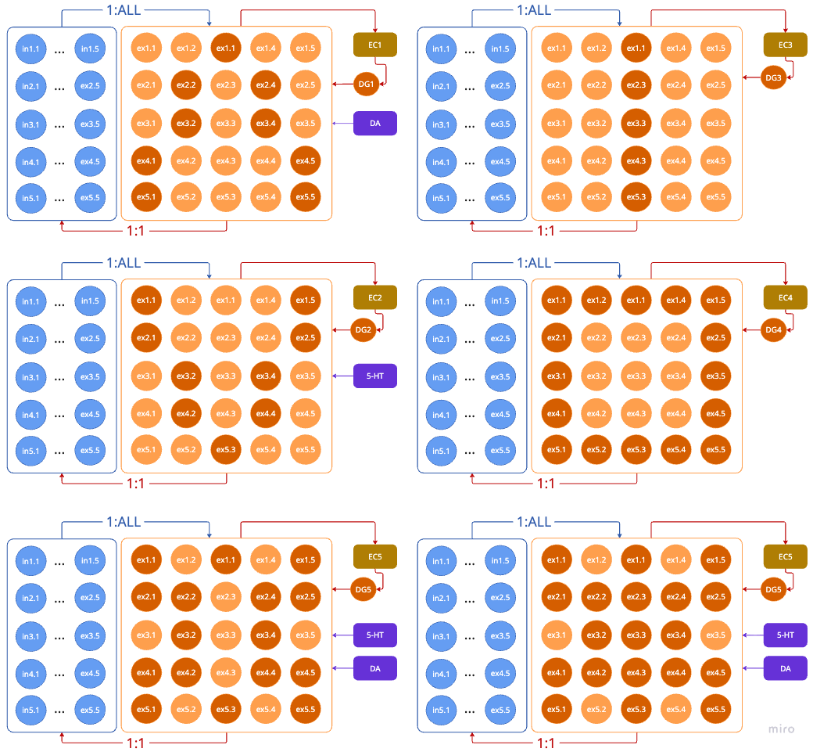
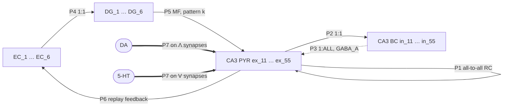

# tinyCA3: architecture of the basic circuit

Nov 11, 2026 · Max Talanov

## The main idea

tinyCA3 is a heavily simplified CA3 auto-associative network used to test synaptic tagging and capture in a recurrent circuit. It has 25 pyramidal cells connected all-to-all in both directions, and 25 basket cells that give global feedback inhibition. Entorhinal (EC) and dentate gyrus (DG) inputs select which pyramidal cells fire together. Dopamine (DA) and serotonin (5-HT) projections mark some of these patterns, so that only their recurrent synapses can turn a tag into a lasting weight. A CA3 → EC projection closes the loop and lets stored patterns be replayed.

The plasticity rules come from the [up/down-scaling model of November 2026](https://github.com/max-talanov/tinyHippo-bio-plasticity/blob/main/docs/plasticity_up_down_model_2026-11-06.md) (here called *the plasticity model*). That model is one CA1 pyramidal cell; tinyCA3 carries its three levels (release, tag, stored weight) over to the CA3 recurrent synapses. Like the plasticity model, tinyCA3 is a specification: nothing below is built yet.



**Figure 1.** The basic circuit, shown six times with a different pattern selected in each panel. Blue: basket cells; orange: pyramidal cells, dark orange when the pattern recruits them. Each panel shows one EC → DG pair and, where present, the neuromodulatory source. The six panels show one network, not six.

## Acronyms and abbreviations

| Term | Meaning |
| --- | --- |
| 5-HT | Serotonin (5-hydroxytryptamine) |
| BC | Basket cell (fast-spiking, perisomatic inhibitory interneuron), `in_ij` |
| CA3 | Cornu Ammonis area 3 |
| DA | Dopamine |
| DG | Dentate gyrus; here one granule-cell unit per pattern, `DG_k` |
| EC | Entorhinal cortex; here one input unit per pattern, `EC_k` |
| MF | Mossy fibre (DG → CA3) |
| PRP | Plasticity-related protein |
| PYR | CA3 pyramidal cell, `ex_ij` |
| RC | Recurrent collateral (CA3 PYR → CA3 PYR) |
| SWR | Sharp-wave ripple |
| T, P, w_cap | Tag, PRP pool and captured weight, Eqs. 3–4 of the plasticity model |
| TM | Tsodyks–Markram short-term plasticity synapse (`TMSyn`) |

## Populations

The network has 64 units in five groups (Table 1). Cells are indexed by their place in the 5 × 5 grid: `ex_ij` and `in_ij`, with row i and column j from 1 to 5.

**Table 1.** Populations of the basic circuit.

| Population | Count | Index | Type | Role |
| --- | --- | --- | --- | --- |
| CA3 pyramidal cells | 25 | `ex_11` … `ex_55` | Excitatory | Store patterns in their recurrent synapses |
| CA3 basket cells | 25 | `in_11` … `in_55` | Inhibitory (GABA_A) | Feedback inhibition, one per pyramidal cell |
| EC units | 6 | `EC_1` … `EC_6` | Excitatory input | Trigger one pattern each; receive replay feedback |
| DG units | 6 | `DG_1` … `DG_6` | Excitatory, detonator-like | Impose one pattern each on CA3 |
| Neuromodulatory sources | 2 | `DA`, `5-HT` | Volume transmission | Gate tagging and capture in their patterns |

**Notes on the figure labels.** Some labels in the figure are drawing slips; the model uses the grid position, not the label.

- In row 1, the third pyramidal cell is labelled `ex1.1`; it is `ex_13`.
- The basket-cell column shows `in1.1 … in1.5`, then `in2.1 … ex2.5` and so on. Each basket block holds 25 cells `in_11` … `in_55`; the `ex` labels on the right are slips.
- The bottom-right panel is labelled `EC5`/`DG5`, the same as the bottom-left one, although it shows a different pattern. It is read here as `EC_6`/`DG_6`.

## Projections

There are seven projection types (Table 2, Figure 2). All synapses are Tsodyks–Markram (`TMSyn`), as in the plasticity model, so the release level (U1, U2, D1) is present in every pathway from the start.

**Table 2.** Projections of the basic circuit.

| # | Projection | Rule | Synapses | Sign | Plastic | In the figure |
| --- | --- | --- | --- | --- | --- | --- |
| P1 | PYR → PYR (RC) | All-to-all, both directions, no autapses | 25 × 24 = 600 | + | Yes: release, tag, capture | Implied by the pattern grid (point 1 of the brief) |
| P2 | PYR → BC | 1:1, `ex_ij → in_ij` | 25 | + | Release only | Red arrow, "1:1" |
| P3 | BC → PYR | 1:ALL, `in_ij →` every `ex_kl` | 25 × 25 = 625, or 600 without self-inhibition | − | Release only | Blue arrow, "1:ALL" |
| P4 | EC_k → DG_k | 1:1 per pattern | 6 | + | No | Red arrow EC → DG |
| P5 | DG_k → PYR (MF) | DG_k → every cell of pattern k | 9 to 19 per pattern (Table 3) | + | No | Red arrow DG → CA3 |
| P6 | PYR → EC (replay feedback) | Pattern k → EC_k (proposed) | One per cell per pattern it belongs to | + | No | Red arrow CA3 → EC |
| P7 | DA, 5-HT → P1 synapses | Volume signal onto the synapses inside the modulated pattern | Not synaptic; a scalar per synapse | Modulatory | Gates tag and capture | Purple arrows into CA3 |



**Figure 2.** Projections of the basic circuit. Solid: excitatory; dotted: inhibitory; thick: neuromodulatory.

### P1: auto-associative recurrent collaterals

Every pyramidal cell excites every other one, in both directions, which gives the network its auto-associative memory. A pattern is stored as raised weights on the n(n − 1) synapses among its n cells. A partial cue then recruits the rest of the pattern through these synapses (pattern completion). All 600 synapses start at the same baseline weight w_0, so before learning no pattern is preferred. P1 is the only plastic pathway, and it carries the full chain of the plasticity model (see *Plasticity*).

### P2 and P3: global feedback inhibition

Each pyramidal cell drives its own basket cell (1:1), and each basket cell inhibits all pyramidal cells (1:ALL). Every active pyramidal cell therefore inhibits the whole population, in proportion to how many cells are active. This works as a soft k-winners-take-all: it limits how many cells can fire together, stops completion from spreading to the whole grid, and makes overlapping patterns compete.

The brief says the inhibition reaches "all other" pyramidal cells, while the figure says 1:ALL. The model keeps both as one switch, `self_inhibition`, off by default: `in_ij` then contacts the 24 cells other than `ex_ij`. P2 and P3 are not plastic; their short-term dynamics follow the PYR → PV and PV → PYR parameters of the plasticity model until CA3 values are found.

### P4 and P5: pattern selection by EC and DG

A pattern k is presented by driving `EC_k`, which drives `DG_k`, which fires every pyramidal cell of pattern k through strong mossy-fibre synapses. DG is therefore the teacher: it decides which cells fire together during learning, and so which recurrent synapses are co-activated and can be tagged. The mossy-fibre weight is set so that one DG volley is enough to fire its target cells, even against the feedback inhibition.

The figure has no direct EC → CA3 (perforant-path) projection. It is left out on purpose: here EC reaches CA3 only through DG. A direct path, needed for recall from a weak cue, is a later extension.

### P6: CA3 → EC feedback for replay

The CA3 block projects back to EC, which closes the loop CA3 → EC → DG → CA3. A pattern reactivated in CA3, from a partial cue or spontaneously, re-drives its own EC unit and so is presented again. This repeated reactivation is the circuit form of replay (U7 in the plasticity model), which there entered only as an imposed input.

The figure draws one arrow from the whole CA3 block to EC, so the mapping is not fixed by it. The proposed rule is pattern-specific: the cells of pattern k project to `EC_k`, and `EC_k` fires only when enough of them are active (threshold θ_EC). The alternative, all cells to all EC units, would let any activity re-trigger every pattern. The loop gain must stay below runaway; the feedback inhibition and the threshold θ_EC are the two controls.

## The six patterns

DG selects six patterns on the 5 × 5 grid (Table 3, Figure 3). They are built from four basic shapes: Λ, V, a vertical bar I and a square frame O. Patterns 5 and 6 are unions of the basic ones. The shapes below are read from the figure; `#` marks a recruited cell.

**Table 3.** The six patterns: cells, size, recurrent synapses inside the pattern and neuromodulation.

| k | Shape | Cells | n | Synapses n(n − 1) | Modulator |
| --- | --- | --- | --- | --- | --- |
| 1 | Λ | 13; 22, 24; 32, 34; 41, 45; 51, 55 | 9 | 72 | DA |
| 2 | V | 11, 15; 21, 25; 32, 34; 42, 44; 53 | 9 | 72 | 5-HT |
| 3 | I (column 3) | 13, 23, 33, 43, 53 | 5 | 20 | None |
| 4 | O (border) | rows 1 and 5, columns 1 and 5 | 16 | 240 | None |
| 5 | Λ ∪ V | union of patterns 1 and 2 | 16 | 240 | DA and 5-HT |
| 6 | Λ ∪ V ∪ I | union of patterns 1, 2 and 3 | 19 | 342 | DA and 5-HT |

```text
 1  Λ  +DA     2  V  +5-HT    3  I          4  O          5  Λ∪V  +DA+5-HT   6  Λ∪V∪I  +DA+5-HT
 . . # . .     # . . . #      . . # . .     # # # # #     # . # . #          # . # . #
 . # . # .     # . . . #      . . # . .     # . . . #     # # . # #          # # # # #
 . # . # .     . # . # .      . . # . .     # . . . #     . # . # .          . # # # .
 # . . . #     . # . # .      . . # . .     # . . . #     # # . # #          # # # # #
 # . . . #     . . # . .      . . # . .     # # # # #     # . # . #          # . # . #
```

**Figure 3.** The six patterns on the grid, rows 1 to 5 from the top.

**Overlaps.** The patterns share cells, so they share recurrent synapses and compete through the inhibition.

- Λ and V share `ex_32` and `ex_34`; the two synapses between these cells belong to both patterns and receive both DA and 5-HT.
- I shares `ex_13` with Λ and `ex_53` with V.
- O shares 5 cells with Λ (13, 41, 45, 51, 55) and 4 with V (11, 15, 21, 25).

**Mapping of the modulators.** DA modulates the Λ pattern (panel EC1) and 5-HT the V pattern (panel EC2), as drawn in the figure. Patterns 5 and 6 contain both shapes and receive both modulators.

## Plasticity

### What each level does in the circuit

The plasticity model has three nested levels. In tinyCA3 all three act on the recurrent synapses (P1); every other pathway has the release level only.

1. **Release (ms to s).** Every synapse is a `TMSyn` with facilitation u and resources x (Eq. 1 of the plasticity model). Depletion (D1) limits how long a pattern can sustain itself through P1, and depressing BC → PYR synapses weaken the inhibition during long bursts.
2. **Tag (minutes to hours).** A P1 synapse `ex_ij → ex_kl` is tagged when both cells fire together within the coincidence window, which in practice means when both belong to the pattern DG is presenting. The tag T rises with the segment signal g_Ca (Eq. 2) and decays with τ_tag (Eq. 4).
3. **Stored weight (hours and longer).** A tag becomes lasting weight only if PRPs are available while it lasts (Eqs. 3 and 4). In tinyCA3 the neuromodulators set that availability (next section).

The stored weight of one recurrent synapse enters each spike as in Eq. 16 of the plasticity model:

```math
\Delta g_n = \big[\,w_0 + \alpha\,\big(T(t_n) + w_{cap}(t_n)\big)\,\big] \cdot A_n \qquad (1)
```

### Neuromodulation as the PRP gate

The plasticity model leaves the PRP trigger open, and names strong input with dopamine D1/D5 signalling as the candidate (its limit 4; Huang & Kandel 1995; Moncada & Viola 2007). tinyCA3 makes this the rule: tagging is set by co-activity alone, but capture needs a neuromodulatory signal at the synapse.

Each source m ∈ {DA, 5-HT} releases a scalar signal M_m(t) during the presentation of its patterns. It reaches the P1 synapses whose two cells both belong to a pattern that m modulates; this set is S_m. The proposed form makes M_m the protein-synthesis gate s(t) of the plasticity model, separately for each source:

```math
\frac{dP_j}{dt} = -\frac{P_j}{\tau_P} + \Delta P \sum_{m} \kappa_m\, M_m(t)\, \mathbb{1}[\,j \in S_m\,] \quad \text{(proposed)} \qquad (2)
```

Here j is a recurrent synapse (or the dendritic compartment that holds it), and κ_m scales each source. Capture then runs as in Eq. 4 of the plasticity model, with h(P_j). Three consequences follow:

- Synapses of Λ capture only with DA, and synapses of V only with 5-HT. The two synapses between `ex_32` and `ex_34` receive both.
- Synapses of I and O are tagged when their patterns are presented but get no PRPs of their own, so their tags decay (D8). They are the unmodulated controls.
- DA and 5-HT may act through different pathways and with different strengths; κ_DA and κ_5HT are set apart. The model makes no claim about a specific 5-HT receptor: 5-HT here is a second, independent gate, and its biology must be sourced before any parameter is fixed.

The alternative reading, that the modulator also sets or scales the tag itself, is kept as a switch (`modulate_tag`) to compare against.

### What the six patterns test

Read this way, the patterns form a small experiment (Table 4).

**Table 4.** Expected outcome per pattern under Eq. 2, with tagging by co-activity and capture gated by the modulator.

| k | Pattern | Tag | PRPs | Expected stored weight | What it tests |
| --- | --- | --- | --- | --- | --- |
| 1 | Λ | Yes | DA | Captured | Capture with DA |
| 2 | V | Yes | 5-HT | Captured | Capture with 5-HT |
| 3 | I | Yes | None | Decays to w_0 | Tag without capture |
| 4 | O | Yes | None | Decays to w_0 | Same, with a large pattern that overlaps Λ and V |
| 5 | Λ ∪ V | Yes | DA and 5-HT | Captured, including the synapses between Λ and V cells | Joint modulation; synapses linking the two halves |
| 6 | Λ ∪ V ∪ I | Yes | DA and 5-HT | Λ and V captured; I captured only if PRPs are shared | Whether an unmodulated input can capture from modulated neighbours |

Pattern 6 is the key case. If PRPs are local to each synapse, the I synapses stay uncaptured, as in pattern 3. If PRPs are shared within a compartment, as in the Frey–Morris design (point 7 of the plasticity model), the I synapses that share compartments with modulated ones capture as well. With a limited pool (D9, Eq. 11 of the plasticity model), they compete with Λ and V instead. Pattern 6 therefore separates these three PRP-pool hypotheses.

### Replay and selection

Replay through P6 reactivates stored patterns while their tags are still alive. In the plasticity model, replay may both store and select (its point 8): what is replayed is captured, and the rest is depressed (D3, Eq. 12). In tinyCA3 this becomes testable in a closed loop. A strongly captured pattern completes from a partial cue, re-drives its EC unit and is replayed; an uncaptured one does not. If SWR-triggered depression (D3) is added, the synapses of patterns that are not replayed, such as I and O, are weakened, so selection is a result of the circuit and not an imposed rule.

## Limits and open choices

1. **Scale.** 25 pyramidal cells and 25 basket cells cannot show population effects, real sharp-wave ripples or the sparse coding of CA3. Capacity results do not carry over.
2. **One basket cell per pyramidal cell.** Real CA3 has far fewer basket cells than pyramidal cells. The 1:1 / 1:ALL scheme is a convenient global inhibition, not an anatomical claim.
3. **Pattern 6 label.** Panel 6 is labelled `EC5`/`DG5` in the figure and is read as `EC_6`/`DG_6`.
4. **Self-inhibition.** 1:ALL in the figure against "all other" in the brief; kept as a switch, off by default.
5. **Replay mapping.** The figure fixes only that CA3 projects to EC. The pattern-specific rule and θ_EC are proposals.
6. **No perforant path.** EC reaches CA3 only through DG, so recall from EC without DG is not possible yet.
7. **PRP gate.** Eq. 2 is our proposal. DA as a PRP trigger has support (Moncada & Viola 2007); the role given to 5-HT has no source in this document yet.
8. **Inherited gaps.** All the limits of the plasticity model hold here: one tag type, no upper bound on w_cap, unsourced α, k_cap, n_H, τ_P, and the STP parameters taken from CA1 and rat data rather than CA3.

## Sources

The plasticity levels, equations and pathway numbers (U1–U8, D1–D13, Eqs. 1–16) come from [`plasticity_up_down_model_2026-11-06.md`](https://github.com/max-talanov/tinyHippo-bio-plasticity/blob/main/docs/plasticity_up_down_model_2026-11-06.md) in [max-talanov/tinyHippo-bio-plasticity](https://github.com/max-talanov/tinyHippo-bio-plasticity); references cited here by author and year are listed there. The circuit and patterns come from [`figs/CA3_basic_circuit.png`](figs/CA3_basic_circuit.png); the patterns were read from the pixel colours of the figure.
