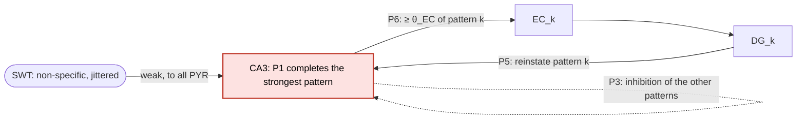
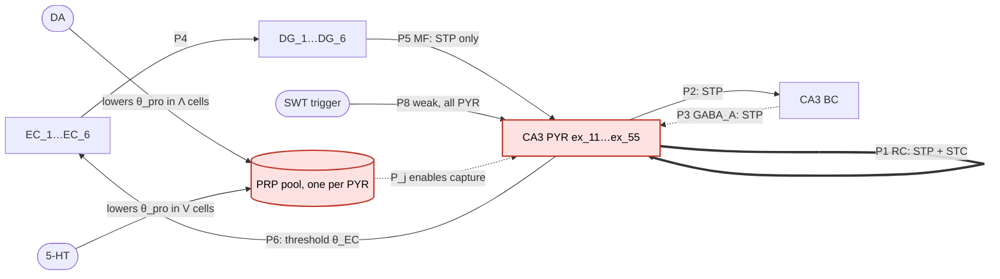
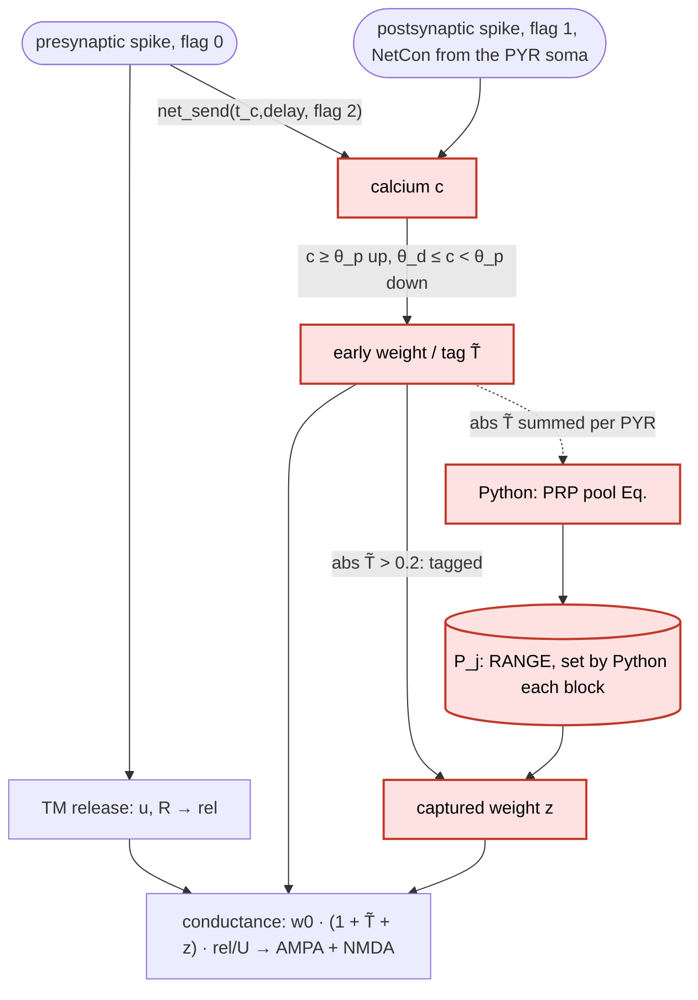
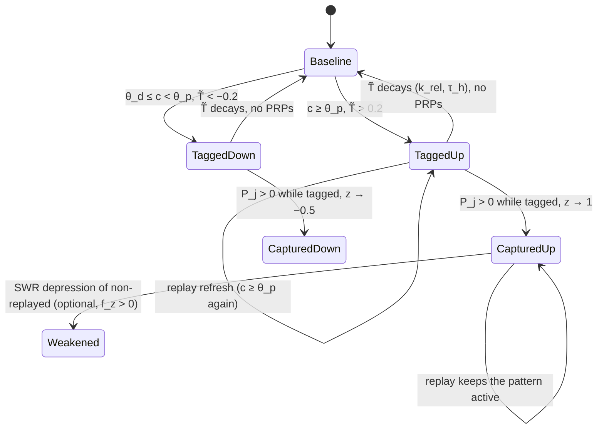
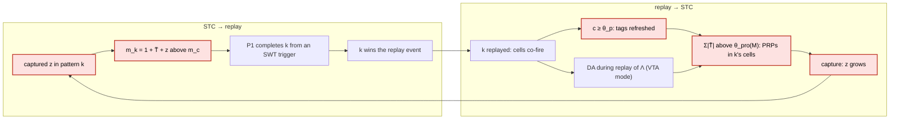
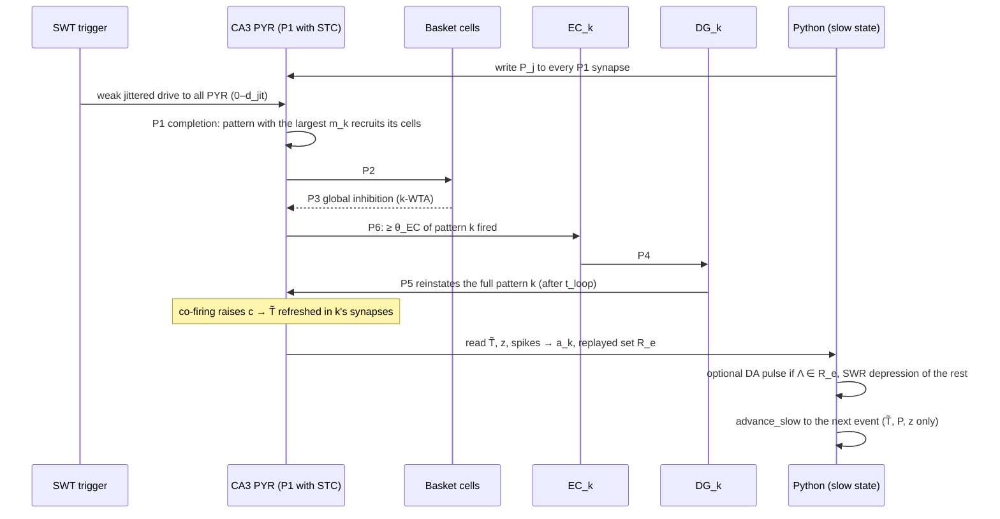

# tinyCA3 implementation plan: STP, tag/capture and replay

Nov 16, 2026

## The main idea

This plan builds the circuit of [ca3_basic_circuit_architecture.md](ca3_basic_circuit_architecture.md)
("the architecture doc") in NEURON, in four layers:

1. **Cells and static wiring.** All cells are Hodgkin–Huxley-type, conductance-based models: 25
   pyramidal cells (PYR), 25 basket cells (BC), 6 EC cells, 6 DG cells and the replay trigger cells.
   No integrate-and-fire or artificial cells are used.
2. **Short-term plasticity (STP) on every synapse.** This uses the existing
   [`neuron/TMExp2SynNMDACA1_SCExc.mod`](../neuron/TMExp2SynNMDACA1_SCExc.mod), with one parameter
   set per projection.
3. **Synaptic tagging and capture (STC) on top of STP, on the recurrent collaterals (P1) only.**
   It needs a new mechanism that adds calcium, a tag and a captured weight to the same synapse.
4. **Replay.** A non-specific trigger in CA3 starts each event. Pattern completion through P1
   decides which pattern is replayed. The CA3 → EC → DG → CA3 loop (P6) then reinstates it in full.

The equations come from [stc_replay_algorithm_tinyCA3.md](stc_replay_algorithm_tinyCA3.md) ("the
algorithm doc"). The evidence is in
[synaptic_tagging_literature_review.md](synaptic_tagging_literature_review.md). This document
decides how they are built, in which order, and how each stage is accepted.

## 0. What exists

**Table 0.** Current state of [`neuron/`](../neuron/).

| File | What it is | Checked here |
|---|---|---|
| `TMExp2SynNMDACA1_SCExc.mod` | Tsodyks–Markram release (U, τ_f, τ_d) driving dual-exponential AMPA + NMDA conductances with Mg²⁺ block. Calibrated for CA1 Schaffer collateral → pyramidal cell. U = 0.1528, τ_f = 138.4 ms, τ_d = 101.0 ms (fit to Wierenga & Wadman 2003; Wistar rat, P14–28) | Compiles with NEURON 8.2.7 (`nrnivmodl`). At 80 Hz the release per spike, relative to spike 1, is 1.000, 1.535, 1.598, 1.406, 1.165. This matches a numpy reference of the same equations to 4 decimals |
| `testTM.hoc`, `testTM.ses` | One soma (5 µm, passive, 34 °C), a NetStim at 80 Hz, one synapse, GUI | — |

**What the STP mechanism needs before tinyCA3 can use it:**

- **Its parameters are CA1 values.**
  - U, τ_f and τ_d are fitted to CA1 Schaffer collaterals, not to CA3 recurrent collaterals.
  - The mossy-fibre, PYR → BC and BC → PYR synapses need their own sets.
  - All three STP parameters are `RANGE`, so each synapse instance can be set from Python. Only the
    *values* are missing (§2.3).
- **Inhibition can reuse the same mechanism:** gmax_nmda = 0, e = E_GABA, GABA_A kinetics. No new
  mod file is needed for P3.
- **It has no plasticity state.** The NetCon weight is fixed. STC needs a weight that changes
  (§3.3).
- **Python version:** `from neuron import h` fails under Python 3.14, the default here. The
  installed NEURON supports 3.9–3.13. Stage T0 sets up a Python 3.13 environment.

## 1. Replay: how it is triggered

### 1.1 Decision: replay is triggered in CA3, and CA3 picks the content

Each replay event starts with a brief, **non-specific** trigger that reaches all 25 PYR. The P1
weights then decide which pattern is completed. Global inhibition suppresses the others. The P6
loop (CA3 → EC_k → DG_k → CA3) turns that partial reactivation into the full pattern.

This is the biologically plausible reading:

- Sharp-wave ripples are generated in the CA3 recurrent network.
- Their content follows what that network has stored.
- Luboeinski & Tetzlaff 2022 measure spontaneous reactivation the same way, from background activity
  only, with no input that names a pattern (S&A Ch. 23, p. 492).

It is also the only design in which STC can decide *which* pattern is replayed:

- Captured patterns win.
- Uncaptured ones lose once their tags decay.

### 1.2 Why EC cannot trigger replay through DG

In the architecture doc, EC reaches CA3 only through DG. DG_k fires *every* cell of pattern k
through detonator mossy fibres (P5), whatever the P1 weights are. Any replay started by EC → DG
would therefore be imposed: the input would name the pattern, and STC could not influence the
content.

**P1 is enough for completion.** With 25 cells connected all-to-all and global feedback inhibition,
P1 is an attractor network. It completes a pattern from a non-specific trigger if two conditions
hold:

1. The trigger reaches CA3 directly, not through the detonator DG route.
2. Completion has a weight threshold that the weights cross only through capture (calibration rule,
   §2.4).

The architecture doc has no direct EC → CA3 path (its limit 6). The trigger is therefore a new
population, `SWT` (sharp-wave trigger), described next.

### 1.3 The trigger and the loop

**Table 1.** Replay modes. Both keep P6, which turns a partial reactivation of pattern k into a full
one.

| Mode | Trigger | Who picks the content | Status |
|---|---|---|---|
| **Triggered** (default) | `SWT`: n_SWT Hodgkin–Huxley cells that fire one short burst per event. They project weakly and uniformly to *all* 25 PYR. Delays are jittered over d_jit, so the drive builds up over ~10–20 ms rather than arriving as one volley | P1 weights (pattern completion) | Built in T7 |
| **Spontaneous** | None: background input only | P1 weights | Later. Needs background firing tuned so events are rare. Compared with L&T 2022 |



**Figure 1.** Triggered replay. The trigger carries no pattern. CA3 chooses the content through the
P1 weights, which carry STC (pink, red border).

**Why the trigger is non-specific.** If the trigger favoured a pattern, the trigger itself would
pick the content. SWT therefore contacts all PYR with equal weight. A null test checks this: before
any learning, triggered events must activate each pattern about equally often (stage T7).

**The P6 loop** is the readout and the amplifier:

- When ≥ θ_EC of pattern k's cells fire, EC_k fires. DG_k then re-imposes the full pattern
  t_loop later.
- t_loop is the sum of the CA3 → EC → DG → CA3 delays (§2.2).
- Because DG is a detonator, the loop makes replay all-or-none per pattern.
- The loop gain must stay below runaway: one reinstatement per event at most. EC_k has an
  after-hyperpolarisation, or a refractory window t_ref,EC, calibrated in T3.

## 2. The tiny model

### 2.1 Populations and cell models

**Table 2.** Populations. Every cell is a Hodgkin–Huxley-type conductance model, using the
hippocampal channel set of Bezaire et al. 2016 (*eLife* 5:e18566), already copied to
tinyHippo-bio-plasticity `mod/`. That repository also has `cells.build_bezaire_pyr` and
`cells.build_bezaire_interneuron`, checked against the original templates; T1 starts from them. The
Bezaire model runs at 34 °C, and each channel file carries its own temperature dependence. The
built-in NEURON `hh` (squid axon, 6.3 °C) is not used, because its kinetics would have to be scaled
far outside the temperature they were measured at. Rheobase is measured by injected DC current (CLAUDE.md of
tinyHippo-bio-plasticity). Spike generators (NetStim) appear only as *inputs* to synapses, never as
cells of the circuit.

| Population | n | Model | Notes |
|---|---|---|---|
| PYR `ex_ij` | 25 | Three compartments (built in T1): soma and one apical dendrite with Navp, Kdrp, KvAproxp, HCNp and leak, plus an axon initial segment with Navaxonp, as in the Bezaire template. Densities are the template's somatic values | The dendrite gives NMDA a local voltage; P1, P5 and SWT synapses sit on it. The axon segment is where the Bezaire cell initiates spikes. CA3 bursting (I_CaL, I_KCa) is a later extension |
| BC `in_ij` | 25 | The published Bezaire PV basket cell (17 sections, seven channel types), ported and checked against its template in T1 | Fast-spiking: > 100 Hz with little accommodation |
| EC_k | 6 | One compartment with the pyramidal somatic channels (Navp, Kdrp, KvAproxp, leak) | Fires on its encoding drive, or on P6 input from ≥ θ_EC of pattern k. The threshold is set by the P6 synaptic weight, not by a rule. Its inputs are AMPA-only (T1: with NMDA one event fires a train) |
| DG_k | 6 | One compartment, same channel set | Fires once per EC_k spike through an AMPA-only P4 synapse. It acts as a detonator through strong P5 synapses |
| SWT | n_SWT (e.g. 10) | One compartment, same channel set | Driven by a NetStim burst onto an AMPA-only synapse at each event |
| Encoding and background inputs | One per cell | Poisson NetStim onto `TMExp2SynNMDA` synapses, or an OU current (L&T 2021 Eq. 9) | Background tuned to ~0.2–1.5 Hz PYR firing. This keeps the offline integration valid (< 3 Hz; S&A p. 487) |

### 2.2 Projections: mechanism, STP set and STC

**Table 3.** Every projection of the architecture doc, plus the replay trigger input. Only P1
carries STC.

| # | Projection | Mechanism | STP set | STC | Delay | Weight set by |
|---|---|---|---|---|---|---|
| P1 | PYR → PYR (RC), all-to-all, 600 synapses | **`TMExp2SynNMDA_STC`** (new, §3.3) | `CA3_RC` | **Yes:** calcium, tag T, captured z, PRP pool of the postsynaptic PYR | d_RC | Calibration rule §2.4 |
| P2 | PYR → BC, 1:1 | `TMExp2SynNMDA` (renamed copy of the existing mod) | `CA3_PYR_BC` | No | d_PB | One PYR spike gives a BC spike |
| P3 | BC → PYR, 1:all (switch `self_inhibition`) | Same mod, gmax_nmda = 0, e = E_GABA, GABA_A kinetics | `CA3_BC_PYR` | No | d_BP | Soft k-WTA: about one pattern active |
| P4 | EC_k → DG_k | `TMExp2SynNMDA`, AMPA only (gmax_nmda = 0) | Static placeholder (U = 1, no facilitation) | No | d_ED | One EC_k spike gives one DG_k spike (T1: one spike for weights 0.003–0.016) |
| P5 | DG_k → PYR of pattern k (MF) | `TMExp2SynNMDA` | `CA3_MF` | No (see §3.1) | d_MF | One DG volley fires every target, against inhibition |
| P6 | PYR of pattern k → EC_k | `TMExp2SynNMDA`, AMPA only | Static placeholder | No | d_CE | EC_k fires only when ≥ θ_EC of pattern k fire together |
| P7 | DA, 5-HT → PRP pools | Python, not a synapse | — | **Gates STC** | — | κ_DA, κ_5HT |
| P8 | SWT → all PYR (new) | `TMExp2SynNMDA` | `CA3_RC` (placeholder) | No | d_jit spread | Weak: alone it fires few PYR |

**STP parameter sets** are named, and each value needs a source before use (CLAUDE.md):

- `CA3_RC`: starts at the CA1 SC values of the existing mod. Marked placeholder until CA3–CA3 data
  are sourced.
- `CA3_MF`: mossy fibres are known to facilitate strongly from a low release probability. Values
  are **to source** before use.
- `CA3_PYR_BC`, `CA3_BC_PYR`: start from the PYR → PV and PV → PYR sets of the tinyHippo
  plasticity model. Marked as CA1 placeholders.

**Delays:** d_RC, d_PB, d_BP, d_ED, d_MF, d_CE and d_jit are free and **to source**. t_loop =
d_CE + d_ED + d_MF sets how soon P6 reinstates a pattern within one replay event.

### 2.3 Where STC sits in the circuit



**Figure 2.** The circuit with the STC parts in pink with a red border: the P1 synapses, which carry tag and captured
weight, and the PRP pools. The neuromodulators act only on the pools. Every other projection has
STP only.

### 2.4 Calibration rule for P1: capture must decide completion

The whole design rests on one property: **a 50% cue completes a pattern if and only if the
pattern's synapses are potentiated.** Define the mean weight multiplier of pattern k,
m_k = mean over s ∈ k of (1 + T̃_s + z_s). Here T̃ and z are in units of w0 (§3.2), so each P1
spike delivers w0·(1 + T̃ + z)·A_n.

1. **w0 at baseline.** With m_k = 1 (no learning), a 0.1-s drive to half of pattern k's cells
   recruits < 20% of the other half. This uses the recall test of L&T 2021, with Q_k near 0.
2. **Completion threshold.** Find the m_c at which the same cue recruits ≥ 80% of the other half.
   **Target: m_c ≈ 1.5.**
3. **Consequence.**
   - z saturates at 1 (algorithm doc Eq. 7). A captured pattern settles at m_k ≈ 1.6–2 and
     completes.
   - An uncaptured pattern falls back below m_c once T̃ decays, and stops completing.
   - If m_c is set too low, early LTP alone keeps a pattern replaying, and the PRP-block check
     (T7) fails.

## 3. STC modelling in detail

### 3.1 Which projections carry STC, and why only P1

- **P1 (CA3 recurrent collaterals): STC on.**
  - P1 is where patterns are stored (architecture doc), and STC is what turns stored patterns into
    lasting ones.
  - The recurrent STC network models (Päpper et al. 2011; Luboeinski & Tetzlaff 2021) put STC on
    excitatory → excitatory synapses only (S&A pp. 477–480).
  - Their NMDA-dependent plasticity matches the calcium rule.
- **P5 (mossy fibres): STP only.**
  - In the architecture doc DG is the teacher, and its weights must stay fixed so that pattern
    imposition is reliable.
  - Mossy-fibre LTP is also presynaptic and NMDA-independent, so the calcium/NMDA tag rule does not
    apply.
  - None of the sources read here reports STC at mossy fibres.
- **P2, P3 (inhibition): STP only.**
  - L&T 2021 found inhibitory plasticity unnecessary for memory representations (S&A p. 484).
  - The open question of STC in inhibitory neurons is listed as future work (S&A preface, p. viii).
- **P4, P6, P8: static.** They are input, readout and trigger pathways. Making them plastic would
  let the trigger itself learn which pattern to favour.
- **P7: gates STC** through the PRP pools. It is a scalar, not a synapse.

### 3.2 Equations, dimensionless

The algorithm doc uses L&T 2021 in units of charge (nC). In NEURON, weights are conductances (µS).
Both T and z are therefore expressed in units of the baseline weight w0. The equations then hold
whatever the NetCon weight is:

```
T̃ = T / w0,    effective weight per spike:  w0 · (1 + T̃ + z) · A_n

dc/dt     = −c/τ_c + c_pre Σ δ(t − t_pre − t_c,delay) + c_post Σ δ(t − t_post)
τ_h dT̃/dt = −k_rel·T̃ + γ_p (T̃_max − T̃) Θ[c − θ_p] − γ_d (1 + T̃) Θ[c − θ_d] + ξ̃(t)
tag⁺ ⇔ T̃ > 0.2,   tag⁻ ⇔ T̃ < −0.2
τ_z dz/dt = P_j [ (1 − z) Θ(T̃ − 0.2) − (z + 0.5) Θ(−T̃ − 0.2) ]
τ_P dP_j/dt = −P_j + α_P Θ[ Σ_{s→j} |T̃_s| − θ̃_pro(M_j) ],   θ̃_pro(M) = θ̃_pro,0 / (M + 0.001)
```

These are L&T 2021 Eqs. 11–15 and Lehr 2022 Eq. 10, divided by h0 = 0.420075 nC. That gives:

- T̃_max = 1/0.420075 − 1 = 1.3805;
- tag threshold 0.2 and θ_pro = 0.5 (in units of summed |T̃|);
- noise σ̃_pl = 0.290436/0.420075 = 0.6914 s^½.

The other constants are unchanged: τ_c = 48.8 ms, t_c,delay = 18.8 ms, c_pre = 0.6,
c_post = 0.1655, θ_p = 3, θ_d = 1.2, γ_p = 1645.6, γ_d = 313.1, τ_h = 688.4 s, τ_z = τ_P = 60 min.
The choices k_rel ∈ {0.1, 0.265} and τ_P ∈ {60 min, 1.4–2.9 h} are made in the algorithm doc §5.

These calcium constants were fitted with leaky integrate-and-fire spikes and in vivo calcium
scaling. Here they are driven by Hodgkin–Huxley spikes, which can arrive as doublets or bursts. Stage
T4 checks that they still give the single-synapse protocols in this cell. Whether the network needs more calcium for P1 co-activity than L&T's sparse network is
**open**.

### 3.3 The new mechanism `TMExp2SynNMDA_STC`

A copy of `TMExp2SynNMDACA1_SCExc.mod` with four additions. Each P1 synapse is its own point
process (600 instances), because the TM and STC states are per synapse.



**Figure 3.** One P1 synapse. The STP part (TM release, AMPA/NMDA) is unchanged. The STC part (pink)
sets the factor (1 + T̃ + z) that multiplies each released quantum.

**The four additions:**

1. **Calcium**, three event types in NET_RECEIVE:
   - flag 0: presynaptic spike. It runs TM release as now and schedules `net_send(t_c_delay, 2)`.
   - flag 2: delayed presynaptic calcium. It adds `c += c_pre`.
   - flag 1: postsynaptic spike, from a NetCon on the PYR soma with weight vector `[0, 1]`. It adds
     `c += c_post`.

   `NET_RECEIVE(weight, ispost)` separates flag 0 from flag 1 by the second weight element.
2. **T̃ and z** as STATEs. The Heaviside terms make the equations non-linear, so they use
   `METHOD derivimplicit` or an explicit Euler `PROCEDURE` called from BREAKPOINT at dt = 0.025 ms.
   Noise ξ̃ uses `normrand` scaled by √dt, applied only while c ≥ θ_d (as in L&T).
3. **P as a RANGE variable**, written from Python at the boundaries of each block. P changes over
   minutes, so it is held constant within a ≤ 1-s online block (algorithm doc §3.2). This avoids
   POINTER management for 600 synapses.
4. **The weight factor.** In NET_RECEIVE, A and B increment by
   `weight · (1 + Tt + z) · gmax · scale · factor` instead of `weight · gmax · scale · factor`.

**Verification** (the S1 rule of tinyHippo-bio-plasticity) runs before the mechanism enters the
circuit:

- a numpy reference of the same equations;
- the single-synapse protocols (strong tetanus, weak tetanus, strong LFS, weak LFS), at 1 h and 8 h;
- the two-pathway weak-before-strong and strong-before-weak protocols.

All three must match to < 1% on T̃ and z (stage T4).

### 3.4 Synapse life cycle



**Figure 4.** A P1 synapse can end in three states:

- **Lost:** back to baseline, because no PRPs arrived before the tag decayed.
- **Captured.**
- **Weakened:** captured but not replayed, under optional SWR depression.

Replay acts on two arrows. It refreshes a tag, which buys time for PRPs to arrive. It keeps captured
patterns active, which protects them from selective depression.

### 3.5 The two loops between STC and replay



**Figure 5.** The positive loop. It is bounded by:

- z ≤ 1;
- inhibition (P3), which allows about one winner per event;
- the threshold θ_EC and the refractory window t_ref,EC on EC_k;
- the PRP-block check, which makes sure early LTP alone cannot close the loop.

### 3.6 One triggered replay event



**Figure 6.** One SWR event (online, ~100–200 ms), followed by offline integration of the slow
variables until the next event (algorithm doc §3).

### 3.7 Protocol of the main experiment (X2/X4)

```mermaid
gantt
    title Encode, then replay epochs over 8 h (times after encoding)
    dateFormat HH:mm
    axisFormat %H:%M
    section Encoding
    Patterns 1–6, 3 pulses each        :e1, 00:00, 2m
    DA on Λ, 5-HT on V (VTA mode)      :e2, 00:00, 30m
    section Tags
    Tag lifetime, k_rel = 0.265 (~43 min) :t1, 00:00, 43m
    Tag lifetime, k_rel = 0.1 (~1.9 h)    :t2, 00:00, 114m
    section Triggered replay
    Epoch 1                            :r1, 00:30, 30m
    Epoch 2                            :r2, 01:30, 30m
    Epoch 3                            :r3, 03:00, 30m
    Epoch 4                            :r4, 06:00, 30m
    section Tests
    Recall at 10 s                     :milestone, 00:00, 0m
    Recall at 8 h                      :milestone, 08:00, 0m
```



**Figure 7.** Timeline of the main protocol. Replay epochs inside the tag lifetime can refresh tags
and drive capture. Later epochs read out which patterns survived. Epoch times are a starting design,
not sourced values.

## 4. Stages

A single-seed pilot of T2–T7 (RESULTS_2026-11-17.md §3) runs the whole loop with hand-calibrated weights; only T0, T1 and the
T4 synapse check are accepted so far. Each stage ends in an acceptance criterion and a numbered section in
[RESULTS_2026-11-17.md](RESULTS_2026-11-17.md). Stochastic
results use ≥ 5 seeds and are reported per pattern.

**Table 4.** Implementation stages.

| Stage | Build | Acceptance |
|---|---|---|
| T0 Environment | Python 3.13 venv with pip `neuron==9.0.2` (PYTHONPATH unset); `nrn_setup.load_mechanisms` compiles `neuron/`; `params.py` with source and conditions for every value | `from neuron import h` works; all mechanisms load; TM release at 10–80 Hz matches the numpy reference to 1e-9 (**done**, RESULTS_2026-11-17.md §1) |
| T1 Cells (**done**, RESULTS_2026-11-17.md §2) | `PyrParams` + `build_pyr`, `BCParams` + `build_bc`, `RSParams` + `build_rs` (EC, DG, SWT); all Hodgkin–Huxley-type | Rheobase by DC current, f–I curve and input resistance reported per cell type; BC fires > 100 Hz without accommodation; EC/DG/SWT fire single spikes to a brief synaptic volley |
| T2 STP sets | `STPSet` dataclass; `TMExp2SynNMDA` renamed copy; sets `CA3_RC`, `CA3_MF`, `CA3_PYR_BC`, `CA3_BC_PYR` with sources or "placeholder" | Paired-pulse ratio and 10-pulse trains at 10/20/40 Hz match each set's numpy reference to < 1% |
| T3 Static circuit | `build_circuit(arch)` from the architecture tables; EC/DG drive; inhibition switch | (a) DG_k fires all of pattern k and only it; (b) with m_k set by hand, the calibration rule §2.4 holds: m_c ≈ 1.5; (c) baseline PYR rate 0.2–1.5 Hz |
| T4 STC synapse | `TMExp2SynNMDA_STC` mod + numpy reference | Single-synapse and two-pathway protocols match the numpy reference to < 1% on T̃ and z; late LTP and late LTD only after strong stimulation (as in L&T 2021 Fig. 2) |
| T5 Pools and modulators | `PRPPoolParams` + `build_prp_pools(pool=…)`; `ModulatorSchedule` + `build_modulators(da_mode=…)`; `advance_slow` | Offline integration matches the online integration of a 10-min stretch with no spikes to < 1% |
| T6 Encoding, no replay | Patterns 1–6 with DA/5-HT; recall at 10 s and 8 h | Architecture doc Table 4: Λ and V captured, I and O back to w0; pattern 6 per pool setting |
| T7 Replay | Triggered replay (§1.3), `run_swr_event`, P6 loop with θ_EC and the EC_k after-hyperpolarisation | (a) Null test: before learning, triggered replay activates each pattern about equally often; (b) PRP block: no pattern survives 8 h despite replay; (c) no runaway (< 90% of events to one pattern unless only that pattern is captured) |
| T8 Experiments | X1–X10 of the algorithm doc §6 | Per-pattern W_k(t), tag fraction, P_j(t), replay share and Q_k, with ≥ 5 seeds each |

## 5. Files

```
tinyCA3/
  neuron/
    TMExp2SynNMDACA1_SCExc.mod   existing, kept as the CA1 reference
    TMExp2SynNMDA.mod            T2: same equations, projection-neutral name
    TMExp2SynNMDA_STC.mod        T4: + calcium, T̃, z, P
  params.py                      every value with source, species, age, [Ca²⁺]ₒ, temperature
  cells.py                       T1: PyrParams/build_pyr, BCParams/build_bc, RSParams/build_rs
  synapses.py                    T2/T4: STPSet, build_stp_synapse, STCParams, build_stc_synapse
  circuit.py                     T3: build_circuit(arch), patterns from the architecture doc Table 3
  stc.py                         T5: PRP pools, modulators, advance_slow (numpy)
  replay.py                      T7: ReplayParams, run_swr_event, SWT driver
  reference/                     numpy references for TM and STC
  run_*.py                       one script per stage and experiment
  docs/RESULTS_2026-11-17.md                numbered sections per stage, numbered figures with captions
```

## 6. Open points

1. **CA3 STP values.** Recurrent-collateral, mossy-fibre and CA3 inhibitory STP need sources. All
   start as CA1 placeholders, except the mossy fibres, which have no values at all.
2. **Calcium constants in a conductance-based CA3 network.** The L&T values were fitted with LIF
   spikes and in vivo scaling. T4 tests a single synapse; T6 will show whether co-activity in a 9-cell pattern
   over-tags.
3. **Delays and replay timing.** The delays (d_*, t_loop), the SWT size, d_jit, the event rate and
   the epoch schedule are free. They need a primary ripple source before any timing claim.
4. **Ordered sequences.** Symmetric P1 learning stores sets, not orders, so triggered replay
   reinstates one pattern per event. Replaying an ordered sequence would need an asymmetric
   (spike-timing) term in P1 and is out of scope.
5. **5-HT.** Read from one CA2 study as an LTD-side gate (literature review §4). It stays a
   separate, switchable κ_5HT.
